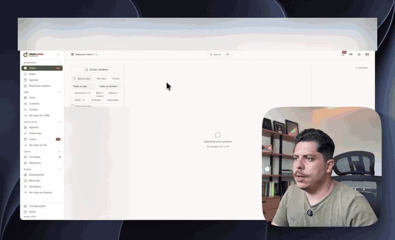

<div align="center">

[🇧🇷 Português](README.md) · 🇺🇸 English · [🇪🇸 Español](README.es.md)

<picture>
  <source media="(prefers-color-scheme: dark)" srcset="docs/brand/deskcomm-logo-dark.svg">
  
</picture>

# 🛠️ DeskcommCRM — The open-source AI Sales OS for WhatsApp

**AI agents that answer, qualify and sell on WhatsApp — inside an open-source CRM running on your own server.**
**No subscription, no gated features, your data stays yours. The open alternative to Kommo, Octadesk and Intercom.**

[](https://nextjs.org)
[](https://www.typescriptlang.org)
[](https://supabase.com)
[](hostgator-setup-kit/)
[](https://github.com/melgarafael/DeskcommCRM/actions/workflows/ci.yml)
[](LICENSE)

[](https://github.com/sponsors/melgarafael)
<!-- ALL-CONTRIBUTORS-BADGE:START - Do not remove or modify this section -->
[](#contributors-)
<!-- ALL-CONTRIBUTORS-BADGE:END -->
[**⚡ Install**](#-install-on-your-vps-the-main-path) · [**🔄 Update**](#-updating) · [**🧭 Vision**](VISION.md) · [**🏗️ Architecture**](ARCHITECTURE.md) · [**🤝 Contributing**](CONTRIBUTING.en.md) · [**🗺️ Roadmap**](#%EF%B8%8F-roadmap)



</div>

---

> ### ☁️ Run this CRM in production with one command
>
> DeskcommCRM is developed in **partnership with HostGator**: the [`hostgator-setup-kit/`](hostgator-setup-kit/)
> installs the full CRM (app + WhatsApp + database) on a VPS with a single command, and the
> [production runbook](docs/runbooks/waha-hostgator.md) assumes that environment.
>
> **[👉 Get the HostGator VPS with the partnership discount](https://www.hostgator.com.br/52708-141-3-52.html)** —
> São Paulo datacenter, ideal for WhatsApp running 24/7. *(partner link — subscribing through it supports the project and costs you less)*
>
> **No server yet?** Run this **on your own computer** (macOS, Linux or WSL). It tells you which
> plan to buy — with the runbook's real numbers, not a "it depends" — and hands you the exact
> command for your case:
>
> ```bash
> curl -fsSL https://raw.githubusercontent.com/melgarafael/DeskcommCRM/main/hostgator-setup-kit/comecar.sh | bash
> ```
>
> *(prefer to read before executing? clone the repo and run `bash hostgator-setup-kit/comecar.sh` —
> it installs nothing without your confirmation.)*

---

## ⚡ Install on your VPS (the main path)

### 1. Connect to your VPS

Open a **Terminal** on your computer (**PowerShell** on Windows; **Terminal** on macOS or Linux)
and connect using the IP and port your host emailed you:

```bash
ssh -p PORT root@YOUR_IP
```

Replace `PORT` and `YOUR_IP` with yours. If your host never mentioned a port, it's the default
(22) and you can omit it: `ssh root@YOUR_IP`.

It will ask for your password. **As you type, nothing appears on screen — not even asterisks.**
That is not a freeze: the terminal is hiding your password. Type (or paste) it and press Enter.

> On the first connection it asks `Are you sure you want to continue connecting?` — answer
> `yes`. That's the server introducing itself for the first time.

### 2. Run the installer

Once inside the VPS:

```bash
git clone https://github.com/melgarafael/DeskcommCRM.git
cd DeskcommCRM
bash hostgator-setup-kit/install.sh
```

That's it. **You don't install Node, or pnpm, or compile anything** — the app image is
prebuilt. If Docker is missing, the installer asks and installs it for you.

### What you need on hand

| Item | Where to get it |
|---|---|
| **VPS with Docker** | [HostGator](https://www.hostgator.com.br/52708-141-3-52.html) (partnership) — or any VPS with Docker. 4 GB RAM recommended |
| **Domain** | An **A** record pointing to your VPS IP (e.g. `crm.yourcompany.com`) |
| **Database** | Free account at [supabase.com](https://supabase.com) — 3 keys + the **Session pooler** connection string |
| **AI** | An **OpenRouter**, **Anthropic** or **OpenAI** key — the installer asks which one you want |
| **WhatsApp** | Your number, connected via QR code during onboarding (or Meta's official channel) |

> 💡 **Supabase can be created by the installer itself.** Export a `SUPABASE_ACCESS_TOKEN`
> before running and it creates the project, waits for the database to become healthy, fetches
> all 4 credentials and discovers the pooler host by testing a real connection — no copy-paste.

### What the installer does for you

It **only asks for what's yours** (domain, keys, admin password), **validates every answer
before moving on** — a wrong key is rejected right there, not three steps later — and handles
the rest:

1. Generates every technical secret itself (you invent no passwords).
2. Creates the Postgres extensions and applies the full schema (`supabase/baseline.sql`).
3. Creates the first admin with the email and password you chose.
4. Brings the whole stack up with **automatic HTTPS** and checks its health at the end.
5. Installs the **automations cron** (without it, WHEN/IF/THEN rules pile up in the queue) and
   the **update agent**, which is what makes the "Update now" button exist on screen.

**Running it again breaks nothing** — `install.sh` is idempotent: it doesn't duplicate the cron,
doesn't recreate the user, and resumes where it stopped.

> **Non-interactive mode:** copy `.env.hostgator.example` to `.env`, fill it in and run
> `bash hostgator-setup-kit/install.sh --yes`.

### Another host? (Hostinger, Coolify, Dokploy, CapRover…)

It works. If your VPS already ships with its **own reverse proxy** occupying ports 80/443, the
installer **detects that on its own** and publishes the CRM through it, instead of trying to
start a Caddy that wouldn't fit. In one specific case — a proxy on `--network host`, as
Hostinger does — it **asks instead of guessing**, because publishing behind the wrong proxy
"successfully" installs a mute website. Details in
[`hostgator-setup-kit/README.md`](hostgator-setup-kit/README.md).

### First access

Open `https://<your-domain>` (the padlock takes ~1 min to appear), sign in as the admin, and
have **Google Authenticator** or **Authy** at hand *if* you want to turn on two-step verification — it is **optional** and lives in Settings › Security; the first login does **not** require it. During
onboarding, scan the QR code with your WhatsApp number.

### 🤖 Rather have an AI install it for you?

The repository ships **assistant guides** that load on their own in Claude Code, Codex, Cursor,
OpenCode or Antigravity: install, set up a client per niche, analyze metrics, tune the agent
prompt and contribute. To have them in **any folder** — including before cloning, on your own
machine — run once:

```bash
curl -fsSL https://raw.githubusercontent.com/melgarafael/DeskcommCRM/main/scripts/instalar-guias.sh | bash
```

Then open a new session of your assistant and say *"I want to install the CRM on my VPS"*: asking
for the subject in Portuguese triggers the right guide in any of the five. To call a guide by name,
each one has its own way — `/deskcomm-instalar` in Claude Code, Cursor and Antigravity;
`$deskcomm-instalar` in Codex; in OpenCode, ask for it by name, in natural language.

The guides do **not** update themselves: running the same command again brings the new version. To
undo:

```bash
curl -fsSL https://raw.githubusercontent.com/melgarafael/DeskcommCRM/main/scripts/instalar-guias.sh | bash -s -- --remover
```

With the repository already cloned, the guides come inside it (`.agents/skills/`) and none of that
is needed. If you ran the command anyway, know that in Claude Code the installed guide wins over
the one in the clone — and stays on the version of the day you ran it, until you run it again (or
undo). The old way still works too: drop just the `hostgator-setup-kit/` folder into the **Claude
Code** chat inside the VPS — it reads the kit's [`CLAUDE.md`](hostgator-setup-kit/CLAUDE.md) and
walks you through everything, in Portuguese.

---

## 🔄 Updating

New version out? There are two paths, and the first one needs no terminal.

### From the screen (recommended)

When a new version exists, the sidebar footer lights up **"Nova versão"** — only for the server
owner, because alerting someone who can't update is noise. Click it and you land on
**Settings → Update**, which shows what changed, **takes a database backup by itself** and
follows every phase (backup → code → database → live) to the end. No SSH.

If the new version comes up broken, the agent **rolls back to the previous image on its own**
and records that rollback in `.env` — without it, the next restart would silently bring the
broken app back.

> Under the hood: the app only records the request; the executor is the agent `install.sh` left
> on your VPS, on a cron that checks **every 5 minutes** — so the update starts within 5 minutes
> of the click. If that agent is down, the screen says **"Atualização automática indisponível"**
> and shows the command below — it never pretends it worked.

### From the terminal

```bash
cd /path/to/DeskcommCRM
bash hostgator-setup-kit/update.sh
```

In order, the command: (1) checks whether there really is a new version — if not, it exits
immediately; (2) **backs up the database before touching anything**; (3) pulls the new code;
(4) updates the database by re-applying `baseline.sql`, which is idempotent and **self-healing**
(it repairs data left inconsistent by older versions); (5) pulls the new app image; (6) checks
health at the end.

**The target is the latest published release** (`v1.2.3`), not the tip of `main` — updating
always lands on a tagged version described in [`CHANGELOG.md`](CHANGELOG.md), never on an
untested commit. It **refuses** to go back to a version older than the installed one (that would
turn off things you already have); `--force` exists for that, deliberately.

**Normal things you will see:** a pile of `already exists` / `multiple primary keys` during the
database step — **expected and harmless**, those are things that already existed. The script
filters that noise and prints `✓ banco atualizado`. If the database is busy with the CRM serving
customers, it applies again on its own (up to 3 passes) and says so — this holds from the update
after the one that installs this fix. If you see `⚠ Apareceram avisos no banco que NÃO são os esperados`, that one
is worth keeping: the **end** of the output tells you what to do in each case (repeat with `--force`
when the database was busy, declare `SUPABASE_DB_ADMIN_URL` when it was permissions).

**Something went wrong?** Keep the message and ask for help. `restore.sh` does **not** put the
backup back over the database in use: it only restores into an empty database (see [`hostgator-setup-kit/README.md`](hostgator-setup-kit/README.md)).
**Just want a diagnosis?** `bash hostgator-setup-kit/healthcheck.sh`.

> ⚠️ **On an older install that doesn't have the screen agent yet**, run `update.sh` **twice**:
> the first run is still the old script (which downloads the new one); the second installs the
> agent and turns the button on.

### Other kit commands

| Script | What it does |
|---|---|
| `install.sh` | Installs everything (idempotent — safe to re-run) |
| `update.sh` | Updates to a new version, with automatic backup |
| `backup.sh` | Backs up the database + WhatsApp sessions |
| `restore.sh` | Restores a backup |
| `reset-password.sh` | Resets a user's password |
| `reset-mfa.sh` | Removes MFA for someone who lost their phone |
| `healthcheck.sh` | Diagnoses every service at once |

> **Backups matter:** Supabase's free plan **does not back up on its own**. Schedule `backup.sh`
> daily via cron. `update.sh` already takes one before every update.

### 🧹 Uninstall (take this application out of Docker)

To stop and delete **only the Docker resources of this installation**, from the repository root:

```bash
bash desinstalar_docker.sh
```

It finds the project through the label Docker Compose writes and removes only the containers,
volumes and internal networks of **this** project. Other applications on the same server, images,
build cache, the reverse proxy's external network, the code, the `.env`, the backups and an
external Supabase are left untouched.

The interactive mode shows how many resources it found and requires the confirmation
`REMOVER-<project-name>` before removing anything. For throwing an environment away,
`bash desinstalar_docker.sh --force` skips the question. Use `--project-name NAME` only when the
installation has a custom `COMPOSE_PROJECT_NAME` that is no longer in the `.env`.

> **The volumes go with it** — local WhatsApp sessions included. Run `backup.sh` before if you
> need to keep them.

---

## ✨ What is it

**Deskcomm** comes from **Desk** + **comm** (commerce): your entire sales operation on a single desk, run by people and AI agents working together.

The project was born as an e-commerce CRM — and the open-source community took it much further: today it runs in **clinics, real-estate agencies, info-product businesses, agencies, stores and service providers** — any business that sells over WhatsApp. The product followed that shift and became a **sales operating system**: AI agents with per-tenant RAG answer customers, qualify leads, move them through the pipeline, trigger automations and know when to hand off to a human — with the whole CRM exposed via **MCP** so agents can truly operate it. The full story is in [`VISION.md`](VISION.md).

### Why it's different

- 🤖 **AI agents that operate the CRM** — per-tenant RAG, skills the agent executes on its own mid-conversation, operational memory, sentiment analysis, audited AI→human handoff, AI as a first-class assignee and per-org spending caps. Not a decorative chatbot: the agent answers, qualifies and moves the funnel.
- 🔁 **Nothing dies in silence** — follow-up that revives a cold conversation (with adaptive timing and per-stage triggers), a radar of what's at risk of dying unanswered, and a notice center for what needs a human decision.
- 🧠 **Self-improving agents** — resolved conversations become new knowledge; the **AI Evolution** screen shows whether the agent is improving, where it fails and what's left to teach; **Proposals** are improvements the AI suggests for itself, applicable as a new version — always human-gated.
- 🧩 **Multi-niche by design** — configurable vocabulary per pipeline: a lead becomes a *Customer*, *Patient* or *Buyer*; "won" becomes *Paid*, *Booked* or *Closed*. The same core serves e-commerce (our birthplace, with native Nuvemshop integration), clinics, real estate or info-products.
- 💬 **WhatsApp two ways** — via **QR code** (WAHA, multi-number, with anti-ban: throttle + jitter + time windows) or through **Meta's official channel** (Cloud API, with approved templates kept in sync). Media via Storage, STOP detection.
- 🔀 **Choose your AI** — OpenRouter, Anthropic or OpenAI, decided at install time and switchable later from the screen, **per part of the system** (whatever talks doesn't have to be whatever indexes).
- 👥 **Support governance** — real server-side RBAC, audited assignment/transfer, round-robin queue, automatic intent routing and per-role visibility scopes.
- 🏢 **Multi-tenant + privacy by design (LGPD)** — RLS on every tenant-aware table with an isolation test as a CI gate; anonymization preferred over deletion; append-only audit log with 5-year retention.
- 🖥️ **Truly self-hosted** — your data on your VPS; install and update with one command (or one click); no paid tier, no gated features.

### 🔌 Webhooks & Automations

Every tenant can create **capture sources**: a public endpoint (`/api/v1/webhooks/in/<token>`) that receives leads from landing pages, custom forms or tools like Zapier/n8n via POST (JSON or `application/x-www-form-urlencoded`) and drops them straight into the chosen pipeline/stage — no code, no per-tenant custom integration. On top of those sources (and the other CRM events — lead changed stage, got a tag, WhatsApp message arrived), tenants build **automations**: WHEN/IF/THEN rules that add tags, move leads, assign agents, send WhatsApp messages or notify external systems via outgoing webhooks.

In the UI everything lives under **Webhooks** in the sidebar (visible only to `manager`/`admin` roles). Three tabs: **Receive data** (create a source, copy the ready-made endpoint/form, fire a test lead, see recent deliveries), **Automations** (build rules, which are always born paused until reviewed and enabled) and **Activity** (a timeline of each run, with per-action results and manual retry when an external webhook call fails).

Under the hood, every event becomes a row in `event_log` — no database trigger ever makes an HTTP call. The `/api/v1/cron/event-log-drain` route drains the queue every minute. **`install.sh`/`update.sh` configure that cron automatically** — without it, automations get created normally but never run.

---

## 🖥️ What you operate (the screens)

| Group | Screens |
|---|---|
| **Support** | **Inbox** (WhatsApp conversations, you and the AI side by side) · **Radar** (who went cold and is still open) · **Quick replies** |
| **CRM** | **Kanban** (where each deal sits in the funnel) · **Contacts** · **Pipelines** (stages, business vocabulary and loss reasons) |
| **AI Agent** | **Agents** · **Follow-ups** · **Routers** · **Providers** and **Credentials** · **Knowledge** (RAG) · **Memory** · **Skills** · **Cases** · **Alerts** · **Proposals** · **Runs** · **Usage & budget** |
| **Channels** | **Connections** (QR or Meta's official channel, with health, reconnect and templates) · **Nuvemshop** · **Webhooks** |
| **Analytics** | **Performance** (funnel and per-agent metrics) · **AI Evolution** · **Audit Log** |
| **Organization** | **Team** · **Support distribution** · **Organization** · **LGPD** · **API Tokens** · **Security** (MFA, recovery codes, sessions) · Profile, Notifications, Billing |

Every screen has a door in the navigation — CI fails a screen that exists but can only be reached by typing its URL.

---

## 🧱 Stack

| Layer | Choice | Why |
|---|---|---|
| **Frontend** | Next.js 16 App Router (Turbopack) + React 19 + strict TypeScript 6 | Server Components + Route Handlers in one repo |
| **Styling** | Tailwind + shadcn/ui (`new-york`, neutral) | Customizable without lock-in |
| **DB** | Supabase (Postgres + RLS + `vector`) | Native multi-tenancy, embeddings for RAG |
| **Auth** | Supabase Auth via `@supabase/ssr` | SameSite=Strict, HttpOnly cookies |
| **Realtime** | Supabase Realtime | postgres_changes + broadcast |
| **Storage** | Supabase Storage (signed URLs) | Private `whatsapp-media` bucket |
| **WhatsApp** | WAHA Plus (NOWEB engine) + Meta Cloud API | QR to start fast; official channel to scale |
| **Queues** | `event_log` table + workers (cron) | A database trigger never makes HTTP calls |
| **Rate limit** | Upstash Redis (sliding window) | Serverless, free tier is enough |
| **AI** | Vercel AI SDK v7 — OpenRouter, Requesty, Anthropic, OpenAI and Google | The installer asks which; switch later from the screen |
| **Validation** | Zod | External input, env, payloads |
| **Observability** | Sentry (scrubbed in errors, transactions, spans and breadcrumbs) | Opt-in telemetry at install time |
| **Hosting** | Any VPS with Docker (HostGator/SP in the partnership) | App + WhatsApp + workers on your own box |

Details: [`ARCHITECTURE.md`](ARCHITECTURE.md).

---

## 🧑‍💻 Development (only to contribute to the code)

> ⚠️ **If you want to USE the CRM, this is not it** — use the [VPS installer](#-install-on-your-vps-the-main-path).
> This section is for people who will change the code.

```bash
git clone https://github.com/melgarafael/DeskcommCRM.git
cd DeskcommCRM

nvm use                     # Node 22
npm install -g pnpm && pnpm install

cp .env.example .env.local  # full guide in docs/SETUP.md

docker compose up -d        # local WAHA (optional in dev without WhatsApp)

# Schema: apply the baseline, NOT the migrations.
# Migrations 0001-0009 and 0013 are `SELECT 1;` stubs — the chain does not build from zero.
# The real schema lives in baseline.sql, the same one install.sh applies on the VPS.
# `supabase db push` "succeeds" and leaves you with an empty database.
supabase link --project-ref <your-ref>

# On a NEW Supabase project, first enable the extensions the schema uses —
# without them the baseline stops at `type public.vector does not exist`.
psql "$SUPABASE_DB_URL" -v ON_ERROR_STOP=1 -c \
  'create extension if not exists vector with schema public;
   create extension if not exists citext with schema public;
   create extension if not exists pg_trgm with schema public;'

psql "$SUPABASE_DB_URL" -v ON_ERROR_STOP=1 -f supabase/baseline.sql

pnpm dev
```

App: <http://localhost:3000> · Health check: <http://localhost:3000/api/v1/health>

[`docs/SETUP.md`](docs/SETUP.md) is the complete tutorial for **every integration** (Supabase, WAHA, AI providers, Upstash, Sentry, Resend, Nuvemshop) — ~60–90 min from zero to a running app. *(Docs are in Brazilian Portuguese; translations welcome!)*

---

## 📁 Structure

```
DeskcommCRM/
├── app/                    # Next.js App Router
│   ├── (admin)/            # super-admin routes (impersonate, tenants)
│   ├── (public)/           # Login, recovery
│   ├── app/                # Authenticated routes: inbox, radar, kanban, contacts,
│   │                       #   connections, ai/*, integrations, metrics, lgpd,
│   │                       #   audit, team, settings
│   └── api/v1/             # Canonical REST API
├── components/             # React (ui/, inbox/, kanban/, shell/, ...)
├── lib/                    # supabase/, waha/, channels/, ai/, agent-engine/,
│                           #   api/, routing/, navigation/, env.ts
├── workers/                # event_log consumers (AI, RAG, LGPD, media, routines)
├── supabase/migrations/    # Versioned SQL (+ baseline.sql for self-host)
├── tests/{e2e,unit,invariants,shell}/
├── scripts/                # seeds, qa-waves, maintenance
├── docs/                   # PRDs, specs, runbooks, SETUP.md, ATUALIZANDO.md
└── hostgator-setup-kit/    # self-host install and update
```

---

## 🧪 Tests

```bash
pnpm typecheck     # tsc --noEmit (strict)
pnpm lint          # eslint next/core-web-vitals
pnpm test:unit     # Vitest (does NOT include tests/invariants/**)
pnpm test:db       # ephemeral Postgres + baseline install/update + invariants
pnpm test:e2e      # Playwright (requires dev server)
```

**These checks are required** to merge into `main`. This list has already said "four" and then "five" — **measure, don't trust it**:

```bash
gh api repos/melgarafael/DeskcommCRM/branches/main/protection \
  --jq '.required_status_checks.contexts|join(", ")'
# on 2026-08-14: verify, build-and-size, invariants, e2e, imagens-ok
```


| Check | What it does |
|---|---|
| `verify` | typecheck + lint + `lint:channels` + `test:unit` + `test:shell` |
| `invariants` | boots a clean Postgres, applies `baseline.sql` in **install** mode (`ON_ERROR_STOP=1`) and then in **update** mode (proving idempotency), and runs the invariants for RBAC, assignment, scoping, routing, follow-up, webhooks and automations |
| `build-and-size` | `pnpm build` on Node 22 |
| `e2e` | boots a local Supabase, applies `baseline.sql` and runs through the frontend every Playwright spec except the ones `FORA_DO_CI` declares |
| `imagens-ok` | fails when any of the three Docker images (`app`, `worker`, `scheduler`) does not build — it is the artifact the self-hoster installs |

Which specs stay out is a question for a command, not for reading — this line used to claim the only one was `vps-fresh-onboarding`, and since PR #983 it runs in CI:

```bash
git show origin/main:.github/workflows/e2e.yml | python3 -c "import sys,re; y=sys.stdin.read(); print(sorted({s for _,c in re.findall(r'(FORA_DO_CI):\s*>-\n((?:[ ]{8,}.*\n)+)',y) for s in re.findall(r'[a-z0-9-]+\.spec\.ts',c)}))"
```

`vps-fresh-onboarding` is still the **P0** of our visual-QA doctrine, because the fresh install is the product we sell. Having a gate does not replace proving it on screen: a gate proves it did not regress, not that the experience is good.

Among the invariants is the **RLS isolation test**: it creates 2 organizations, simulates JWT claims through the same `auth.uid()` / `fn_user_org_ids()` path production policies use, and proves a user of org A sees **zero rows** of org B in `conversations`, `messages`, `contacts` and `crm_leads`. A control case first proves org B's rows actually exist — without it, the test would pass against an empty table.

---

## 📚 Documentation

| Doc | What's in it |
|---|---|
| [`hostgator-setup-kit/README.md`](hostgator-setup-kit/README.md) | **Self-host installation** — the kit, the scripts, hosts with their own proxy |
| [`docs/ATUALIZANDO.md`](docs/ATUALIZANDO.md) | **How to update** your installation, in plain language |
| [`VISION.md`](VISION.md) | **Vision & positioning** — what the project is, what it believes, where it's going |
| [`CHANGELOG.md`](CHANGELOG.md) | What changed in each version — **read your target version's section before updating** |
| [`docs/SETUP.md`](docs/SETUP.md) | Development setup, step by step, for every integration |
| [`docs/white-label.en.md`](docs/white-label.en.md) | **Installing for clients** — rebranding, one-install-per-client vs shared, reseller operations |
| [`docs/runbooks/waha-hostgator.md`](docs/runbooks/waha-hostgator.md) | Production runbook for WAHA (sizing, recovery) |
| [`CLAUDE.md`](CLAUDE.md) | Non-negotiable conventions (required reading to contribute) |
| [`ARCHITECTURE.md`](ARCHITECTURE.md) | One-page architecture overview |
| [`docs/index.md`](docs/index.md) | Index of all 157 documents, with a precedence rule |
| [`docs/prd/`](docs/prd/) · [`docs/specs/`](docs/specs/) | PRDs and technical specs (SQL schema, payloads, MCP, governance) |

> Most docs are written in Brazilian Portuguese — our primary community. Translation contributions are very welcome.

---

## 🤝 Contributing

This project is open source for the community. Every contribution is welcome — from doc typo fixes to new features.

1. Read [`CLAUDE.md`](CLAUDE.md) (~5 min) — non-negotiable conventions (multi-tenancy, RLS, audit, privacy).
2. Read [`CONTRIBUTING.en.md`](CONTRIBUTING.en.md) — branch flow, commits.
3. Follow the [Code of Conduct](CODE_OF_CONDUCT.md).

**Short flow:**

```bash
git checkout -b feat/short-slug
# implement + tests
pnpm typecheck && pnpm lint && pnpm lint:channels && pnpm test:unit && pnpm test:shell && pnpm build
pnpm test:db   # needs Docker — this is the `invariants` job, required to merge
git commit -m "feat(scope): description"
```

Those two lines are **everything you can run on your machine**, on purpose: running half of them and discovering the rest as a red surprise after hours of waiting is the worst first experience this repository knows how to deliver.

Two required gates do **not** fit there and only run in CI: `e2e` (needs a local Supabase) and `imagens-ok` (builds the three Docker images). Green on your machine is not green at merge time.

**Definition of Done:** zero typecheck errors, zero lint errors, relevant tests green, RLS tested if a tenant-aware table is touched, audit log emitted on mutations, versioned migration **+ an idempotent appendix in `baseline.sql`** if the schema changes (otherwise the change never reaches self-hosters).

---

<a id="contributors-"></a>

## 🙌 Who builds DeskcommCRM

Thanks to everyone who has contributed code, a well-reported bug, an idea, docs or a translation. To join this list, see [how to contribute](CONTRIBUTING.en.md) ([emoji key](https://allcontributors.org/docs/en/emoji-key)).

Want to support the project another way? [Sponsor it on GitHub Sponsors](https://github.com/sponsors/melgarafael).

<!-- ALL-CONTRIBUTORS-LIST:START - Do not remove or modify this section -->
<!-- prettier-ignore-start -->
<!-- markdownlint-disable -->
<table>
  <tbody>
    <tr>
      <td align="center" valign="top" width="12.5%"><a href="https://github.com/melgarafael"><br /><sub><b>Rafael Melgaço</b></sub></a><br /><a href="https://github.com/melgarafael/DeskcommCRM/commits?author=melgarafael" title="Code">💻</a> <a href="#maintenance-melgarafael" title="Maintenance">🚧</a> <a href="#ideas-melgarafael" title="Ideas, Planning, & Feedback">🤔</a></td>
      <td align="center" valign="top" width="12.5%"><a href="https://github.com/webtecnica"><br /><sub><b>webtecnica</b></sub></a><br /><a href="https://github.com/melgarafael/DeskcommCRM/commits?author=webtecnica" title="Code">💻</a> <a href="https://github.com/melgarafael/DeskcommCRM/commits?author=webtecnica" title="Documentation">📖</a></td>
      <td align="center" valign="top" width="12.5%"><a href="https://github.com/paulolimajr77"><br /><sub><b>Paulo Lima Jr</b></sub></a><br /><a href="https://github.com/melgarafael/DeskcommCRM/commits?author=paulolimajr77" title="Code">💻</a></td>
      <td align="center" valign="top" width="12.5%"><a href="https://github.com/jmpo"><br /><sub><b>Marcelo Pompa</b></sub></a><br /><a href="https://github.com/melgarafael/DeskcommCRM/commits?author=jmpo" title="Code">💻</a></td>
      <td align="center" valign="top" width="12.5%"><a href="https://github.com/Tong-bit-art"><br /><sub><b>ordinary being</b></sub></a><br /><a href="https://github.com/melgarafael/DeskcommCRM/commits?author=Tong-bit-art" title="Code">💻</a></td>
      <td align="center" valign="top" width="12.5%"><a href="https://github.com/JowaniOrantes"><br /><sub><b>Jowani Orantes</b></sub></a><br /><a href="https://github.com/melgarafael/DeskcommCRM/commits?author=JowaniOrantes" title="Code">💻</a></td>
      <td align="center" valign="top" width="12.5%"><a href="https://github.com/joaopaulomirandamatias"><br /><sub><b>João Paulo</b></sub></a><br /><a href="https://github.com/melgarafael/DeskcommCRM/commits?author=joaopaulomirandamatias" title="Code">💻</a></td>
      <td align="center" valign="top" width="12.5%"><a href="https://github.com/IanCouto"><br /><sub><b>Ian Couto</b></sub></a><br /><a href="https://github.com/melgarafael/DeskcommCRM/commits?author=IanCouto" title="Code">💻</a></td>
    </tr>
    <tr>
      <td align="center" valign="top" width="12.5%"><a href="https://github.com/rafaelbatistazz"><br /><sub><b>rafaelbatistazz</b></sub></a><br /><a href="https://github.com/melgarafael/DeskcommCRM/commits?author=rafaelbatistazz" title="Code">💻</a></td>
      <td align="center" valign="top" width="12.5%"><a href="https://github.com/423313"><br /><sub><b>423313</b></sub></a><br /><a href="https://github.com/melgarafael/DeskcommCRM/commits?author=423313" title="Code">💻</a></td>
      <td align="center" valign="top" width="12.5%"><a href="https://github.com/vitorlacerdadigital"><br /><sub><b>vitorlacerdadigital</b></sub></a><br /><a href="https://github.com/melgarafael/DeskcommCRM/commits?author=vitorlacerdadigital" title="Code">💻</a></td>
      <td align="center" valign="top" width="12.5%"><a href="https://github.com/maugarciasa"><br /><sub><b>maugarciasa</b></sub></a><br /><a href="https://github.com/melgarafael/DeskcommCRM/commits?author=maugarciasa" title="Code">💻</a></td>
      <td align="center" valign="top" width="12.5%"><a href="https://github.com/ozzure"><br /><sub><b>ozzure</b></sub></a><br /><a href="https://github.com/melgarafael/DeskcommCRM/commits?author=ozzure" title="Code">💻</a></td>
      <td align="center" valign="top" width="12.5%"><a href="https://github.com/hiro-nikaitou"><br /><sub><b>hiro-nikaitou</b></sub></a><br /><a href="https://github.com/melgarafael/DeskcommCRM/commits?author=hiro-nikaitou" title="Code">💻</a></td>
      <td align="center" valign="top" width="12.5%"><a href="https://github.com/maclevison"><br /><sub><b>Mac Silva</b></sub></a><br /><a href="https://github.com/melgarafael/DeskcommCRM/commits?author=maclevison" title="Code">💻</a></td>
      <td align="center" valign="top" width="12.5%"><a href="https://github.com/bossprt"><br /><sub><b>bossprt</b></sub></a><br /><a href="https://github.com/melgarafael/DeskcommCRM/commits?author=bossprt" title="Code">💻</a></td>
    </tr>
    <tr>
      <td align="center" valign="top" width="12.5%"><a href="https://github.com/gustavorodcruz96"><br /><sub><b>Gustavo Rodrigues</b></sub></a><br /><a href="https://github.com/melgarafael/DeskcommCRM/commits?author=gustavorodcruz96" title="Code">💻</a></td>
      <td align="center" valign="top" width="12.5%"><a href="https://github.com/LuckasBrito-Dev"><br /><sub><b>Lucas Brito</b></sub></a><br /><a href="https://github.com/melgarafael/DeskcommCRM/commits?author=LuckasBrito-Dev" title="Code">💻</a></td>
      <td align="center" valign="top" width="12.5%"><a href="https://github.com/FabioMundoDigital"><br /><sub><b>Fabio Kortex</b></sub></a><br /><a href="https://github.com/melgarafael/DeskcommCRM/commits?author=FabioMundoDigital" title="Code">💻</a></td>
      <td align="center" valign="top" width="12.5%"><a href="https://github.com/automatikpg-ux"><br /><sub><b>automatikpg-ux</b></sub></a><br /><a href="https://github.com/melgarafael/DeskcommCRM/commits?author=automatikpg-ux" title="Code">💻</a></td>
      <td align="center" valign="top" width="12.5%"><a href="https://github.com/nsbastosconsultoria"><br /><sub><b>Leandro Nogueira de Souza Bastos</b></sub></a><br /><a href="https://github.com/melgarafael/DeskcommCRM/commits?author=nsbastosconsultoria" title="Code">💻</a></td>
      <td align="center" valign="top" width="12.5%"><a href="https://github.com/vgamkt"><br /><sub><b>VANDER GUSTAVO ALVES</b></sub></a><br /><a href="https://github.com/melgarafael/DeskcommCRM/commits?author=vgamkt" title="Code">💻</a></td>
      <td align="center" valign="top" width="12.5%"><a href="https://github.com/rafaelcesardev"><br /><sub><b>Rafael César</b></sub></a><br /><a href="https://github.com/melgarafael/DeskcommCRM/commits?author=rafaelcesardev" title="Code">💻</a></td>
      <td align="center" valign="top" width="12.5%"><a href="https://github.com/SnoopyHuman"><br /><sub><b>SnoopyHuman</b></sub></a><br /><a href="https://github.com/melgarafael/DeskcommCRM/commits?author=SnoopyHuman" title="Code">💻</a></td>
    </tr>
    <tr>
      <td align="center" valign="top" width="12.5%"><a href="https://github.com/saraivabr"><br /><sub><b>Saraiva</b></sub></a><br /><a href="https://github.com/melgarafael/DeskcommCRM/commits?author=saraivabr" title="Code">💻</a></td>
      <td align="center" valign="top" width="12.5%"><a href="https://github.com/valterhjr"><br /><sub><b>Valter</b></sub></a><br /><a href="https://github.com/melgarafael/DeskcommCRM/commits?author=valterhjr" title="Code">💻</a></td>
      <td align="center" valign="top" width="12.5%"><a href="https://github.com/omayklourenco"><br /><sub><b>Mayk Lourenço</b></sub></a><br /><a href="https://github.com/melgarafael/DeskcommCRM/commits?author=omayklourenco" title="Code">💻</a></td>
      <td align="center" valign="top" width="12.5%"><a href="https://github.com/Draven9"><br /><sub><b>Eric Azevedo</b></sub></a><br /><a href="https://github.com/melgarafael/DeskcommCRM/commits?author=Draven9" title="Code">💻</a></td>
      <td align="center" valign="top" width="12.5%"><a href="https://github.com/Gervanno"><br /><sub><b>Gervànno</b></sub></a><br /><a href="https://github.com/melgarafael/DeskcommCRM/commits?author=Gervanno" title="Code">💻</a></td>
      <td align="center" valign="top" width="12.5%"><a href="https://github.com/felipebnt"><br /><sub><b>Felipe Oliveira</b></sub></a><br /><a href="https://github.com/melgarafael/DeskcommCRM/commits?author=felipebnt" title="Code">💻</a></td>
      <td align="center" valign="top" width="12.5%"><a href="https://github.com/flaviosiq"><br /><sub><b>flaviosiq</b></sub></a><br /><a href="https://github.com/melgarafael/DeskcommCRM/commits?author=flaviosiq" title="Code">💻</a></td>
      <td align="center" valign="top" width="12.5%"><a href="https://github.com/brunowatz"><br /><sub><b>Bruno Jakowatz </b></sub></a><br /><a href="https://github.com/melgarafael/DeskcommCRM/commits?author=brunowatz" title="Code">💻</a></td>
    </tr>
    <tr>
      <td align="center" valign="top" width="12.5%"><a href="https://github.com/fillipe-felix"><br /><sub><b>fillipe-felix</b></sub></a><br /><a href="https://github.com/melgarafael/DeskcommCRM/commits?author=fillipe-felix" title="Code">💻</a></td>
      <td align="center" valign="top" width="12.5%"><a href="https://github.com/claude"><br /><sub><b>Claude</b></sub></a><br /><a href="https://github.com/melgarafael/DeskcommCRM/commits?author=claude" title="Code">💻</a></td>
      <td align="center" valign="top" width="12.5%"><a href="https://github.com/sprakashsurya-debug"><br /><sub><b>sprakashsurya-debug</b></sub></a><br /><a href="https://github.com/melgarafael/DeskcommCRM/commits?author=sprakashsurya-debug" title="Code">💻</a></td>
      <td align="center" valign="top" width="12.5%"><a href="https://github.com/luka1601"><br /><sub><b>luka1601</b></sub></a><br /><a href="https://github.com/melgarafael/DeskcommCRM/commits?author=luka1601" title="Code">💻</a></td>
      <td align="center" valign="top" width="12.5%"><a href="https://github.com/samirhvbr"><br /><sub><b>Samir Hanna Verza</b></sub></a><br /><a href="https://github.com/melgarafael/DeskcommCRM/commits?author=samirhvbr" title="Code">💻</a></td>
      <td align="center" valign="top" width="12.5%"><a href="https://github.com/advglauberpires"><br /><sub><b>advglauberpires</b></sub></a><br /><a href="https://github.com/melgarafael/DeskcommCRM/commits?author=advglauberpires" title="Code">💻</a></td>
      <td align="center" valign="top" width="12.5%"><a href="https://github.com/Tanderakkkj"><br /><sub><b>Tanderakkkj</b></sub></a><br /><a href="https://github.com/melgarafael/DeskcommCRM/commits?author=Tanderakkkj" title="Code">💻</a></td>
      <td align="center" valign="top" width="12.5%"><a href="https://github.com/vagnerrm122"><br /><sub><b>vagnerrm122</b></sub></a><br /><a href="https://github.com/melgarafael/DeskcommCRM/commits?author=vagnerrm122" title="Code">💻</a></td>
    </tr>
    <tr>
      <td align="center" valign="top" width="12.5%"><a href="https://github.com/betoarts"><br /><sub><b>Humberto Moura Neto DEV</b></sub></a><br /><a href="https://github.com/melgarafael/DeskcommCRM/commits?author=betoarts" title="Code">💻</a></td>
      <td align="center" valign="top" width="12.5%"><a href="https://github.com/italopabloferreria"><br /><sub><b>Ítalo Pablo Ferreira</b></sub></a><br /><a href="https://github.com/melgarafael/DeskcommCRM/commits?author=italopabloferreria" title="Code">💻</a></td>
      <td align="center" valign="top" width="12.5%"><a href="https://github.com/Wyllams"><br /><sub><b>Wyllams Bione</b></sub></a><br /><a href="https://github.com/melgarafael/DeskcommCRM/commits?author=Wyllams" title="Code">💻</a></td>
      <td align="center" valign="top" width="12.5%"><a href="https://github.com/opp4s"><br /><sub><b>opp4s</b></sub></a><br /><a href="https://github.com/melgarafael/DeskcommCRM/commits?author=opp4s" title="Code">💻</a></td>
      <td align="center" valign="top" width="12.5%"><a href="https://github.com/nusretbayindir-stack"><br /><sub><b>nusretbayindir-stack</b></sub></a><br /><a href="https://github.com/melgarafael/DeskcommCRM/commits?author=nusretbayindir-stack" title="Code">💻</a></td>
      <td align="center" valign="top" width="12.5%"><a href="https://github.com/thiagobaltuilhe"><br /><sub><b>thiagobaltuilhe</b></sub></a><br /><a href="https://github.com/melgarafael/DeskcommCRM/commits?author=thiagobaltuilhe" title="Code">💻</a></td>
      <td align="center" valign="top" width="12.5%"><a href="https://github.com/fabianmartinelli-fm"><br /><sub><b>Fabian Martinelli</b></sub></a><br /><a href="https://github.com/melgarafael/DeskcommCRM/commits?author=fabianmartinelli-fm" title="Code">💻</a></td>
      <td align="center" valign="top" width="12.5%"><a href="https://github.com/Elevstudio-Dev"><br /><sub><b>Elevstudio-Dev</b></sub></a><br /><a href="https://github.com/melgarafael/DeskcommCRM/commits?author=Elevstudio-Dev" title="Code">💻</a></td>
    </tr>
    <tr>
      <td align="center" valign="top" width="12.5%"><a href="https://github.com/felipedelvan"><br /><sub><b>felipedelvan</b></sub></a><br /><a href="https://github.com/melgarafael/DeskcommCRM/commits?author=felipedelvan" title="Code">💻</a></td>
      <td align="center" valign="top" width="12.5%"><a href="https://github.com/in100tiva"><br /><sub><b>Luan Oliveira Dos Santos</b></sub></a><br /><a href="https://github.com/melgarafael/DeskcommCRM/commits?author=in100tiva" title="Code">💻</a></td>
      <td align="center" valign="top" width="12.5%"><a href="https://github.com/mauriciobera1990-droid"><br /><sub><b>mauriciobera1990-droid</b></sub></a><br /><a href="https://github.com/melgarafael/DeskcommCRM/commits?author=mauriciobera1990-droid" title="Code">💻</a></td>
      <td align="center" valign="top" width="12.5%"><a href="https://github.com/SerusoNakamoto"><br /><sub><b>SerusoNakamoto</b></sub></a><br /><a href="https://github.com/melgarafael/DeskcommCRM/commits?author=SerusoNakamoto" title="Code">💻</a></td>
      <td align="center" valign="top" width="12.5%"><a href="https://github.com/jostoz"><br /><sub><b>josuetoz</b></sub></a><br /><a href="https://github.com/melgarafael/DeskcommCRM/commits?author=jostoz" title="Code">💻</a></td>
      <td align="center" valign="top" width="12.5%"><a href="https://github.com/Drmachado0"><br /><sub><b>Drmachado0</b></sub></a><br /><a href="https://github.com/melgarafael/DeskcommCRM/commits?author=Drmachado0" title="Code">💻</a></td>
      <td align="center" valign="top" width="12.5%"><a href="https://github.com/rogercampel"><br /><sub><b>Roger Campel</b></sub></a><br /><a href="https://github.com/melgarafael/DeskcommCRM/commits?author=rogercampel" title="Code">💻</a></td>
      <td align="center" valign="top" width="12.5%"><a href="https://github.com/raphaelmartins"><br /><sub><b>Raphael Martins</b></sub></a><br /><a href="https://github.com/melgarafael/DeskcommCRM/commits?author=raphaelmartins" title="Code">💻</a></td>
    </tr>
    <tr>
      <td align="center" valign="top" width="12.5%"><a href="https://github.com/matheuspedro360"><br /><sub><b>matheuspedro360</b></sub></a><br /><a href="https://github.com/melgarafael/DeskcommCRM/commits?author=matheuspedro360" title="Code">💻</a></td>
      <td align="center" valign="top" width="12.5%"><a href="https://github.com/lzandonadi"><br /><sub><b>Lucas Falqueto Zandonadi</b></sub></a><br /><a href="https://github.com/melgarafael/DeskcommCRM/commits?author=lzandonadi" title="Code">💻</a></td>
      <td align="center" valign="top" width="12.5%"><a href="https://github.com/LeonardoMarcelo"><br /><sub><b>leonardo marcelo santana da paz</b></sub></a><br /><a href="https://github.com/melgarafael/DeskcommCRM/commits?author=LeonardoMarcelo" title="Code">💻</a></td>
      <td align="center" valign="top" width="12.5%"><a href="https://github.com/cabindaferreira"><br /><sub><b>João Ferreira</b></sub></a><br /><a href="https://github.com/melgarafael/DeskcommCRM/commits?author=cabindaferreira" title="Code">💻</a></td>
      <td align="center" valign="top" width="12.5%"><a href="https://github.com/claudioghirellifh"><br /><sub><b>Claudio Ghirelli Filho</b></sub></a><br /><a href="https://github.com/melgarafael/DeskcommCRM/commits?author=claudioghirellifh" title="Code">💻</a></td>
      <td align="center" valign="top" width="12.5%"><a href="https://github.com/xxfabioxx12"><br /><sub><b>xxfabioxx12</b></sub></a><br /><a href="https://github.com/melgarafael/DeskcommCRM/commits?author=xxfabioxx12" title="Code">💻</a></td>
      <td align="center" valign="top" width="12.5%"><a href="https://github.com/rafaeskytrabalho"><br /><sub><b>Renan Rafaesky</b></sub></a><br /><a href="https://github.com/melgarafael/DeskcommCRM/commits?author=rafaeskytrabalho" title="Code">💻</a></td>
      <td align="center" valign="top" width="12.5%"><a href="https://github.com/andersontomazi-ctrl"><br /><sub><b>andersontomazi-ctrl</b></sub></a><br /><a href="https://github.com/melgarafael/DeskcommCRM/commits?author=andersontomazi-ctrl" title="Code">💻</a></td>
    </tr>
    <tr>
      <td align="center" valign="top" width="12.5%"><a href="https://github.com/agencyspeedagend-del"><br /><sub><b>agencyspeedagend-del</b></sub></a><br /><a href="https://github.com/melgarafael/DeskcommCRM/commits?author=agencyspeedagend-del" title="Code">💻</a></td>
      <td align="center" valign="top" width="12.5%"><a href="https://github.com/vanksestevao"><br /><sub><b>vanksestevao</b></sub></a><br /><a href="https://github.com/melgarafael/DeskcommCRM/commits?author=vanksestevao" title="Code">💻</a></td>
      <td align="center" valign="top" width="12.5%"><a href="https://github.com/xxjjjj"><br /><sub><b>URNOTKRYSTALXU</b></sub></a><br /><a href="https://github.com/melgarafael/DeskcommCRM/commits?author=xxjjjj" title="Code">💻</a></td>
      <td align="center" valign="top" width="12.5%"><a href="https://github.com/kocaemre"><br /><sub><b>Emre K.</b></sub></a><br /><a href="https://github.com/melgarafael/DeskcommCRM/commits?author=kocaemre" title="Code">💻</a></td>
      <td align="center" valign="top" width="12.5%"><a href="https://github.com/arthurbarreto07"><br /><sub><b>arthurbarreto07</b></sub></a><br /><a href="https://github.com/melgarafael/DeskcommCRM/commits?author=arthurbarreto07" title="Code">💻</a></td>
      <td align="center" valign="top" width="12.5%"><a href="https://github.com/dilneiss"><br /><sub><b>Dilnei</b></sub></a><br /><a href="https://github.com/melgarafael/DeskcommCRM/commits?author=dilneiss" title="Code">💻</a></td>
      <td align="center" valign="top" width="12.5%"><a href="https://github.com/resdasilva"><br /><sub><b>resdasilva</b></sub></a><br /><a href="https://github.com/melgarafael/DeskcommCRM/commits?author=resdasilva" title="Code">💻</a></td>
      <td align="center" valign="top" width="12.5%"><a href="https://github.com/hampikamayuq"><br /><sub><b>Diego Galvez</b></sub></a><br /><a href="https://github.com/melgarafael/DeskcommCRM/commits?author=hampikamayuq" title="Code">💻</a></td>
    </tr>
    <tr>
      <td align="center" valign="top" width="12.5%"><a href="https://github.com/andradevander"><br /><sub><b>Vanderson Andrade</b></sub></a><br /><a href="https://github.com/melgarafael/DeskcommCRM/commits?author=andradevander" title="Code">💻</a></td>
      <td align="center" valign="top" width="12.5%"><a href="https://github.com/Thibaultjaigu"><br /><sub><b>Thibault Jaigu</b></sub></a><br /><a href="https://github.com/melgarafael/DeskcommCRM/commits?author=Thibaultjaigu" title="Code">💻</a></td>
      <td align="center" valign="top" width="12.5%"><a href="https://github.com/rodrigotxt"><br /><sub><b>Rodrigo Martins</b></sub></a><br /><a href="https://github.com/melgarafael/DeskcommCRM/commits?author=rodrigotxt" title="Code">💻</a></td>
      <td align="center" valign="top" width="12.5%"><a href="https://github.com/GGBueno"><br /><sub><b>Giovane Bueno</b></sub></a><br /><a href="https://github.com/melgarafael/DeskcommCRM/commits?author=GGBueno" title="Code">💻</a></td>
      <td align="center" valign="top" width="12.5%"><a href="https://github.com/erikyudi"><br /><sub><b>erikyudi</b></sub></a><br /><a href="https://github.com/melgarafael/DeskcommCRM/commits?author=erikyudi" title="Code">💻</a></td>
      <td align="center" valign="top" width="12.5%"><a href="https://github.com/eudanielhenrique"><br /><sub><b>Daniel Henrique</b></sub></a><br /><a href="https://github.com/melgarafael/DeskcommCRM/commits?author=eudanielhenrique" title="Code">💻</a></td>
      <td align="center" valign="top" width="12.5%"><a href="https://github.com/Clalber"><br /><sub><b>Clalber Pereira</b></sub></a><br /><a href="https://github.com/melgarafael/DeskcommCRM/commits?author=Clalber" title="Code">💻</a></td>
      <td align="center" valign="top" width="12.5%"><a href="https://github.com/AllisonFABRASoftware"><br /><sub><b>Allison FABRA Software</b></sub></a><br /><a href="https://github.com/melgarafael/DeskcommCRM/commits?author=AllisonFABRASoftware" title="Code">💻</a></td>
    </tr>
    <tr>
      <td align="center" valign="top" width="12.5%"><a href="https://github.com/allisonwilliancandido"><br /><sub><b>Allison Willian</b></sub></a><br /><a href="https://github.com/melgarafael/DeskcommCRM/commits?author=allisonwilliancandido" title="Code">💻</a></td>
      <td align="center" valign="top" width="12.5%"><a href="https://github.com/Alencaf"><br /><sub><b>Alencaf</b></sub></a><br /><a href="https://github.com/melgarafael/DeskcommCRM/commits?author=Alencaf" title="Code">💻</a></td>
      <td align="center" valign="top" width="12.5%"><a href="https://github.com/Sandersono"><br /><sub><b>Sanderson Palmeira de Oliveira</b></sub></a><br /><a href="https://github.com/melgarafael/DeskcommCRM/commits?author=Sandersono" title="Code">💻</a></td>
      <td align="center" valign="top" width="12.5%"><a href="https://github.com/victor-will"><br /><sub><b>victor-will</b></sub></a><br /><a href="https://github.com/melgarafael/DeskcommCRM/commits?author=victor-will" title="Code">💻</a></td>
      <td align="center" valign="top" width="12.5%"><a href="https://github.com/salomaobatistamkt"><br /><sub><b>salomaobatistamkt</b></sub></a><br /><a href="https://github.com/melgarafael/DeskcommCRM/commits?author=salomaobatistamkt" title="Code">💻</a></td>
      <td align="center" valign="top" width="12.5%"><a href="https://github.com/gaberaldo-svg"><br /><sub><b>gaberaldo-svg</b></sub></a><br /><a href="https://github.com/melgarafael/DeskcommCRM/commits?author=gaberaldo-svg" title="Code">💻</a></td>
      <td align="center" valign="top" width="12.5%"><a href="https://github.com/vinicoretecnologia-svg"><br /><sub><b>vinicoretecnologia-svg</b></sub></a><br /><a href="https://github.com/melgarafael/DeskcommCRM/commits?author=vinicoretecnologia-svg" title="Code">💻</a></td>
      <td align="center" valign="top" width="12.5%"><a href="https://github.com/RafaelBarbosaBR"><br /><sub><b>RafaelBarbosaBR</b></sub></a><br /><a href="https://github.com/melgarafael/DeskcommCRM/commits?author=RafaelBarbosaBR" title="Code">💻</a></td>
    </tr>
    <tr>
      <td align="center" valign="top" width="12.5%"><a href="https://github.com/pedroscharrff"><br /><sub><b>pedroscharrff</b></sub></a><br /><a href="https://github.com/melgarafael/DeskcommCRM/commits?author=pedroscharrff" title="Code">💻</a></td>
      <td align="center" valign="top" width="12.5%"><a href="https://github.com/LuigiMDev"><br /><sub><b>Luigi Matheus</b></sub></a><br /><a href="https://github.com/melgarafael/DeskcommCRM/commits?author=LuigiMDev" title="Code">💻</a></td>
      <td align="center" valign="top" width="12.5%"><a href="https://github.com/tatarevick"><br /><sub><b>tatarevick</b></sub></a><br /><a href="https://github.com/melgarafael/DeskcommCRM/commits?author=tatarevick" title="Code">💻</a></td>
      <td align="center" valign="top" width="12.5%"><a href="https://github.com/anarkaike"><br /><sub><b>Junio de Almeida Vitorino</b></sub></a><br /><a href="https://github.com/melgarafael/DeskcommCRM/commits?author=anarkaike" title="Code">💻</a></td>
      <td align="center" valign="top" width="12.5%"><a href="https://github.com/JonathasmpDEV"><br /><sub><b>Jonathas Micael de Paulo</b></sub></a><br /><a href="https://github.com/melgarafael/DeskcommCRM/commits?author=JonathasmpDEV" title="Code">💻</a></td>
      <td align="center" valign="top" width="12.5%"><a href="https://github.com/Frank-zhu2000"><br /><sub><b>jack</b></sub></a><br /><a href="https://github.com/melgarafael/DeskcommCRM/commits?author=Frank-zhu2000" title="Code">💻</a></td>
      <td align="center" valign="top" width="12.5%"><a href="https://github.com/CristianoFF43"><br /><sub><b>CristianoFF43</b></sub></a><br /><a href="https://github.com/melgarafael/DeskcommCRM/commits?author=CristianoFF43" title="Code">💻</a></td>
      <td align="center" valign="top" width="12.5%"><a href="https://github.com/obrunogonzaga"><br /><sub><b>Bruno Gonzaga Santos</b></sub></a><br /><a href="https://github.com/melgarafael/DeskcommCRM/commits?author=obrunogonzaga" title="Code">💻</a></td>
    </tr>
    <tr>
      <td align="center" valign="top" width="12.5%"><a href="https://github.com/brastramidia"><br /><sub><b>José Oliveira</b></sub></a><br /><a href="https://github.com/melgarafael/DeskcommCRM/commits?author=brastramidia" title="Code">💻</a></td>
      <td align="center" valign="top" width="12.5%"><a href="https://github.com/AlecsanderAbreu"><br /><sub><b>Alecsander Abreu</b></sub></a><br /><a href="https://github.com/melgarafael/DeskcommCRM/commits?author=AlecsanderAbreu" title="Code">💻</a></td>
      <td align="center" valign="top" width="12.5%"><a href="https://github.com/careis-junior"><br /><sub><b>careis-junior</b></sub></a><br /><a href="https://github.com/melgarafael/DeskcommCRM/commits?author=careis-junior" title="Code">💻</a></td>
      <td align="center" valign="top" width="12.5%"><a href="https://github.com/dajiaohuang"><br /><sub><b>Wu Shuwen</b></sub></a><br /><a href="https://github.com/melgarafael/DeskcommCRM/commits?author=dajiaohuang" title="Code">💻</a></td>
      <td align="center" valign="top" width="12.5%"><a href="https://github.com/lauropilatti-c01"><br /><sub><b>lauropilatti-c01</b></sub></a><br /><a href="https://github.com/melgarafael/DeskcommCRM/commits?author=lauropilatti-c01" title="Code">💻</a></td>
      <td align="center" valign="top" width="12.5%"><a href="https://github.com/AngelaHelloKittyBaby"><br /><sub><b>AngelaHelloKittyBaby</b></sub></a><br /><a href="https://github.com/melgarafael/DeskcommCRM/commits?author=AngelaHelloKittyBaby" title="Code">💻</a></td>
      <td align="center" valign="top" width="12.5%"><a href="https://github.com/mbiero"><br /><sub><b>mbiero</b></sub></a><br /><a href="https://github.com/melgarafael/DeskcommCRM/commits?author=mbiero" title="Code">💻</a></td>
      <td align="center" valign="top" width="12.5%"><a href="https://github.com/peterkeussen"><br /><sub><b>Peter Keussen de Souza</b></sub></a><br /><a href="https://github.com/melgarafael/DeskcommCRM/commits?author=peterkeussen" title="Code">💻</a></td>
    </tr>
    <tr>
      <td align="center" valign="top" width="12.5%"><a href="https://github.com/profpeque"><br /><sub><b>profpeque</b></sub></a><br /><a href="https://github.com/melgarafael/DeskcommCRM/commits?author=profpeque" title="Code">💻</a></td>
      <td align="center" valign="top" width="12.5%"><a href="https://github.com/scavio-ai"><br /><sub><b>Scavio AI</b></sub></a><br /><a href="https://github.com/melgarafael/DeskcommCRM/commits?author=scavio-ai" title="Code">💻</a></td>
      <td align="center" valign="top" width="12.5%"><a href="https://github.com/wellpelomundo"><br /><sub><b>Wellington Ribeiro</b></sub></a><br /><a href="https://github.com/melgarafael/DeskcommCRM/commits?author=wellpelomundo" title="Code">💻</a></td>
      <td align="center" valign="top" width="12.5%"><a href="https://github.com/ygorebos"><br /><sub><b>Ygor E O Silva</b></sub></a><br /><a href="https://github.com/melgarafael/DeskcommCRM/commits?author=ygorebos" title="Code">💻</a></td>
      <td align="center" valign="top" width="12.5%"><a href="https://github.com/DissonADSon"><br /><sub><b>Anderson Simão</b></sub></a><br /><a href="https://github.com/melgarafael/DeskcommCRM/commits?author=DissonADSon" title="Code">💻</a></td>
      <td align="center" valign="top" width="12.5%"><a href="https://github.com/carloshmlima"><br /><sub><b>Carlos Lima</b></sub></a><br /><a href="https://github.com/melgarafael/DeskcommCRM/commits?author=carloshmlima" title="Code">💻</a></td>
      <td align="center" valign="top" width="12.5%"><a href="https://github.com/lucasa15"><br /><sub><b>lucasa15</b></sub></a><br /><a href="https://github.com/melgarafael/DeskcommCRM/commits?author=lucasa15" title="Code">💻</a></td>
      <td align="center" valign="top" width="12.5%"><a href="https://github.com/ajsaranetaeu"><br /><sub><b>ajsaranetaeu</b></sub></a><br /><a href="https://github.com/melgarafael/DeskcommCRM/commits?author=ajsaranetaeu" title="Code">💻</a></td>
    </tr>
    <tr>
      <td align="center" valign="top" width="12.5%"><a href="https://github.com/SrPascoa"><br /><sub><b>Fábio Páscoa</b></sub></a><br /><a href="https://github.com/melgarafael/DeskcommCRM/commits?author=SrPascoa" title="Code">💻</a></td>
      <td align="center" valign="top" width="12.5%"><a href="https://github.com/felpzGondim"><br /><sub><b>felpzGondim</b></sub></a><br /><a href="https://github.com/melgarafael/DeskcommCRM/commits?author=felpzGondim" title="Code">💻</a></td>
      <td align="center" valign="top" width="12.5%"><a href="https://github.com/HigorLira"><br /><sub><b>HigorLira</b></sub></a><br /><a href="https://github.com/melgarafael/DeskcommCRM/commits?author=HigorLira" title="Code">💻</a></td>
      <td align="center" valign="top" width="12.5%"><a href="https://github.com/joaoalexsandroed"><br /><sub><b>joaoalexsandroed</b></sub></a><br /><a href="https://github.com/melgarafael/DeskcommCRM/commits?author=joaoalexsandroed" title="Code">💻</a></td>
      <td align="center" valign="top" width="12.5%"><a href="https://github.com/lucasprestes1"><br /><sub><b>lucasprestes1</b></sub></a><br /><a href="https://github.com/melgarafael/DeskcommCRM/commits?author=lucasprestes1" title="Code">💻</a></td>
      <td align="center" valign="top" width="12.5%"><a href="https://github.com/matheussouzasantos"><br /><sub><b>Matheus Santos</b></sub></a><br /><a href="https://github.com/melgarafael/DeskcommCRM/commits?author=matheussouzasantos" title="Code">💻</a></td>
      <td align="center" valign="top" width="12.5%"><a href="https://github.com/RenanzitoIA"><br /><sub><b>Renan Alves</b></sub></a><br /><a href="https://github.com/melgarafael/DeskcommCRM/commits?author=RenanzitoIA" title="Code">💻</a></td>
      <td align="center" valign="top" width="12.5%"><a href="https://github.com/rominparekh"><br /><sub><b>Romin Parekh</b></sub></a><br /><a href="https://github.com/melgarafael/DeskcommCRM/commits?author=rominparekh" title="Code">💻</a></td>
    </tr>
    <tr>
      <td align="center" valign="top" width="12.5%"><a href="https://github.com/xxgamesxx14"><br /><sub><b>xxgamesxx14</b></sub></a><br /><a href="https://github.com/melgarafael/DeskcommCRM/commits?author=xxgamesxx14" title="Code">💻</a></td>
      <td align="center" valign="top" width="12.5%"><a href="https://github.com/chiliec"><br /><sub><b>Vladimir Babin</b></sub></a><br /><a href="https://github.com/melgarafael/DeskcommCRM/commits?author=chiliec" title="Code">💻</a></td>
      <td align="center" valign="top" width="12.5%"><a href="https://github.com/Aleshan-dev"><br /><sub><b>Aleshan-dev</b></sub></a><br /><a href="https://github.com/melgarafael/DeskcommCRM/commits?author=Aleshan-dev" title="Code">💻</a></td>
      <td align="center" valign="top" width="12.5%"><a href="https://github.com/faxamkt"><br /><sub><b>faxa marketing</b></sub></a><br /><a href="https://github.com/melgarafael/DeskcommCRM/commits?author=faxamkt" title="Code">💻</a></td>
      <td align="center" valign="top" width="12.5%"><a href="https://github.com/mentitaa"><br /><sub><b>Mentita</b></sub></a><br /><a href="https://github.com/melgarafael/DeskcommCRM/commits?author=mentitaa" title="Code">💻</a></td>
      <td align="center" valign="top" width="12.5%"><a href="https://github.com/luiscgc91"><br /><sub><b>luiscgc91</b></sub></a><br /><a href="https://github.com/melgarafael/DeskcommCRM/commits?author=luiscgc91" title="Code">💻</a></td>
      <td align="center" valign="top" width="12.5%"><a href="https://github.com/lucivan212"><br /><sub><b>lucivan212</b></sub></a><br /><a href="https://github.com/melgarafael/DeskcommCRM/commits?author=lucivan212" title="Code">💻</a></td>
      <td align="center" valign="top" width="12.5%"><a href="https://github.com/leadframeassessoria-lab"><br /><sub><b>leadframeassessoria-lab</b></sub></a><br /><a href="https://github.com/melgarafael/DeskcommCRM/commits?author=leadframeassessoria-lab" title="Code">💻</a></td>
    </tr>
    <tr>
      <td align="center" valign="top" width="12.5%"><a href="https://github.com/gabigurgeldev"><br /><sub><b>GABRIEL MORAIS GURGEL</b></sub></a><br /><a href="https://github.com/melgarafael/DeskcommCRM/commits?author=gabigurgeldev" title="Code">💻</a></td>
      <td align="center" valign="top" width="12.5%"><a href="https://github.com/actions-user"><br /><sub><b>actions-user</b></sub></a><br /><a href="https://github.com/melgarafael/DeskcommCRM/commits?author=actions-user" title="Code">💻</a></td>
      <td align="center" valign="top" width="12.5%"><a href="https://github.com/fillipeagra-cyber"><br /><sub><b>fillipeagra-cyber</b></sub></a><br /><a href="https://github.com/melgarafael/DeskcommCRM/commits?author=fillipeagra-cyber" title="Code">💻</a></td>
      <td align="center" valign="top" width="12.5%"><a href="https://github.com/carlospaivabr"><br /><sub><b>Carlos Paiva</b></sub></a><br /><a href="https://github.com/melgarafael/DeskcommCRM/commits?author=carlospaivabr" title="Code">💻</a></td>
      <td align="center" valign="top" width="12.5%"><a href="https://github.com/caiofacchinato"><br /><sub><b>caiofacchinato</b></sub></a><br /><a href="https://github.com/melgarafael/DeskcommCRM/commits?author=caiofacchinato" title="Code">💻</a></td>
      <td align="center" valign="top" width="12.5%"><a href="https://github.com/alexneverland"><br /><sub><b>Lazaros Avramidis</b></sub></a><br /><a href="https://github.com/melgarafael/DeskcommCRM/commits?author=alexneverland" title="Code">💻</a></td>
      <td align="center" valign="top" width="12.5%"><a href="https://github.com/scademir"><br /><sub><b>Ademir Santos</b></sub></a><br /><a href="https://github.com/melgarafael/DeskcommCRM/commits?author=scademir" title="Code">💻</a></td>
      <td align="center" valign="top" width="12.5%"><a href="https://github.com/patronotech"><br /><sub><b>patronotech</b></sub></a><br /><a href="https://github.com/melgarafael/DeskcommCRM/commits?author=patronotech" title="Code">💻</a></td>
    </tr>
    <tr>
      <td align="center" valign="top" width="12.5%"><a href="https://github.com/rabbitkleber"><br /><sub><b>rabbitkleber</b></sub></a><br /><a href="https://github.com/melgarafael/DeskcommCRM/commits?author=rabbitkleber" title="Code">💻</a></td>
      <td align="center" valign="top" width="12.5%"><a href="https://github.com/rafaelbatistak"><br /><sub><b>rafaelbatistak</b></sub></a><br /><a href="https://github.com/melgarafael/DeskcommCRM/commits?author=rafaelbatistak" title="Code">💻</a></td>
      <td align="center" valign="top" width="12.5%"><a href="https://github.com/ragaspaleilao"><br /><sub><b>ragaspaleilao</b></sub></a><br /><a href="https://github.com/melgarafael/DeskcommCRM/commits?author=ragaspaleilao" title="Code">💻</a></td>
      <td align="center" valign="top" width="12.5%"><a href="https://github.com/realLoganLuo"><br /><sub><b>Logan-Luo</b></sub></a><br /><a href="https://github.com/melgarafael/DeskcommCRM/commits?author=realLoganLuo" title="Code">💻</a></td>
      <td align="center" valign="top" width="12.5%"><a href="https://github.com/renatofortal"><br /><sub><b>renatofortal</b></sub></a><br /><a href="https://github.com/melgarafael/DeskcommCRM/commits?author=renatofortal" title="Code">💻</a></td>
      <td align="center" valign="top" width="12.5%"><a href="https://github.com/rgisjr"><br /><sub><b>rgisjr</b></sub></a><br /><a href="https://github.com/melgarafael/DeskcommCRM/commits?author=rgisjr" title="Code">💻</a></td>
      <td align="center" valign="top" width="12.5%"><a href="https://github.com/stivanellidrop-dotcom"><br /><sub><b>stivanellidrop-dotcom</b></sub></a><br /><a href="https://github.com/melgarafael/DeskcommCRM/commits?author=stivanellidrop-dotcom" title="Code">💻</a></td>
      <td align="center" valign="top" width="12.5%"><a href="https://github.com/tratham-oficial"><br /><sub><b>tratham-oficial</b></sub></a><br /><a href="https://github.com/melgarafael/DeskcommCRM/commits?author=tratham-oficial" title="Code">💻</a></td>
    </tr>
    <tr>
      <td align="center" valign="top" width="12.5%"><a href="https://github.com/vitor-licassali"><br /><sub><b>vitor-licassali</b></sub></a><br /><a href="https://github.com/melgarafael/DeskcommCRM/commits?author=vitor-licassali" title="Code">💻</a></td>
      <td align="center" valign="top" width="12.5%"><a href="https://github.com/w4rlockem"><br /><sub><b>w4rlockem</b></sub></a><br /><a href="https://github.com/melgarafael/DeskcommCRM/commits?author=w4rlockem" title="Code">💻</a></td>
      <td align="center" valign="top" width="12.5%"><a href="https://github.com/xofrd"><br /><sub><b>William</b></sub></a><br /><a href="https://github.com/melgarafael/DeskcommCRM/commits?author=xofrd" title="Code">💻</a></td>
      <td align="center" valign="top" width="12.5%"><a href="https://github.com/Agenciatektus"><br /><sub><b>Agência Tektus</b></sub></a><br /><a href="https://github.com/melgarafael/DeskcommCRM/commits?author=Agenciatektus" title="Code">💻</a></td>
      <td align="center" valign="top" width="12.5%"><a href="https://github.com/codex"><br /><sub><b>Codex</b></sub></a><br /><a href="https://github.com/melgarafael/DeskcommCRM/commits?author=codex" title="Code">💻</a></td>
      <td align="center" valign="top" width="12.5%"><a href="https://github.com/EduFkn"><br /><sub><b>Eduardo Almeida</b></sub></a><br /><a href="https://github.com/melgarafael/DeskcommCRM/commits?author=EduFkn" title="Code">💻</a></td>
      <td align="center" valign="top" width="12.5%"><a href="https://github.com/edaben"><br /><sub><b>edaben</b></sub></a><br /><a href="https://github.com/melgarafael/DeskcommCRM/commits?author=edaben" title="Code">💻</a></td>
      <td align="center" valign="top" width="12.5%"><a href="https://github.com/thinhnx128"><br /><sub><b>Gau·Beo</b></sub></a><br /><a href="https://github.com/melgarafael/DeskcommCRM/commits?author=thinhnx128" title="Code">💻</a></td>
    </tr>
    <tr>
      <td align="center" valign="top" width="12.5%"><a href="https://github.com/gyanu2507"><br /><sub><b>Gyanu Mayank</b></sub></a><br /><a href="https://github.com/melgarafael/DeskcommCRM/commits?author=gyanu2507" title="Code">💻</a></td>
      <td align="center" valign="top" width="12.5%"><a href="https://github.com/hamiltonviana"><br /><sub><b>hamiltonviana</b></sub></a><br /><a href="https://github.com/melgarafael/DeskcommCRM/commits?author=hamiltonviana" title="Code">💻</a></td>
      <td align="center" valign="top" width="12.5%"><a href="https://github.com/Hefesto25"><br /><sub><b>Hefesto25</b></sub></a><br /><a href="https://github.com/melgarafael/DeskcommCRM/commits?author=Hefesto25" title="Code">💻</a></td>
      <td align="center" valign="top" width="12.5%"><a href="https://github.com/holive"><br /><sub><b>holive</b></sub></a><br /><a href="https://github.com/melgarafael/DeskcommCRM/commits?author=holive" title="Code">💻</a></td>
      <td align="center" valign="top" width="12.5%"><a href="https://github.com/oianmaxdev"><br /><sub><b>oianmaxdev</b></sub></a><br /><a href="https://github.com/melgarafael/DeskcommCRM/commits?author=oianmaxdev" title="Code">💻</a></td>
      <td align="center" valign="top" width="12.5%"><a href="https://github.com/KauaAmaral"><br /><sub><b>Kauã Amaral</b></sub></a><br /><a href="https://github.com/melgarafael/DeskcommCRM/commits?author=KauaAmaral" title="Code">💻</a></td>
      <td align="center" valign="top" width="12.5%"><a href="https://github.com/kristhianlumai-lgtm"><br /><sub><b>kristhianlumai-lgtm</b></sub></a><br /><a href="https://github.com/melgarafael/DeskcommCRM/commits?author=kristhianlumai-lgtm" title="Code">💻</a></td>
      <td align="center" valign="top" width="12.5%"><a href="https://github.com/devmonisat"><br /><sub><b>Monisat</b></sub></a><br /><a href="https://github.com/melgarafael/DeskcommCRM/commits?author=devmonisat" title="Code">💻</a></td>
    </tr>
    <tr>
      <td align="center" valign="top" width="12.5%"><a href="https://github.com/lcsilvestrini"><br /><sub><b>Luiz Carlos Silvestrini</b></sub></a><br /><a href="https://github.com/melgarafael/DeskcommCRM/commits?author=lcsilvestrini" title="Code">💻</a></td>
      <td align="center" valign="top" width="12.5%"><a href="https://github.com/lmarceloc"><br /><sub><b>Marcelo</b></sub></a><br /><a href="https://github.com/melgarafael/DeskcommCRM/commits?author=lmarceloc" title="Code">💻</a></td>
      <td align="center" valign="top" width="12.5%"><a href="https://github.com/marcelovolei15"><br /><sub><b>marcelovolei15</b></sub></a><br /><a href="https://github.com/melgarafael/DeskcommCRM/commits?author=marcelovolei15" title="Code">💻</a></td>
      <td align="center" valign="top" width="12.5%"><a href="https://github.com/murilloimparavel"><br /><sub><b>Murillo Alves</b></sub></a><br /><a href="https://github.com/melgarafael/DeskcommCRM/commits?author=murilloimparavel" title="Code">💻</a></td>
      <td align="center" valign="top" width="12.5%"><a href="https://github.com/pljrcombr"><br /><sub><b>pljrcombr</b></sub></a><br /><a href="https://github.com/melgarafael/DeskcommCRM/commits?author=pljrcombr" title="Code">💻</a></td>
      <td align="center" valign="top" width="12.5%"><a href="https://github.com/Teowfb"><br /><sub><b>Teowfb</b></sub></a><br /><a href="https://github.com/melgarafael/DeskcommCRM/commits?author=Teowfb" title="Code">💻</a></td>
      <td align="center" valign="top" width="12.5%"><a href="https://github.com/terceiroregiss"><br /><sub><b>Terceiro Régis</b></sub></a><br /><a href="https://github.com/melgarafael/DeskcommCRM/commits?author=terceiroregiss" title="Code">💻</a></td>
      <td align="center" valign="top" width="12.5%"><a href="https://github.com/PiahDoNeumann"><br /><sub><b>Valdecir Neumann</b></sub></a><br /><a href="https://github.com/melgarafael/DeskcommCRM/commits?author=PiahDoNeumann" title="Code">💻</a></td>
    </tr>
    <tr>
      <td align="center" valign="top" width="12.5%"><a href="https://github.com/ViktorHugodev"><br /><sub><b>Victor H Correa</b></sub></a><br /><a href="https://github.com/melgarafael/DeskcommCRM/commits?author=ViktorHugodev" title="Code">💻</a></td>
      <td align="center" valign="top" width="12.5%"><a href="https://github.com/ygorl"><br /><sub><b>ygorl</b></sub></a><br /><a href="https://github.com/melgarafael/DeskcommCRM/commits?author=ygorl" title="Code">💻</a></td>
      <td align="center" valign="top" width="12.5%"><a href="https://github.com/bfs2021"><br /><sub><b>zgy</b></sub></a><br /><a href="https://github.com/melgarafael/DeskcommCRM/commits?author=bfs2021" title="Code">💻</a></td>
      <td align="center" valign="top" width="12.5%"><a href="https://github.com/ricagui"><br /><sub><b>Ricardo Mendes</b></sub></a><br /><a href="https://github.com/melgarafael/DeskcommCRM/commits?author=ricagui" title="Code">💻</a></td>
      <td align="center" valign="top" width="12.5%"><a href="https://github.com/ZvisionAutomations"><br /><sub><b>ZvisionAutomations</b></sub></a><br /><a href="https://github.com/melgarafael/DeskcommCRM/commits?author=ZvisionAutomations" title="Code">💻</a></td>
      <td align="center" valign="top" width="12.5%"><a href="https://github.com/jhometal"><br /><sub><b>jhometal</b></sub></a><br /><a href="https://github.com/melgarafael/DeskcommCRM/issues?q=author%3Ajhometal" title="Bug reports">🐛</a> <a href="#ideas-jhometal" title="Ideas, Planning, & Feedback">🤔</a></td>
      <td align="center" valign="top" width="12.5%"><a href="https://github.com/juniorpagedown"><br /><sub><b>juniorpagedown</b></sub></a><br /><a href="https://github.com/melgarafael/DeskcommCRM/issues?q=author%3Ajuniorpagedown" title="Bug reports">🐛</a></td>
      <td align="center" valign="top" width="12.5%"><a href="https://github.com/nemyasalmeida"><br /><sub><b>nemyasalmeida</b></sub></a><br /><a href="https://github.com/melgarafael/DeskcommCRM/issues?q=author%3Anemyasalmeida" title="Bug reports">🐛</a></td>
    </tr>
    <tr>
      <td align="center" valign="top" width="12.5%"><a href="https://github.com/hudson-souza-mkt"><br /><sub><b>hudson-souza-mkt</b></sub></a><br /><a href="https://github.com/melgarafael/DeskcommCRM/commits?author=hudson-souza-mkt" title="Code">💻</a> <a href="https://github.com/melgarafael/DeskcommCRM/issues?q=author%3Ahudson-souza-mkt" title="Bug reports">🐛</a></td>
      <td align="center" valign="top" width="12.5%"><a href="https://github.com/NeroSued"><br /><sub><b>Nero Sued</b></sub></a><br /><a href="#ideas-NeroSued" title="Ideas, Planning, & Feedback">🤔</a></td>
      <td align="center" valign="top" width="12.5%"><a href="https://github.com/aerosuiteapp"><br /><sub><b>Danilo Costa</b></sub></a><br /><a href="#ideas-aerosuiteapp" title="Ideas, Planning, & Feedback">🤔</a> <a href="https://github.com/melgarafael/DeskcommCRM/issues?q=author%3Aaerosuiteapp" title="Bug reports">🐛</a></td>
      <td align="center" valign="top" width="12.5%"><a href="https://github.com/frankjohann"><br /><sub><b>Frank Johann</b></sub></a><br /><a href="#ideas-frankjohann" title="Ideas, Planning, & Feedback">🤔</a></td>
      <td align="center" valign="top" width="12.5%"><a href="https://github.com/tec7alex"><br /><sub><b>tec7alex</b></sub></a><br /><a href="#ideas-tec7alex" title="Ideas, Planning, & Feedback">🤔</a></td>
      <td align="center" valign="top" width="12.5%"><a href="https://github.com/shu-chen-dot-ca"><br /><sub><b>Shu Chen</b></sub></a><br /><a href="https://github.com/melgarafael/DeskcommCRM/commits?author=shu-chen-dot-ca" title="Code">💻</a></td>
      <td align="center" valign="top" width="12.5%"><a href="https://github.com/renatomprado"><br /><sub><b>Renato Prado</b></sub></a><br /><a href="https://github.com/melgarafael/DeskcommCRM/commits?author=renatomprado" title="Code">💻</a></td>
      <td align="center" valign="top" width="12.5%"><a href="https://github.com/Villa-Nova-Cont"><br /><sub><b>Villa-Nova-Cont</b></sub></a><br /><a href="https://github.com/melgarafael/DeskcommCRM/commits?author=Villa-Nova-Cont" title="Code">💻</a></td>
    </tr>
    <tr>
      <td align="center" valign="top" width="12.5%"><a href="https://seax.com.br/"><br /><sub><b>Seax</b></sub></a><br /><a href="https://github.com/melgarafael/DeskcommCRM/commits?author=seax-trophy" title="Code">💻</a></td>
      <td align="center" valign="top" width="12.5%"><a href="https://github.com/routeti"><br /><sub><b>routeti</b></sub></a><br /><a href="https://github.com/melgarafael/DeskcommCRM/commits?author=routeti" title="Code">💻</a></td>
      <td align="center" valign="top" width="12.5%"><a href="https://codenome.com/"><br /><sub><b>Ricardo Souza</b></sub></a><br /><a href="https://github.com/melgarafael/DeskcommCRM/commits?author=Riicksouzaa" title="Code">💻</a> <a href="https://github.com/melgarafael/DeskcommCRM/issues?q=author%3ARiicksouzaa" title="Bug reports">🐛</a></td>
      <td align="center" valign="top" width="12.5%"><a href="https://github.com/rglucchini-ai"><br /><sub><b>rglucchini-ai</b></sub></a><br /><a href="https://github.com/melgarafael/DeskcommCRM/commits?author=rglucchini-ai" title="Code">💻</a> <a href="#ideas-rglucchini-ai" title="Ideas, Planning, & Feedback">🤔</a></td>
      <td align="center" valign="top" width="12.5%"><a href="https://asishkumar.com/"><br /><sub><b>Asish Kumar</b></sub></a><br /><a href="https://github.com/melgarafael/DeskcommCRM/commits?author=officialasishkumar" title="Code">💻</a></td>
      <td align="center" valign="top" width="12.5%"><a href="https://github.com/mindflowai1"><br /><sub><b>mindflowai1</b></sub></a><br /><a href="https://github.com/melgarafael/DeskcommCRM/commits?author=mindflowai1" title="Code">💻</a> <a href="https://github.com/melgarafael/DeskcommCRM/issues?q=author%3Amindflowai1" title="Bug reports">🐛</a></td>
      <td align="center" valign="top" width="12.5%"><a href="https://github.com/jay23606"><br /><sub><b>Jay</b></sub></a><br /><a href="https://github.com/melgarafael/DeskcommCRM/commits?author=jay23606" title="Code">💻</a></td>
      <td align="center" valign="top" width="12.5%"><a href="https://hanbintan.com/"><br /><sub><b>Hanbin Tan</b></sub></a><br /><a href="https://github.com/melgarafael/DeskcommCRM/commits?author=hskl18" title="Code">💻</a></td>
    </tr>
    <tr>
      <td align="center" valign="top" width="12.5%"><a href="https://github.com/felipehenriquess"><br /><sub><b>Felipe Henrique</b></sub></a><br /><a href="https://github.com/melgarafael/DeskcommCRM/commits?author=felipehenriquess" title="Code">💻</a></td>
      <td align="center" valign="top" width="12.5%"><a href="https://github.com/betoloko1970"><br /><sub><b>betoloko1970</b></sub></a><br /><a href="https://github.com/melgarafael/DeskcommCRM/commits?author=betoloko1970" title="Code">💻</a></td>
      <td align="center" valign="top" width="12.5%"><a href="https://github.com/berrub00"><br /><sub><b>berrub00</b></sub></a><br /><a href="https://github.com/melgarafael/DeskcommCRM/commits?author=berrub00" title="Code">💻</a></td>
      <td align="center" valign="top" width="12.5%"><a href="https://github.com/zeroaiproject"><br /><sub><b>Zero AI</b></sub></a><br /><a href="https://github.com/melgarafael/DeskcommCRM/commits?author=zeroaiproject" title="Code">💻</a></td>
      <td align="center" valign="top" width="12.5%"><a href="https://github.com/World2576"><br /><sub><b>World2576</b></sub></a><br /><a href="https://github.com/melgarafael/DeskcommCRM/commits?author=World2576" title="Code">💻</a></td>
      <td align="center" valign="top" width="12.5%"><a href="https://github.com/wanjinhao1"><br /><sub><b>Kratos</b></sub></a><br /><a href="https://github.com/melgarafael/DeskcommCRM/commits?author=wanjinhao1" title="Code">💻</a></td>
      <td align="center" valign="top" width="12.5%"><a href="https://github.com/Denispds"><br /><sub><b>Denis pereira dos santos Araújo</b></sub></a><br /><a href="https://github.com/melgarafael/DeskcommCRM/commits?author=Denispds" title="Code">💻</a></td>
      <td align="center" valign="top" width="12.5%"><a href="https://github.com/gabriel-lima-git-hub"><br /><sub><b>gabriel-lima-git-hub</b></sub></a><br /><a href="https://github.com/melgarafael/DeskcommCRM/commits?author=gabriel-lima-git-hub" title="Code">💻</a></td>
    </tr>
    <tr>
      <td align="center" valign="top" width="12.5%"><a href="https://github.com/lucas-nobrega"><br /><sub><b>Lucas</b></sub></a><br /><a href="https://github.com/melgarafael/DeskcommCRM/issues?q=author%3Alucas-nobrega" title="Bug reports">🐛</a></td>
      <td align="center" valign="top" width="12.5%"><a href="https://github.com/WaldineyGodoy"><br /><sub><b>WaldineyGodoy</b></sub></a><br /><a href="#ideas-WaldineyGodoy" title="Ideas, Planning, & Feedback">🤔</a></td>
      <td align="center" valign="top" width="12.5%"><a href="https://github.com/brunno-soaress"><br /><sub><b>brunno-soaress</b></sub></a><br /><a href="https://github.com/melgarafael/DeskcommCRM/issues?q=author%3Abrunno-soaress" title="Bug reports">🐛</a></td>
      <td align="center" valign="top" width="12.5%"><a href="https://github.com/gleisaum"><br /><sub><b>Gleison Neves</b></sub></a><br /><a href="https://github.com/melgarafael/DeskcommCRM/issues?q=author%3Agleisaum" title="Bug reports">🐛</a></td>
      <td align="center" valign="top" width="12.5%"><a href="https://github.com/amexgestao"><br /><sub><b>amexgestao</b></sub></a><br /><a href="#ideas-amexgestao" title="Ideas, Planning, & Feedback">🤔</a></td>
      <td align="center" valign="top" width="12.5%"><a href="https://github.com/InvestidorDiversificado"><br /><sub><b>InvestidorDiversificado</b></sub></a><br /><a href="https://github.com/melgarafael/DeskcommCRM/issues?q=author%3AInvestidorDiversificado" title="Bug reports">🐛</a></td>
    </tr>
  </tbody>
</table>

<!-- markdownlint-restore -->
<!-- prettier-ignore-end -->

<!-- ALL-CONTRIBUTORS-LIST:END -->

---

## 🐛 Reporting bugs

Open an [issue](https://github.com/melgarafael/DeskcommCRM/issues/new/choose) — the template asks for what we need (environment, `/api/v1/health`, steps). Running `bash hostgator-setup-kit/healthcheck.sh` and pasting the output helps a lot.

For **security vulnerabilities**, **do NOT open a public issue** — use [private vulnerability reporting](https://github.com/melgarafael/DeskcommCRM/security/advisories/new). Details in [`SECURITY.md`](SECURITY.md).

---

## 🗺️ Roadmap

### ✅ Shipped

- **Foundation & platform** — auth (MFA for admins), multi-tenancy with RLS + isolation test, 4-role RBAC, append-only audit log, tenant onboarding.
- **WhatsApp support** — real-time 3-pane inbox, multi-number connections via **QR (WAHA)** or **Meta's official channel** (approved templates kept in sync), media via Storage, anti-ban (throttle + jitter + time windows), STOP detection.
- **CRM & orders** — kanban with per-niche configurable vocabulary (fractional indexing), pipeline management from the screen, customer 360, contacts, tags, Nuvemshop integration.
- **Native AI** — agents with per-tenant RAG (pgvector), **skills** the agent runs by itself, **organization memory**, per-number intent router, sentiment analysis, AI→human handoff, per-org spending caps, internal MCP server.
- **AI provider choice** — OpenRouter, Anthropic or OpenAI, decided at install time and switchable per part of the system from the screen.
- **Living follow-up** — reviving cold conversations with adaptive timing, per-stage and per-case triggers, round-robin queue, and the Radar of what risks dying unanswered.
- **Privacy (LGPD)** — export and redact via workers, cascading anonymization, audited consent.
- **Self-host** — `hostgator-setup-kit` (app + WhatsApp + database with one command), self-healing `baseline.sql`, **updating from the screen** with automatic backup, production runbook.
- **Webhooks & automation** — capture sources + WHEN/IF/THEN rules + triggers for external systems.
- **Support governance** — server-side RBAC across the API, audited assignment/transfer (AI as a first-class assignee), per-role visibility (RLS) + per-agent metrics, automatic routing with queue and management panel, and a governance contract for external AI agents ([`docs/specs/14`](docs/specs/14-contrato-governanca-agentes-externos.md)).
- **Visible operation** — anti-ban hold reasons translated in the conversation, a notice center with severities, stuck-message alerts, send-protection controls (window/pace/cap), declared agent capabilities and flywheel proposals applicable as a new version (human-gated).

### 🔮 Next

- **Public MCP** — CRM capabilities exposed to the agent ecosystem: plug in any agent and it operates Deskcomm.
- **Niche templates** — ready-made pipelines and vocabularies for clinics, real estate, info-products and services (e-commerce already shipped).
- **Integrations** — VTEX and Shopify via the adapter pattern (Nuvemshop already shipped).
- **Probabilistic identity** — contact unification across channels.

---

## 💬 Community

- **Discussions:** [GitHub Discussions](https://github.com/melgarafael/DeskcommCRM/discussions)
- **Issues:** [GitHub Issues](https://github.com/melgarafael/DeskcommCRM/issues)
- **Instagram:** [@melgarafael](https://www.instagram.com/melgarafael)
- **YouTube:** [youtube.com/@melgarafael](https://www.youtube.com/@melgarafael)

---

## 📜 License

Distributed under the **MIT** license — see [`LICENSE`](LICENSE). You may use, modify and distribute freely, including commercially. The software is provided **"as is", without warranties**.

---

## 🛟 Support & responsibilities (self-host)

This is a **self-hosted** project: each person runs the CRM on their **own infrastructure** (own VPS, Supabase database and AI key). That means:

- **Support is community-based and "as-is".** No SLA — it's open source maintained by goodwill.
- **You are responsible for your installation.** Updates are not automatic (you click, or run `update.sh`, when you want), and keeping/backing up your server is on you.
- **Data protection:** whoever **hosts** the instance is the **controller** of the personal data processed there (customers, conversations, orders), with the legal obligations that follow. The project maintainers are **neither** controllers nor processors of your instance, and have no access to your database, your WhatsApp or your storage.
- **Telemetry (Sentry):** `install.sh` **asks** during installation and respects your answer; in non-interactive mode, with no `SENTRY_DSN` set, telemetry is **off**. If you accept the community Sentry, what gets sent are **error reports** (stack traces) with national IDs, phone numbers and emails replaced, sensitive headers stripped, and webhook/invite tokens redacted from URLs — **no** performance tracing and **no** session replay, both pinned to 0 on that path. To turn it off at any time: `SENTRY_DSN=off` in `.env`. To send to **your** Sentry (there, with performance and replay): `SENTRY_DSN=<your-dsn>`. What is redacted, and why, lives in [`lib/sentry/scrub.ts`](lib/sentry/scrub.ts); DSN resolution in [`lib/sentry/dsn.ts`](lib/sentry/dsn.ts).

---

## 🙏 Acknowledgements

- **WAHA** ([devlikeapro](https://waha.devlikeapro.com/)) — WhatsApp engine.
- **Supabase** — Postgres + Auth + Storage + Realtime in one stack.
- **HostGator** — the infrastructure partnership that made one-command self-hosting possible.
- **Anthropic**, **OpenAI** and **OpenRouter** — the AI providers the CRM knows how to use.
- **shadcn/ui** — component base.
- The community that took Deskcomm from e-commerce to clinics, real estate, info-products and beyond — you defined what this project is.

---

<div align="center">

**Built with ☕ in Brasil** · **Made for the community**

</div>
