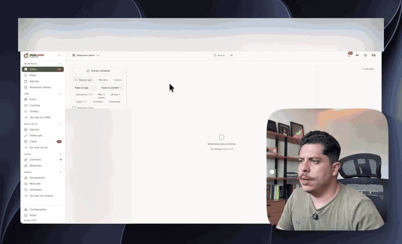

<div align="center">

[🇧🇷 Português](README.md) · [🇺🇸 English](README.en.md) · 🇪🇸 Español

<picture>
  <source media="(prefers-color-scheme: dark)" srcset="docs/brand/deskcomm-logo-dark.svg">
  
</picture>

# 🛠️ DeskcommCRM — el Sistema Operativo de Ventas con IA, open source, para WhatsApp

**Agentes de IA que atienden, califican y venden en WhatsApp — dentro de un CRM open source que corre en tu propio servidor.**
**Sin mensualidad, sin funciones bloqueadas, tus datos siguen siendo tuyos. La alternativa abierta a Kommo, Octadesk e Intercom.**

[](https://nextjs.org)
[](https://www.typescriptlang.org)
[](https://supabase.com)
[](hostgator-setup-kit/)
[](https://github.com/melgarafael/DeskcommCRM/actions/workflows/ci.yml)
[](LICENSE)

[](https://github.com/sponsors/melgarafael)
<!-- ALL-CONTRIBUTORS-BADGE:START - Do not remove or modify this section -->
[](#contributors-)
<!-- ALL-CONTRIBUTORS-BADGE:END -->
[**⚡ Instalar**](#-instalar-en-tu-vps-el-camino-principal) · [**🔄 Actualizar**](#-actualizar) · [**🧭 Visión**](VISION.md) · [**🏗️ Arquitectura**](ARCHITECTURE.md) · [**🤝 Contribuir**](CONTRIBUTING.md) · [**🗺️ Roadmap**](#%EF%B8%8F-roadmap)



</div>

---

> ### ☁️ Corre este CRM en producción con 1 comando
>
> DeskcommCRM se desarrolla en **alianza con HostGator**: el [`hostgator-setup-kit/`](hostgator-setup-kit/)
> instala el CRM completo (app + WhatsApp + base de datos) en un VPS con un único comando, y el
> [runbook de producción](docs/runbooks/waha-hostgator.md) ya asume ese entorno.
>
> **[👉 Contratar el VPS de HostGator con el descuento de la alianza](https://www.hostgator.com.br/52708-141-3-52.html)** —
> datacenter en São Paulo, ideal para WhatsApp funcionando 24/7. *(enlace de partner — contratar por él apoya el proyecto y te sale más barato)*
>
> **¿Todavía no tienes servidor?** Ejecuta esto **en tu propia computadora** (macOS, Linux o WSL).
> Te dice qué plan contratar — con los números reales del runbook, no un "depende" — y te
> devuelve el comando exacto para tu caso:
>
> ```bash
> curl -fsSL https://raw.githubusercontent.com/melgarafael/DeskcommCRM/main/hostgator-setup-kit/comecar.sh | bash
> ```
>
> *(¿prefieres leer antes de ejecutar? clona el repo y corre `bash hostgator-setup-kit/comecar.sh` —
> no instala nada sin que confirmes.)*

---

## ⚡ Instalar en tu VPS (el camino principal)

### 1. Entra a tu VPS

Abre la **Terminal** en tu computadora (en Windows, **PowerShell**; en Mac o Linux, la
**Terminal**) y conéctate con la IP y el puerto que tu hosting te envió por correo:

```bash
ssh -p PUERTO root@TU_IP
```

Reemplaza `PUERTO` y `TU_IP` por los tuyos. Si tu hosting no mencionó ningún puerto, es el que
viene por defecto (22) y puedes omitirlo: `ssh root@TU_IP`.

Te va a pedir la contraseña. **Mientras escribes, no aparece nada en pantalla — ni asteriscos.**
Eso no es que se haya trabado: la terminal está ocultando tu contraseña. Escríbela (o pégala) y
presiona Enter.

> En la primera conexión pregunta `Are you sure you want to continue connecting?` — responde
> `yes`. Es el servidor presentándose por primera vez.

### 2. Ejecuta el instalador

Ya dentro del VPS:

```bash
git clone https://github.com/melgarafael/DeskcommCRM.git
cd DeskcommCRM
bash hostgator-setup-kit/install.sh
```

Eso es todo. **No instalas Node, ni pnpm, ni compilas nada** — la imagen de la app ya viene
lista. Si falta Docker, el instalador pregunta y lo instala solo.

### Lo que necesitas tener a mano

| Ítem | Dónde conseguirlo |
|---|---|
| **VPS con Docker** | [HostGator](https://www.hostgator.com.br/52708-141-3-52.html) (alianza) — o cualquier VPS con Docker. 4 GB de RAM recomendados |
| **Dominio** | Un registro **A** apuntando a la IP del VPS (ej.: `crm.tuempresa.com`) |
| **Base de datos** | Cuenta gratis en [supabase.com](https://supabase.com) — 3 claves + la cadena de conexión del **Session pooler** |
| **IA** | Una clave de **OpenRouter**, **Anthropic** u **OpenAI** — el instalador pregunta cuál quieres |
| **WhatsApp** | Tu número, conectado por código QR en el onboarding (o el canal oficial de Meta) |

> 💡 **Supabase puede crearlo el propio instalador.** Exporta un `SUPABASE_ACCESS_TOKEN` antes
> de ejecutarlo y él crea el proyecto, espera a que la base quede saludable, busca las 4
> credenciales y descubre el host del pooler probando una conexión real — sin copiar y pegar.

### Lo que el instalador hace por ti

**Pregunta solo lo que es tuyo** (dominio, claves, contraseña del admin), **valida cada
respuesta antes de seguir** — una clave equivocada la rechaza en el momento, no tres pasos
después — y se encarga del resto:

1. Genera todos los secretos técnicos solo (tú no inventas ninguna contraseña).
2. Crea las extensiones de Postgres y aplica el schema completo (`supabase/baseline.sql`).
3. Crea el primer admin con el correo y la contraseña que elegiste.
4. Levanta toda la stack con **HTTPS automático** y verifica la salud al final.
5. Instala el **cron de las automatizaciones** (sin él, las reglas CUANDO/SI/ENTONCES se
   acumulan en la cola) y el **agente de actualización**, que es lo que hace existir el botón
   "Actualizar ahora" en pantalla.

**Volver a ejecutarlo no rompe nada** — `install.sh` es idempotente: no duplica el cron, no
recrea el usuario y retoma donde se quedó.

> **Modo no interactivo:** copia `.env.hostgator.example` a `.env`, complétalo y ejecuta
> `bash hostgator-setup-kit/install.sh --yes`.

### ¿Otro hosting? (Hostinger, Coolify, Dokploy, CapRover…)

Funciona. Si tu VPS ya viene con un **proxy inverso propio** ocupando los puertos 80/443, el
instalador **lo detecta solo** y publica el CRM a través de él, en vez de intentar levantar un
Caddy que no cabría. En un caso específico — proxy en `--network host`, como hace Hostinger —
**pregunta en vez de adivinar**, porque publicar detrás del proxy equivocado instala "con éxito"
un sitio mudo. Detalles en [`hostgator-setup-kit/README.md`](hostgator-setup-kit/README.md).

### Primer acceso

Abre `https://<tu-dominio>` (el candado tarda ~1 min en aparecer), entra con el admin y ten a
mano **Google Authenticator** o **Authy** *si* querés activar la verificación en dos pasos — es **opcional** y está en Configuración › Seguridad; el primer inicio de sesión **no** la exige. En el
onboarding, escanea el código QR con el WhatsApp de tu número.

### 🤖 ¿Prefieres que una IA lo instale por ti?

Suelta la carpeta `hostgator-setup-kit/` en el chat de **Claude Code** corriendo dentro del VPS
y dile *"instálame el DeskcommCRM"*. Lee el [`CLAUDE.md`](hostgator-setup-kit/CLAUDE.md) del kit
— que trae el paso a paso y las trampas ya mapeadas — y conduce todo.

---

## 🔄 Actualizar

¿Salió versión nueva? Hay dos caminos, y el primero **no exige terminal**.

### Desde la pantalla (recomendado)

Cuando existe versión nueva, el pie del menú lateral enciende **"Nova versão"** — solo para el
dueño del servidor, porque avisarle a quien no puede actualizar es ruido. Haz clic y llegas a
**Configuración → Actualización**, que muestra qué cambia, **hace backup de la base sola** y
acompaña cada fase (backup → código → base → en línea) hasta terminar. Nada de SSH.

Si la versión nueva levanta rota, el agente **vuelve a la imagen anterior solo** y graba esa
vuelta en el `.env` — sin eso, el siguiente reinicio traería la app rota de nuevo, en silencio.

> Por debajo: la app solo registra el pedido; quien ejecuta es el agente que `install.sh` dejó
> en tu VPS, en un cron que revisa **cada 5 minutos** — así que la actualización empieza dentro
> de los 5 minutos del clic. Si ese agente está caído, la pantalla avisa **"Atualização
> automática indisponível"** y muestra el comando de abajo — nunca finge que funcionó.

### Desde la terminal

```bash
cd /ruta/al/DeskcommCRM
bash hostgator-setup-kit/update.sh
```

El comando hace, en este orden: (1) verifica si de verdad hay versión nueva — si no, sale de
inmediato; (2) **hace backup de la base antes de tocar nada**; (3) baja el código nuevo;
(4) actualiza la base re-aplicando `baseline.sql`, que es idempotente y **auto-curativo**
(repara datos que versiones viejas dejaron inconsistentes); (5) baja la imagen nueva de la app;
(6) verifica la salud al final.

**El objetivo es la última versión publicada** (`v1.2.3`), no la punta de `main` — actualizar
siempre lleva a una versión etiquetada y descrita en [`CHANGELOG.md`](CHANGELOG.md), nunca a un
commit sin probar. **Se niega** a volver a una versión anterior a la instalada (eso apagaría
cosas que ya tienes); para eso existe `--force`, a propósito.

**Cosas normales que vas a ver:** un montón de `already exists` / `multiple primary keys` en la
parte de la base — **es esperado e inofensivo**, son cosas que ya existían. El script filtra ese
ruido y muestra `✓ banco atualizado`. Si la base está ocupada con el CRM atendiendo, la aplica de
nuevo sola (hasta 3 pasadas) y lo dice en pantalla — esto vale desde la actualización siguiente a la
que instale esta corrección. Si aparece `⚠ Apareceram avisos no banco que NÃO são os esperados`, ahí sí guarda el
mensaje: el **final** de la salida dice qué hacer en cada caso (repetir con `--force` cuando la base
estaba ocupada, declarar `SUPABASE_DB_ADMIN_URL` cuando fue permiso).

**¿Salió mal?** Guarda el mensaje y pide ayuda. El `restore.sh` **no** vuelve el backup sobre la
base de datos en uso: solo restaura en una base de datos vacía (ver [`hostgator-setup-kit/README.md`](hostgator-setup-kit/README.md)).
**¿Solo quieres diagnosticar?** `bash hostgator-setup-kit/healthcheck.sh`.

> ⚠️ **En una instalación vieja que todavía no tiene el agente de la pantalla**, ejecuta
> `update.sh` **dos veces**: la primera es todavía el script viejo (que baja el nuevo); la
> segunda instala el agente y enciende el botón.

### Otros comandos del kit

| Script | Función |
|---|---|
| `install.sh` | Instala todo (idempotente — puedes volver a ejecutarlo) |
| `update.sh` | Actualiza a la versión nueva, con backup automático |
| `backup.sh` | Backup de la base + sesiones de WhatsApp |
| `restore.sh` | Restaura un backup |
| `reset-password.sh` | Redefine la contraseña de un usuario |
| `reset-mfa.sh` | Quita el MFA de quien perdió el celular |
| `healthcheck.sh` | Diagnóstico de todos los servicios de una vez |

> **El backup importa:** el plan gratis de Supabase **no hace backup solo**. Vale la pena
> agendar `backup.sh` diariamente en el cron. `update.sh` ya hace uno antes de cada
> actualización.

---

## ✨ Qué es

**Deskcomm** viene de **Desk** (escritorio) + **comm** (comercio): toda la operación de ventas de tu negocio en un solo escritorio, operada por personas y agentes de IA trabajando juntos.

El proyecto nació como CRM de e-commerce y la comunidad lo llevó mucho más lejos: hoy corre en **clínicas, inmobiliarias, infoproductos, agencias, tiendas y prestadores de servicios** — cualquier negocio que venda por WhatsApp. El producto acompañó ese giro y se convirtió en un **sistema operativo de ventas**: agentes de IA con RAG por tenant atienden, califican, mueven leads en el embudo, disparan automatizaciones y saben cuándo pasarle la conversación a una persona — con todo el CRM expuesto vía **MCP** para que los agentes lo operen de verdad. La historia completa está en [`VISION.md`](VISION.md).

### Diferenciales

- 🤖 **Agentes de IA que operan el CRM** — RAG por tenant, skills que el agente ejecuta solo durante la atención, memoria de la operación, análisis de sentimiento, handoff IA→humano auditado, IA como responsable de primera clase y tope de gasto por organización. No es un chatbot decorativo: el agente atiende, califica y mueve el embudo.
- 🔁 **Nada muere en silencio** — follow-up que retoma la conversación enfriada (con tiempo adaptativo y disparadores por etapa), radar de lo que corre riesgo de morir sin respuesta, y central de avisos para lo que necesita una decisión humana.
- 🧠 **Agentes que se automejoran** — las conversaciones resueltas se vuelven conocimiento nuevo; la pantalla de **Evolución de la IA** muestra si el agente está mejorando, dónde falla y qué falta enseñarle; **Propuestas** son mejoras que la IA sugiere para sí misma, aplicables como versión nueva — siempre con gate humano.
- 🧩 **Multinicho por diseño** — vocabulario configurable por embudo: lead se vuelve *Cliente*, *Paciente* o *Comprador*; "ganado" se vuelve *Pagado*, *Agendado* o *Cerrado*. El mismo core sirve a e-commerce (nuestra cuna, con integración Nuvemshop), clínicas, inmobiliarias o infoproductos.
- 💬 **WhatsApp de dos formas** — por **código QR** (WAHA, multinúmero, con anti-baneo: throttle + jitter + ventana horaria) o por el **canal oficial de Meta** (Cloud API, con plantillas aprobadas y sincronizadas). Medios vía Storage, detección de STOP.
- 🔀 **Elige tu IA** — OpenRouter, Anthropic u OpenAI, decidido en la instalación y cambiable después desde la pantalla, **por parte del sistema** (lo que conversa no tiene que ser lo que indexa).
- 👥 **Gobernanza de atención** — RBAC server-side de verdad, asignación/transferencia auditada, cola con rotación, enrutamiento automático por intención y alcance de visualización por rol.
- 🏢 **Multi-tenant + privacidad por diseño (LGPD)** — RLS en toda tabla tenant-aware con test de aislamiento como gate de CI; anonimización preferida sobre borrado; audit log append-only con retención de 5 años.
- 🖥️ **Self-hosted de verdad** — tus datos en tu VPS; instalación y actualización con 1 comando (o 1 clic); sin versión paga, sin funciones bloqueadas.

### 🔌 Webhooks y Automatizaciones

Cada tenant puede crear **fuentes de captación**: una dirección pública (`/api/v1/webhooks/in/<token>`) que recibe leads de landing pages, formularios propios o herramientas como Zapier/n8n vía POST (JSON o `application/x-www-form-urlencoded`) y entra directo al embudo/etapa elegida — sin código, sin integración a medida por tenant. Sobre esas fuentes (y los demás eventos del CRM — el lead cambió de etapa, ganó una etiqueta, llegó un mensaje de WhatsApp), el tenant arma **automatizaciones**: reglas CUANDO/SI/ENTONCES que agregan etiquetas, mueven el lead, lo asignan a alguien, mandan un mensaje de WhatsApp o avisan a otro sistema vía webhook de salida.

En la UI todo vive en **Webhooks** en la barra lateral (visible solo para roles `manager`/`admin`). Tres pestañas: **Recibir datos** (crear fuente, copiar la dirección/formulario listo, disparar un lead de prueba, ver las últimas recepciones), **Automatizaciones** (armar la regla, que siempre nace pausada hasta que la revises y la enciendas) y **Actividad** (línea de tiempo de cada ejecución, con el resultado de cada acción y reenvío manual cuando una llamada externa falla).

Por debajo, cada evento se vuelve una fila en `event_log` — ningún trigger de base de datos hace llamadas HTTP. Quien drena esa cola es la ruta `/api/v1/cron/event-log-drain`, llamada cada minuto. **`install.sh`/`update.sh` ya configuran ese cron solos** — sin él, las automatizaciones se crean normalmente pero nunca corren.

---

## 🖥️ Lo que operas (las pantallas)

| Grupo | Pantallas |
|---|---|
| **Atención** | **Inbox** (conversaciones de WhatsApp, tú y la IA lado a lado) · **Radar** (quién se enfrió y sigue abierto) · **Respuestas rápidas** |
| **CRM** | **Kanban** (dónde está cada negocio en el embudo) · **Contactos** · **Embudos** (etapas, vocabulario del negocio y motivos de pérdida) |
| **Agente de IA** | **Agentes** · **Follow-ups** · **Enrutadores** · **Proveedores** y **Credenciales** · **Conocimiento** (RAG) · **Memoria** · **Skills** · **Casos** · **Alertas** · **Propuestas** · **Ejecuciones** · **Uso y presupuesto** |
| **Canales** | **Conexiones** (QR o canal oficial de Meta, con salud, reconexión y plantillas) · **Nuvemshop** · **Webhooks** |
| **Análisis** | **Desempeño** (embudo y rendimiento por agente) · **Evolución de la IA** · **Audit Log** |
| **Organización** | **Equipo** · **Distribución de atención** · **Organización** · **LGPD** · **API Tokens** · **Seguridad** (MFA, códigos de recuperación, sesiones) · Perfil, Notificaciones, Billing |

Toda pantalla tiene puerta en la navegación — el CI reprueba una pantalla que existe pero a la que solo se llega escribiendo la URL.

---

## 🧱 Stack

| Capa | Elección | Por qué |
|---|---|---|
| **Frontend** | Next.js 16 App Router (Turbopack) + React 19 + TypeScript 6 estricto | Server Components + Route Handlers en el mismo repo |
| **Estilo** | Tailwind + shadcn/ui (`new-york`, neutral) | Personalizable sin lock-in |
| **DB** | Supabase (Postgres + RLS + `vector`) | Multi-tenant nativo, embeddings para RAG |
| **Auth** | Supabase Auth vía `@supabase/ssr` | Cookie SameSite=Strict, HttpOnly |
| **Realtime** | Supabase Realtime | postgres_changes + broadcast |
| **Storage** | Supabase Storage (URLs firmadas) | Bucket privado `whatsapp-media` |
| **WhatsApp** | WAHA Plus (motor NOWEB) + Meta Cloud API | QR para empezar rápido; canal oficial para escalar |
| **Colas** | Tabla `event_log` + workers (cron) | Un trigger de base nunca hace HTTP |
| **Rate limit** | Upstash Redis (sliding window) | Serverless, el free tier alcanza |
| **IA** | Vercel AI SDK v7 — OpenRouter, Requesty, Anthropic, OpenAI y Google | El instalador pregunta cuál; se cambia después desde la pantalla |
| **Validación** | Zod | Input externo, env, payloads |
| **Observabilidad** | Sentry (scrub en error, transacción, span y breadcrumb) | Telemetría opt-in en la instalación |
| **Hosting** | Cualquier VPS con Docker (HostGator/SP en la alianza) | App + WhatsApp + workers en tu propia máquina |

Detalles: [`ARCHITECTURE.md`](ARCHITECTURE.md).

---

## 🧑‍💻 Desarrollo (solo para contribuir al código)

> ⚠️ **Si quieres USAR el CRM, no es acá** — usa el [instalador del VPS](#-instalar-en-tu-vps-el-camino-principal).
> Esta sección es para quien va a tocar el código.

```bash
git clone https://github.com/melgarafael/DeskcommCRM.git
cd DeskcommCRM

nvm use                     # Node 22
npm install -g pnpm && pnpm install

cp .env.example .env.local  # guía completa en docs/SETUP.md

docker compose up -d        # WAHA local (opcional en dev sin WhatsApp)

# Schema: aplica el baseline, NO las migrations.
# Las migrations 0001-0009 y 0013 son stubs `SELECT 1;` — la cadena no sube desde cero.
# El schema real vive en baseline.sql, el mismo que install.sh aplica en el VPS.
# `supabase db push` "pasa" y te deja la base vacía.
supabase link --project-ref <tu-ref>
psql "$SUPABASE_DB_URL" -v ON_ERROR_STOP=1 -f supabase/baseline.sql

pnpm dev
```

App: <http://localhost:3000> · Health check: <http://localhost:3000/api/v1/health>

[`docs/SETUP.md`](docs/SETUP.md) es el tutorial completo de **todas las integraciones** (Supabase, WAHA, proveedores de IA, Upstash, Sentry, Resend, Nuvemshop) — ~60–90 min de cero a la app corriendo. *(La documentación está en portugués de Brasil; ¡las traducciones son bienvenidas!)*

---

## 🧪 Tests

```bash
pnpm typecheck     # tsc --noEmit (estricto)
pnpm lint          # eslint next/core-web-vitals
pnpm test:unit     # Vitest (NO incluye tests/invariants/**)
pnpm test:db       # Postgres efímero + baseline install/update + invariantes
pnpm test:e2e      # Playwright (requiere dev server)
```

**Estos checks son obligatorios** para mergear en `main`. Esta lista ya dijo "cuatro" y después "cinco" — **medí, no confíes en ella**:

```bash
gh api repos/melgarafael/DeskcommCRM/branches/main/protection \
  --jq '.required_status_checks.contexts|join(", ")'
# el 2026-08-14: verify, build-and-size, invariants, e2e, imagens-ok
```


| Check | Qué hace |
|---|---|
| `verify` | typecheck + lint + `lint:channels` + `test:unit` + `test:shell` |
| `invariants` | levanta un Postgres limpio, aplica `baseline.sql` en modo **install** (`ON_ERROR_STOP=1`) y después en modo **update** (probando idempotencia), y corre **618 invariantes en 98 archivos** — RBAC, asignación, alcance, enrutamiento, follow-up, webhooks y automatizaciones |
| `build-and-size` | `pnpm build` en Node 22 |
| `e2e` | levanta un Supabase local, aplica `baseline.sql` y corre por el frontend todas las specs de Playwright menos las que declara `FORA_DO_CI` |

Cuáles specs quedan fuera es pregunta de comando, no de lectura — esta línea llegó a afirmar que la única era `vps-fresh-onboarding`, y desde el PR #983 ella corre en el CI:

```bash
git show origin/main:.github/workflows/e2e.yml | python3 -c "import sys,re; y=sys.stdin.read(); print(sorted({s for _,c in re.findall(r'(FORA_DO_CI):\s*>-\n((?:[ ]{8,}.*\n)+)',y) for s in re.findall(r'[a-z0-9-]+\.spec\.ts',c)}))"
```

`vps-fresh-onboarding` sigue siendo la **P0** de nuestra doctrina de QA visual, porque la instalación fresca es el producto que se vende. Tener gate no reemplaza la prueba por pantalla: el gate prueba que no hubo regresión, no que la experiencia quedó buena.

Entre los invariantes está el **test de aislamiento RLS**: crea 2 organizaciones, simula los claims JWT por el mismo camino `auth.uid()` / `fn_user_org_ids()` que usan las policies de producción, y prueba que un usuario de la org A ve **cero filas** de la org B en `conversations`, `messages`, `contacts` y `crm_leads`. Antes, un caso de control prueba que las filas de la org B realmente existen — sin él, el test pasaría con la tabla vacía.

---

## 📚 Documentación

| Doc | Qué tiene |
|---|---|
| [`hostgator-setup-kit/README.md`](hostgator-setup-kit/README.md) | **Instalación self-host** — el kit, los scripts, los hostings con proxy propio |
| [`docs/ATUALIZANDO.md`](docs/ATUALIZANDO.md) | **Cómo actualizar** tu instalación, en lenguaje simple |
| [`VISION.md`](VISION.md) | **Visión y posicionamiento** — qué es el proyecto, en qué cree y hacia dónde va |
| [`CHANGELOG.md`](CHANGELOG.md) | Qué cambió en cada versión — **lee la sección de tu versión antes de actualizar** |
| [`docs/SETUP.md`](docs/SETUP.md) | Setup de desarrollo, paso a paso, de todas las integraciones |
| [`docs/white-label.es.md`](docs/white-label.es.md) | **Instalar para clientes** — cambiar la marca, una instalación por cliente vs compartida, reventa |
| [`docs/runbooks/waha-hostgator.md`](docs/runbooks/waha-hostgator.md) | Runbook de WAHA en producción (dimensionamiento, recuperación) |
| [`CLAUDE.md`](CLAUDE.md) | Convenciones no negociables (lectura obligatoria para contribuir) |
| [`ARCHITECTURE.md`](ARCHITECTURE.md) | Visión de 1 página de la arquitectura |
| [`docs/index.md`](docs/index.md) | Índice de los 157 documentos, con regla de precedencia |
| [`docs/prd/`](docs/prd/) · [`docs/specs/`](docs/specs/) | PRDs y specs técnicas (schema SQL, payloads, MCP, gobernanza) |

> La mayor parte de la documentación está en portugués de Brasil — nuestra comunidad principal. Las contribuciones de traducción son muy bienvenidas.

---

## 🤝 Contribuir

Este proyecto es open source para la comunidad. Toda contribución es bienvenida — desde arreglar un typo en la documentación hasta una función nueva.

1. Lee [`CLAUDE.md`](CLAUDE.md) (~5 min) — convenciones no negociables (multi-tenancy, RLS, audit, privacidad).
2. Lee [`CONTRIBUTING.md`](CONTRIBUTING.md) — flujo de branches, commits.
3. Sigue el [Código de Conducta](CODE_OF_CONDUCT.md).

**Flujo corto:**

```bash
git checkout -b feat/short-slug
# implementa + tests
pnpm typecheck && pnpm lint && pnpm lint:channels && pnpm test:unit && pnpm test:shell && pnpm build
pnpm test:db   # necesita Docker — es el job `invariants`, obligatorio para mergear
git commit -m "feat(alcance): descripción"
```

Esas dos líneas son **todo lo que podés correr en tu máquina**, a propósito: correr solo la mitad y descubrir el resto como sorpresa roja después de horas de espera es la peor primera experiencia que este repositorio sabe entregar.

Dos gates obligatorios **no** entran ahí y solo corren en CI: `e2e` (necesita un Supabase local) y `imagens-ok` (construye las tres imágenes Docker). Verde en tu máquina no es verde en el merge.

**Definition of Done:** typecheck en cero, lint en cero, tests relevantes verdes, RLS testeada si toca una tabla tenant-aware, audit log emitido en mutaciones, migration versionada **+ apéndice idempotente en `baseline.sql`** si cambia el schema (si no, el cambio nunca llega a quien se auto-hospeda).

---

<a id="contributors-"></a>

## 🙌 Quienes construyen DeskcommCRM

Gracias a cada persona que ya contribuyó con código, un bug bien reportado, una idea, documentación o una traducción. Para entrar en esta lista, mira [cómo contribuir](CONTRIBUTING.md) ([leyenda de los íconos](https://allcontributors.org/docs/en/emoji-key)).

¿Quieres apoyar el proyecto de otra forma? [Patrocínalo en GitHub Sponsors](https://github.com/sponsors/melgarafael).

<!-- ALL-CONTRIBUTORS-LIST:START - Do not remove or modify this section -->
<!-- prettier-ignore-start -->
<!-- markdownlint-disable -->
<table>
  <tbody>
    <tr>
      <td align="center" valign="top" width="12.5%"><a href="https://github.com/melgarafael"><br /><sub><b>Rafael Melgaço</b></sub></a><br /><a href="https://github.com/melgarafael/DeskcommCRM/commits?author=melgarafael" title="Code">💻</a> <a href="#maintenance-melgarafael" title="Maintenance">🚧</a> <a href="#ideas-melgarafael" title="Ideas, Planning, & Feedback">🤔</a></td>
      <td align="center" valign="top" width="12.5%"><a href="https://github.com/webtecnica"><br /><sub><b>webtecnica</b></sub></a><br /><a href="https://github.com/melgarafael/DeskcommCRM/commits?author=webtecnica" title="Code">💻</a> <a href="https://github.com/melgarafael/DeskcommCRM/commits?author=webtecnica" title="Documentation">📖</a></td>
      <td align="center" valign="top" width="12.5%"><a href="https://github.com/paulolimajr77"><br /><sub><b>Paulo Lima Jr</b></sub></a><br /><a href="https://github.com/melgarafael/DeskcommCRM/commits?author=paulolimajr77" title="Code">💻</a></td>
      <td align="center" valign="top" width="12.5%"><a href="https://github.com/jmpo"><br /><sub><b>Marcelo Pompa</b></sub></a><br /><a href="https://github.com/melgarafael/DeskcommCRM/commits?author=jmpo" title="Code">💻</a></td>
      <td align="center" valign="top" width="12.5%"><a href="https://github.com/Tong-bit-art"><br /><sub><b>ordinary being</b></sub></a><br /><a href="https://github.com/melgarafael/DeskcommCRM/commits?author=Tong-bit-art" title="Code">💻</a></td>
      <td align="center" valign="top" width="12.5%"><a href="https://github.com/JowaniOrantes"><br /><sub><b>Jowani Orantes</b></sub></a><br /><a href="https://github.com/melgarafael/DeskcommCRM/commits?author=JowaniOrantes" title="Code">💻</a></td>
      <td align="center" valign="top" width="12.5%"><a href="https://github.com/joaopaulomirandamatias"><br /><sub><b>João Paulo</b></sub></a><br /><a href="https://github.com/melgarafael/DeskcommCRM/commits?author=joaopaulomirandamatias" title="Code">💻</a></td>
      <td align="center" valign="top" width="12.5%"><a href="https://github.com/IanCouto"><br /><sub><b>Ian Couto</b></sub></a><br /><a href="https://github.com/melgarafael/DeskcommCRM/commits?author=IanCouto" title="Code">💻</a></td>
    </tr>
    <tr>
      <td align="center" valign="top" width="12.5%"><a href="https://github.com/rafaelbatistazz"><br /><sub><b>rafaelbatistazz</b></sub></a><br /><a href="https://github.com/melgarafael/DeskcommCRM/commits?author=rafaelbatistazz" title="Code">💻</a></td>
      <td align="center" valign="top" width="12.5%"><a href="https://github.com/423313"><br /><sub><b>423313</b></sub></a><br /><a href="https://github.com/melgarafael/DeskcommCRM/commits?author=423313" title="Code">💻</a></td>
      <td align="center" valign="top" width="12.5%"><a href="https://github.com/vitorlacerdadigital"><br /><sub><b>vitorlacerdadigital</b></sub></a><br /><a href="https://github.com/melgarafael/DeskcommCRM/commits?author=vitorlacerdadigital" title="Code">💻</a></td>
      <td align="center" valign="top" width="12.5%"><a href="https://github.com/maugarciasa"><br /><sub><b>maugarciasa</b></sub></a><br /><a href="https://github.com/melgarafael/DeskcommCRM/commits?author=maugarciasa" title="Code">💻</a></td>
      <td align="center" valign="top" width="12.5%"><a href="https://github.com/ozzure"><br /><sub><b>ozzure</b></sub></a><br /><a href="https://github.com/melgarafael/DeskcommCRM/commits?author=ozzure" title="Code">💻</a></td>
      <td align="center" valign="top" width="12.5%"><a href="https://github.com/hiro-nikaitou"><br /><sub><b>hiro-nikaitou</b></sub></a><br /><a href="https://github.com/melgarafael/DeskcommCRM/commits?author=hiro-nikaitou" title="Code">💻</a></td>
      <td align="center" valign="top" width="12.5%"><a href="https://github.com/maclevison"><br /><sub><b>Mac Silva</b></sub></a><br /><a href="https://github.com/melgarafael/DeskcommCRM/commits?author=maclevison" title="Code">💻</a></td>
      <td align="center" valign="top" width="12.5%"><a href="https://github.com/bossprt"><br /><sub><b>bossprt</b></sub></a><br /><a href="https://github.com/melgarafael/DeskcommCRM/commits?author=bossprt" title="Code">💻</a></td>
    </tr>
    <tr>
      <td align="center" valign="top" width="12.5%"><a href="https://github.com/gustavorodcruz96"><br /><sub><b>Gustavo Rodrigues</b></sub></a><br /><a href="https://github.com/melgarafael/DeskcommCRM/commits?author=gustavorodcruz96" title="Code">💻</a></td>
      <td align="center" valign="top" width="12.5%"><a href="https://github.com/LuckasBrito-Dev"><br /><sub><b>Lucas Brito</b></sub></a><br /><a href="https://github.com/melgarafael/DeskcommCRM/commits?author=LuckasBrito-Dev" title="Code">💻</a></td>
      <td align="center" valign="top" width="12.5%"><a href="https://github.com/FabioMundoDigital"><br /><sub><b>Fabio Kortex</b></sub></a><br /><a href="https://github.com/melgarafael/DeskcommCRM/commits?author=FabioMundoDigital" title="Code">💻</a></td>
      <td align="center" valign="top" width="12.5%"><a href="https://github.com/automatikpg-ux"><br /><sub><b>automatikpg-ux</b></sub></a><br /><a href="https://github.com/melgarafael/DeskcommCRM/commits?author=automatikpg-ux" title="Code">💻</a></td>
      <td align="center" valign="top" width="12.5%"><a href="https://github.com/nsbastosconsultoria"><br /><sub><b>Leandro Nogueira de Souza Bastos</b></sub></a><br /><a href="https://github.com/melgarafael/DeskcommCRM/commits?author=nsbastosconsultoria" title="Code">💻</a></td>
      <td align="center" valign="top" width="12.5%"><a href="https://github.com/vgamkt"><br /><sub><b>VANDER GUSTAVO ALVES</b></sub></a><br /><a href="https://github.com/melgarafael/DeskcommCRM/commits?author=vgamkt" title="Code">💻</a></td>
      <td align="center" valign="top" width="12.5%"><a href="https://github.com/rafaelcesardev"><br /><sub><b>Rafael César</b></sub></a><br /><a href="https://github.com/melgarafael/DeskcommCRM/commits?author=rafaelcesardev" title="Code">💻</a></td>
      <td align="center" valign="top" width="12.5%"><a href="https://github.com/SnoopyHuman"><br /><sub><b>SnoopyHuman</b></sub></a><br /><a href="https://github.com/melgarafael/DeskcommCRM/commits?author=SnoopyHuman" title="Code">💻</a></td>
    </tr>
    <tr>
      <td align="center" valign="top" width="12.5%"><a href="https://github.com/saraivabr"><br /><sub><b>Saraiva</b></sub></a><br /><a href="https://github.com/melgarafael/DeskcommCRM/commits?author=saraivabr" title="Code">💻</a></td>
      <td align="center" valign="top" width="12.5%"><a href="https://github.com/valterhjr"><br /><sub><b>Valter</b></sub></a><br /><a href="https://github.com/melgarafael/DeskcommCRM/commits?author=valterhjr" title="Code">💻</a></td>
      <td align="center" valign="top" width="12.5%"><a href="https://github.com/omayklourenco"><br /><sub><b>Mayk Lourenço</b></sub></a><br /><a href="https://github.com/melgarafael/DeskcommCRM/commits?author=omayklourenco" title="Code">💻</a></td>
      <td align="center" valign="top" width="12.5%"><a href="https://github.com/Draven9"><br /><sub><b>Eric Azevedo</b></sub></a><br /><a href="https://github.com/melgarafael/DeskcommCRM/commits?author=Draven9" title="Code">💻</a></td>
      <td align="center" valign="top" width="12.5%"><a href="https://github.com/Gervanno"><br /><sub><b>Gervànno</b></sub></a><br /><a href="https://github.com/melgarafael/DeskcommCRM/commits?author=Gervanno" title="Code">💻</a></td>
      <td align="center" valign="top" width="12.5%"><a href="https://github.com/felipebnt"><br /><sub><b>Felipe Oliveira</b></sub></a><br /><a href="https://github.com/melgarafael/DeskcommCRM/commits?author=felipebnt" title="Code">💻</a></td>
      <td align="center" valign="top" width="12.5%"><a href="https://github.com/flaviosiq"><br /><sub><b>flaviosiq</b></sub></a><br /><a href="https://github.com/melgarafael/DeskcommCRM/commits?author=flaviosiq" title="Code">💻</a></td>
      <td align="center" valign="top" width="12.5%"><a href="https://github.com/brunowatz"><br /><sub><b>Bruno Jakowatz </b></sub></a><br /><a href="https://github.com/melgarafael/DeskcommCRM/commits?author=brunowatz" title="Code">💻</a></td>
    </tr>
    <tr>
      <td align="center" valign="top" width="12.5%"><a href="https://github.com/fillipe-felix"><br /><sub><b>fillipe-felix</b></sub></a><br /><a href="https://github.com/melgarafael/DeskcommCRM/commits?author=fillipe-felix" title="Code">💻</a></td>
      <td align="center" valign="top" width="12.5%"><a href="https://github.com/claude"><br /><sub><b>Claude</b></sub></a><br /><a href="https://github.com/melgarafael/DeskcommCRM/commits?author=claude" title="Code">💻</a></td>
      <td align="center" valign="top" width="12.5%"><a href="https://github.com/sprakashsurya-debug"><br /><sub><b>sprakashsurya-debug</b></sub></a><br /><a href="https://github.com/melgarafael/DeskcommCRM/commits?author=sprakashsurya-debug" title="Code">💻</a></td>
      <td align="center" valign="top" width="12.5%"><a href="https://github.com/luka1601"><br /><sub><b>luka1601</b></sub></a><br /><a href="https://github.com/melgarafael/DeskcommCRM/commits?author=luka1601" title="Code">💻</a></td>
      <td align="center" valign="top" width="12.5%"><a href="https://github.com/samirhvbr"><br /><sub><b>Samir Hanna Verza</b></sub></a><br /><a href="https://github.com/melgarafael/DeskcommCRM/commits?author=samirhvbr" title="Code">💻</a></td>
      <td align="center" valign="top" width="12.5%"><a href="https://github.com/advglauberpires"><br /><sub><b>advglauberpires</b></sub></a><br /><a href="https://github.com/melgarafael/DeskcommCRM/commits?author=advglauberpires" title="Code">💻</a></td>
      <td align="center" valign="top" width="12.5%"><a href="https://github.com/Tanderakkkj"><br /><sub><b>Tanderakkkj</b></sub></a><br /><a href="https://github.com/melgarafael/DeskcommCRM/commits?author=Tanderakkkj" title="Code">💻</a></td>
      <td align="center" valign="top" width="12.5%"><a href="https://github.com/vagnerrm122"><br /><sub><b>vagnerrm122</b></sub></a><br /><a href="https://github.com/melgarafael/DeskcommCRM/commits?author=vagnerrm122" title="Code">💻</a></td>
    </tr>
    <tr>
      <td align="center" valign="top" width="12.5%"><a href="https://github.com/betoarts"><br /><sub><b>Humberto Moura Neto DEV</b></sub></a><br /><a href="https://github.com/melgarafael/DeskcommCRM/commits?author=betoarts" title="Code">💻</a></td>
      <td align="center" valign="top" width="12.5%"><a href="https://github.com/italopabloferreria"><br /><sub><b>Ítalo Pablo Ferreira</b></sub></a><br /><a href="https://github.com/melgarafael/DeskcommCRM/commits?author=italopabloferreria" title="Code">💻</a></td>
      <td align="center" valign="top" width="12.5%"><a href="https://github.com/Wyllams"><br /><sub><b>Wyllams Bione</b></sub></a><br /><a href="https://github.com/melgarafael/DeskcommCRM/commits?author=Wyllams" title="Code">💻</a></td>
      <td align="center" valign="top" width="12.5%"><a href="https://github.com/opp4s"><br /><sub><b>opp4s</b></sub></a><br /><a href="https://github.com/melgarafael/DeskcommCRM/commits?author=opp4s" title="Code">💻</a></td>
      <td align="center" valign="top" width="12.5%"><a href="https://github.com/nusretbayindir-stack"><br /><sub><b>nusretbayindir-stack</b></sub></a><br /><a href="https://github.com/melgarafael/DeskcommCRM/commits?author=nusretbayindir-stack" title="Code">💻</a></td>
      <td align="center" valign="top" width="12.5%"><a href="https://github.com/thiagobaltuilhe"><br /><sub><b>thiagobaltuilhe</b></sub></a><br /><a href="https://github.com/melgarafael/DeskcommCRM/commits?author=thiagobaltuilhe" title="Code">💻</a></td>
      <td align="center" valign="top" width="12.5%"><a href="https://github.com/fabianmartinelli-fm"><br /><sub><b>Fabian Martinelli</b></sub></a><br /><a href="https://github.com/melgarafael/DeskcommCRM/commits?author=fabianmartinelli-fm" title="Code">💻</a></td>
      <td align="center" valign="top" width="12.5%"><a href="https://github.com/Elevstudio-Dev"><br /><sub><b>Elevstudio-Dev</b></sub></a><br /><a href="https://github.com/melgarafael/DeskcommCRM/commits?author=Elevstudio-Dev" title="Code">💻</a></td>
    </tr>
    <tr>
      <td align="center" valign="top" width="12.5%"><a href="https://github.com/felipedelvan"><br /><sub><b>felipedelvan</b></sub></a><br /><a href="https://github.com/melgarafael/DeskcommCRM/commits?author=felipedelvan" title="Code">💻</a></td>
      <td align="center" valign="top" width="12.5%"><a href="https://github.com/in100tiva"><br /><sub><b>Luan Oliveira Dos Santos</b></sub></a><br /><a href="https://github.com/melgarafael/DeskcommCRM/commits?author=in100tiva" title="Code">💻</a></td>
      <td align="center" valign="top" width="12.5%"><a href="https://github.com/mauriciobera1990-droid"><br /><sub><b>mauriciobera1990-droid</b></sub></a><br /><a href="https://github.com/melgarafael/DeskcommCRM/commits?author=mauriciobera1990-droid" title="Code">💻</a></td>
      <td align="center" valign="top" width="12.5%"><a href="https://github.com/SerusoNakamoto"><br /><sub><b>SerusoNakamoto</b></sub></a><br /><a href="https://github.com/melgarafael/DeskcommCRM/commits?author=SerusoNakamoto" title="Code">💻</a></td>
      <td align="center" valign="top" width="12.5%"><a href="https://github.com/jostoz"><br /><sub><b>josuetoz</b></sub></a><br /><a href="https://github.com/melgarafael/DeskcommCRM/commits?author=jostoz" title="Code">💻</a></td>
      <td align="center" valign="top" width="12.5%"><a href="https://github.com/Drmachado0"><br /><sub><b>Drmachado0</b></sub></a><br /><a href="https://github.com/melgarafael/DeskcommCRM/commits?author=Drmachado0" title="Code">💻</a></td>
      <td align="center" valign="top" width="12.5%"><a href="https://github.com/rogercampel"><br /><sub><b>Roger Campel</b></sub></a><br /><a href="https://github.com/melgarafael/DeskcommCRM/commits?author=rogercampel" title="Code">💻</a></td>
      <td align="center" valign="top" width="12.5%"><a href="https://github.com/raphaelmartins"><br /><sub><b>Raphael Martins</b></sub></a><br /><a href="https://github.com/melgarafael/DeskcommCRM/commits?author=raphaelmartins" title="Code">💻</a></td>
    </tr>
    <tr>
      <td align="center" valign="top" width="12.5%"><a href="https://github.com/matheuspedro360"><br /><sub><b>matheuspedro360</b></sub></a><br /><a href="https://github.com/melgarafael/DeskcommCRM/commits?author=matheuspedro360" title="Code">💻</a></td>
      <td align="center" valign="top" width="12.5%"><a href="https://github.com/lzandonadi"><br /><sub><b>Lucas Falqueto Zandonadi</b></sub></a><br /><a href="https://github.com/melgarafael/DeskcommCRM/commits?author=lzandonadi" title="Code">💻</a></td>
      <td align="center" valign="top" width="12.5%"><a href="https://github.com/LeonardoMarcelo"><br /><sub><b>leonardo marcelo santana da paz</b></sub></a><br /><a href="https://github.com/melgarafael/DeskcommCRM/commits?author=LeonardoMarcelo" title="Code">💻</a></td>
      <td align="center" valign="top" width="12.5%"><a href="https://github.com/cabindaferreira"><br /><sub><b>João Ferreira</b></sub></a><br /><a href="https://github.com/melgarafael/DeskcommCRM/commits?author=cabindaferreira" title="Code">💻</a></td>
      <td align="center" valign="top" width="12.5%"><a href="https://github.com/claudioghirellifh"><br /><sub><b>Claudio Ghirelli Filho</b></sub></a><br /><a href="https://github.com/melgarafael/DeskcommCRM/commits?author=claudioghirellifh" title="Code">💻</a></td>
      <td align="center" valign="top" width="12.5%"><a href="https://github.com/xxfabioxx12"><br /><sub><b>xxfabioxx12</b></sub></a><br /><a href="https://github.com/melgarafael/DeskcommCRM/commits?author=xxfabioxx12" title="Code">💻</a></td>
      <td align="center" valign="top" width="12.5%"><a href="https://github.com/rafaeskytrabalho"><br /><sub><b>Renan Rafaesky</b></sub></a><br /><a href="https://github.com/melgarafael/DeskcommCRM/commits?author=rafaeskytrabalho" title="Code">💻</a></td>
      <td align="center" valign="top" width="12.5%"><a href="https://github.com/andersontomazi-ctrl"><br /><sub><b>andersontomazi-ctrl</b></sub></a><br /><a href="https://github.com/melgarafael/DeskcommCRM/commits?author=andersontomazi-ctrl" title="Code">💻</a></td>
    </tr>
    <tr>
      <td align="center" valign="top" width="12.5%"><a href="https://github.com/agencyspeedagend-del"><br /><sub><b>agencyspeedagend-del</b></sub></a><br /><a href="https://github.com/melgarafael/DeskcommCRM/commits?author=agencyspeedagend-del" title="Code">💻</a></td>
      <td align="center" valign="top" width="12.5%"><a href="https://github.com/vanksestevao"><br /><sub><b>vanksestevao</b></sub></a><br /><a href="https://github.com/melgarafael/DeskcommCRM/commits?author=vanksestevao" title="Code">💻</a></td>
      <td align="center" valign="top" width="12.5%"><a href="https://github.com/xxjjjj"><br /><sub><b>URNOTKRYSTALXU</b></sub></a><br /><a href="https://github.com/melgarafael/DeskcommCRM/commits?author=xxjjjj" title="Code">💻</a></td>
      <td align="center" valign="top" width="12.5%"><a href="https://github.com/kocaemre"><br /><sub><b>Emre K.</b></sub></a><br /><a href="https://github.com/melgarafael/DeskcommCRM/commits?author=kocaemre" title="Code">💻</a></td>
      <td align="center" valign="top" width="12.5%"><a href="https://github.com/arthurbarreto07"><br /><sub><b>arthurbarreto07</b></sub></a><br /><a href="https://github.com/melgarafael/DeskcommCRM/commits?author=arthurbarreto07" title="Code">💻</a></td>
      <td align="center" valign="top" width="12.5%"><a href="https://github.com/dilneiss"><br /><sub><b>Dilnei</b></sub></a><br /><a href="https://github.com/melgarafael/DeskcommCRM/commits?author=dilneiss" title="Code">💻</a></td>
      <td align="center" valign="top" width="12.5%"><a href="https://github.com/resdasilva"><br /><sub><b>resdasilva</b></sub></a><br /><a href="https://github.com/melgarafael/DeskcommCRM/commits?author=resdasilva" title="Code">💻</a></td>
      <td align="center" valign="top" width="12.5%"><a href="https://github.com/hampikamayuq"><br /><sub><b>Diego Galvez</b></sub></a><br /><a href="https://github.com/melgarafael/DeskcommCRM/commits?author=hampikamayuq" title="Code">💻</a></td>
    </tr>
    <tr>
      <td align="center" valign="top" width="12.5%"><a href="https://github.com/andradevander"><br /><sub><b>Vanderson Andrade</b></sub></a><br /><a href="https://github.com/melgarafael/DeskcommCRM/commits?author=andradevander" title="Code">💻</a></td>
      <td align="center" valign="top" width="12.5%"><a href="https://github.com/Thibaultjaigu"><br /><sub><b>Thibault Jaigu</b></sub></a><br /><a href="https://github.com/melgarafael/DeskcommCRM/commits?author=Thibaultjaigu" title="Code">💻</a></td>
      <td align="center" valign="top" width="12.5%"><a href="https://github.com/rodrigotxt"><br /><sub><b>Rodrigo Martins</b></sub></a><br /><a href="https://github.com/melgarafael/DeskcommCRM/commits?author=rodrigotxt" title="Code">💻</a></td>
      <td align="center" valign="top" width="12.5%"><a href="https://github.com/GGBueno"><br /><sub><b>Giovane Bueno</b></sub></a><br /><a href="https://github.com/melgarafael/DeskcommCRM/commits?author=GGBueno" title="Code">💻</a></td>
      <td align="center" valign="top" width="12.5%"><a href="https://github.com/erikyudi"><br /><sub><b>erikyudi</b></sub></a><br /><a href="https://github.com/melgarafael/DeskcommCRM/commits?author=erikyudi" title="Code">💻</a></td>
      <td align="center" valign="top" width="12.5%"><a href="https://github.com/eudanielhenrique"><br /><sub><b>Daniel Henrique</b></sub></a><br /><a href="https://github.com/melgarafael/DeskcommCRM/commits?author=eudanielhenrique" title="Code">💻</a></td>
      <td align="center" valign="top" width="12.5%"><a href="https://github.com/Clalber"><br /><sub><b>Clalber Pereira</b></sub></a><br /><a href="https://github.com/melgarafael/DeskcommCRM/commits?author=Clalber" title="Code">💻</a></td>
      <td align="center" valign="top" width="12.5%"><a href="https://github.com/AllisonFABRASoftware"><br /><sub><b>Allison FABRA Software</b></sub></a><br /><a href="https://github.com/melgarafael/DeskcommCRM/commits?author=AllisonFABRASoftware" title="Code">💻</a></td>
    </tr>
    <tr>
      <td align="center" valign="top" width="12.5%"><a href="https://github.com/allisonwilliancandido"><br /><sub><b>Allison Willian</b></sub></a><br /><a href="https://github.com/melgarafael/DeskcommCRM/commits?author=allisonwilliancandido" title="Code">💻</a></td>
      <td align="center" valign="top" width="12.5%"><a href="https://github.com/Alencaf"><br /><sub><b>Alencaf</b></sub></a><br /><a href="https://github.com/melgarafael/DeskcommCRM/commits?author=Alencaf" title="Code">💻</a></td>
      <td align="center" valign="top" width="12.5%"><a href="https://github.com/Sandersono"><br /><sub><b>Sanderson Palmeira de Oliveira</b></sub></a><br /><a href="https://github.com/melgarafael/DeskcommCRM/commits?author=Sandersono" title="Code">💻</a></td>
      <td align="center" valign="top" width="12.5%"><a href="https://github.com/victor-will"><br /><sub><b>victor-will</b></sub></a><br /><a href="https://github.com/melgarafael/DeskcommCRM/commits?author=victor-will" title="Code">💻</a></td>
      <td align="center" valign="top" width="12.5%"><a href="https://github.com/salomaobatistamkt"><br /><sub><b>salomaobatistamkt</b></sub></a><br /><a href="https://github.com/melgarafael/DeskcommCRM/commits?author=salomaobatistamkt" title="Code">💻</a></td>
      <td align="center" valign="top" width="12.5%"><a href="https://github.com/gaberaldo-svg"><br /><sub><b>gaberaldo-svg</b></sub></a><br /><a href="https://github.com/melgarafael/DeskcommCRM/commits?author=gaberaldo-svg" title="Code">💻</a></td>
      <td align="center" valign="top" width="12.5%"><a href="https://github.com/vinicoretecnologia-svg"><br /><sub><b>vinicoretecnologia-svg</b></sub></a><br /><a href="https://github.com/melgarafael/DeskcommCRM/commits?author=vinicoretecnologia-svg" title="Code">💻</a></td>
      <td align="center" valign="top" width="12.5%"><a href="https://github.com/RafaelBarbosaBR"><br /><sub><b>RafaelBarbosaBR</b></sub></a><br /><a href="https://github.com/melgarafael/DeskcommCRM/commits?author=RafaelBarbosaBR" title="Code">💻</a></td>
    </tr>
    <tr>
      <td align="center" valign="top" width="12.5%"><a href="https://github.com/pedroscharrff"><br /><sub><b>pedroscharrff</b></sub></a><br /><a href="https://github.com/melgarafael/DeskcommCRM/commits?author=pedroscharrff" title="Code">💻</a></td>
      <td align="center" valign="top" width="12.5%"><a href="https://github.com/LuigiMDev"><br /><sub><b>Luigi Matheus</b></sub></a><br /><a href="https://github.com/melgarafael/DeskcommCRM/commits?author=LuigiMDev" title="Code">💻</a></td>
      <td align="center" valign="top" width="12.5%"><a href="https://github.com/tatarevick"><br /><sub><b>tatarevick</b></sub></a><br /><a href="https://github.com/melgarafael/DeskcommCRM/commits?author=tatarevick" title="Code">💻</a></td>
      <td align="center" valign="top" width="12.5%"><a href="https://github.com/anarkaike"><br /><sub><b>Junio de Almeida Vitorino</b></sub></a><br /><a href="https://github.com/melgarafael/DeskcommCRM/commits?author=anarkaike" title="Code">💻</a></td>
      <td align="center" valign="top" width="12.5%"><a href="https://github.com/JonathasmpDEV"><br /><sub><b>Jonathas Micael de Paulo</b></sub></a><br /><a href="https://github.com/melgarafael/DeskcommCRM/commits?author=JonathasmpDEV" title="Code">💻</a></td>
      <td align="center" valign="top" width="12.5%"><a href="https://github.com/Frank-zhu2000"><br /><sub><b>jack</b></sub></a><br /><a href="https://github.com/melgarafael/DeskcommCRM/commits?author=Frank-zhu2000" title="Code">💻</a></td>
      <td align="center" valign="top" width="12.5%"><a href="https://github.com/CristianoFF43"><br /><sub><b>CristianoFF43</b></sub></a><br /><a href="https://github.com/melgarafael/DeskcommCRM/commits?author=CristianoFF43" title="Code">💻</a></td>
      <td align="center" valign="top" width="12.5%"><a href="https://github.com/obrunogonzaga"><br /><sub><b>Bruno Gonzaga Santos</b></sub></a><br /><a href="https://github.com/melgarafael/DeskcommCRM/commits?author=obrunogonzaga" title="Code">💻</a></td>
    </tr>
    <tr>
      <td align="center" valign="top" width="12.5%"><a href="https://github.com/brastramidia"><br /><sub><b>José Oliveira</b></sub></a><br /><a href="https://github.com/melgarafael/DeskcommCRM/commits?author=brastramidia" title="Code">💻</a></td>
      <td align="center" valign="top" width="12.5%"><a href="https://github.com/AlecsanderAbreu"><br /><sub><b>Alecsander Abreu</b></sub></a><br /><a href="https://github.com/melgarafael/DeskcommCRM/commits?author=AlecsanderAbreu" title="Code">💻</a></td>
      <td align="center" valign="top" width="12.5%"><a href="https://github.com/careis-junior"><br /><sub><b>careis-junior</b></sub></a><br /><a href="https://github.com/melgarafael/DeskcommCRM/commits?author=careis-junior" title="Code">💻</a></td>
      <td align="center" valign="top" width="12.5%"><a href="https://github.com/dajiaohuang"><br /><sub><b>Wu Shuwen</b></sub></a><br /><a href="https://github.com/melgarafael/DeskcommCRM/commits?author=dajiaohuang" title="Code">💻</a></td>
      <td align="center" valign="top" width="12.5%"><a href="https://github.com/lauropilatti-c01"><br /><sub><b>lauropilatti-c01</b></sub></a><br /><a href="https://github.com/melgarafael/DeskcommCRM/commits?author=lauropilatti-c01" title="Code">💻</a></td>
      <td align="center" valign="top" width="12.5%"><a href="https://github.com/AngelaHelloKittyBaby"><br /><sub><b>AngelaHelloKittyBaby</b></sub></a><br /><a href="https://github.com/melgarafael/DeskcommCRM/commits?author=AngelaHelloKittyBaby" title="Code">💻</a></td>
      <td align="center" valign="top" width="12.5%"><a href="https://github.com/mbiero"><br /><sub><b>mbiero</b></sub></a><br /><a href="https://github.com/melgarafael/DeskcommCRM/commits?author=mbiero" title="Code">💻</a></td>
      <td align="center" valign="top" width="12.5%"><a href="https://github.com/peterkeussen"><br /><sub><b>Peter Keussen de Souza</b></sub></a><br /><a href="https://github.com/melgarafael/DeskcommCRM/commits?author=peterkeussen" title="Code">💻</a></td>
    </tr>
    <tr>
      <td align="center" valign="top" width="12.5%"><a href="https://github.com/profpeque"><br /><sub><b>profpeque</b></sub></a><br /><a href="https://github.com/melgarafael/DeskcommCRM/commits?author=profpeque" title="Code">💻</a></td>
      <td align="center" valign="top" width="12.5%"><a href="https://github.com/scavio-ai"><br /><sub><b>Scavio AI</b></sub></a><br /><a href="https://github.com/melgarafael/DeskcommCRM/commits?author=scavio-ai" title="Code">💻</a></td>
      <td align="center" valign="top" width="12.5%"><a href="https://github.com/wellpelomundo"><br /><sub><b>Wellington Ribeiro</b></sub></a><br /><a href="https://github.com/melgarafael/DeskcommCRM/commits?author=wellpelomundo" title="Code">💻</a></td>
      <td align="center" valign="top" width="12.5%"><a href="https://github.com/ygorebos"><br /><sub><b>Ygor E O Silva</b></sub></a><br /><a href="https://github.com/melgarafael/DeskcommCRM/commits?author=ygorebos" title="Code">💻</a></td>
      <td align="center" valign="top" width="12.5%"><a href="https://github.com/DissonADSon"><br /><sub><b>Anderson Simão</b></sub></a><br /><a href="https://github.com/melgarafael/DeskcommCRM/commits?author=DissonADSon" title="Code">💻</a></td>
      <td align="center" valign="top" width="12.5%"><a href="https://github.com/carloshmlima"><br /><sub><b>Carlos Lima</b></sub></a><br /><a href="https://github.com/melgarafael/DeskcommCRM/commits?author=carloshmlima" title="Code">💻</a></td>
      <td align="center" valign="top" width="12.5%"><a href="https://github.com/lucasa15"><br /><sub><b>lucasa15</b></sub></a><br /><a href="https://github.com/melgarafael/DeskcommCRM/commits?author=lucasa15" title="Code">💻</a></td>
      <td align="center" valign="top" width="12.5%"><a href="https://github.com/ajsaranetaeu"><br /><sub><b>ajsaranetaeu</b></sub></a><br /><a href="https://github.com/melgarafael/DeskcommCRM/commits?author=ajsaranetaeu" title="Code">💻</a></td>
    </tr>
    <tr>
      <td align="center" valign="top" width="12.5%"><a href="https://github.com/SrPascoa"><br /><sub><b>Fábio Páscoa</b></sub></a><br /><a href="https://github.com/melgarafael/DeskcommCRM/commits?author=SrPascoa" title="Code">💻</a></td>
      <td align="center" valign="top" width="12.5%"><a href="https://github.com/felpzGondim"><br /><sub><b>felpzGondim</b></sub></a><br /><a href="https://github.com/melgarafael/DeskcommCRM/commits?author=felpzGondim" title="Code">💻</a></td>
      <td align="center" valign="top" width="12.5%"><a href="https://github.com/HigorLira"><br /><sub><b>HigorLira</b></sub></a><br /><a href="https://github.com/melgarafael/DeskcommCRM/commits?author=HigorLira" title="Code">💻</a></td>
      <td align="center" valign="top" width="12.5%"><a href="https://github.com/joaoalexsandroed"><br /><sub><b>joaoalexsandroed</b></sub></a><br /><a href="https://github.com/melgarafael/DeskcommCRM/commits?author=joaoalexsandroed" title="Code">💻</a></td>
      <td align="center" valign="top" width="12.5%"><a href="https://github.com/lucasprestes1"><br /><sub><b>lucasprestes1</b></sub></a><br /><a href="https://github.com/melgarafael/DeskcommCRM/commits?author=lucasprestes1" title="Code">💻</a></td>
      <td align="center" valign="top" width="12.5%"><a href="https://github.com/matheussouzasantos"><br /><sub><b>Matheus Santos</b></sub></a><br /><a href="https://github.com/melgarafael/DeskcommCRM/commits?author=matheussouzasantos" title="Code">💻</a></td>
      <td align="center" valign="top" width="12.5%"><a href="https://github.com/RenanzitoIA"><br /><sub><b>Renan Alves</b></sub></a><br /><a href="https://github.com/melgarafael/DeskcommCRM/commits?author=RenanzitoIA" title="Code">💻</a></td>
      <td align="center" valign="top" width="12.5%"><a href="https://github.com/rominparekh"><br /><sub><b>Romin Parekh</b></sub></a><br /><a href="https://github.com/melgarafael/DeskcommCRM/commits?author=rominparekh" title="Code">💻</a></td>
    </tr>
    <tr>
      <td align="center" valign="top" width="12.5%"><a href="https://github.com/xxgamesxx14"><br /><sub><b>xxgamesxx14</b></sub></a><br /><a href="https://github.com/melgarafael/DeskcommCRM/commits?author=xxgamesxx14" title="Code">💻</a></td>
      <td align="center" valign="top" width="12.5%"><a href="https://github.com/chiliec"><br /><sub><b>Vladimir Babin</b></sub></a><br /><a href="https://github.com/melgarafael/DeskcommCRM/commits?author=chiliec" title="Code">💻</a></td>
      <td align="center" valign="top" width="12.5%"><a href="https://github.com/Aleshan-dev"><br /><sub><b>Aleshan-dev</b></sub></a><br /><a href="https://github.com/melgarafael/DeskcommCRM/commits?author=Aleshan-dev" title="Code">💻</a></td>
      <td align="center" valign="top" width="12.5%"><a href="https://github.com/faxamkt"><br /><sub><b>faxa marketing</b></sub></a><br /><a href="https://github.com/melgarafael/DeskcommCRM/commits?author=faxamkt" title="Code">💻</a></td>
      <td align="center" valign="top" width="12.5%"><a href="https://github.com/mentitaa"><br /><sub><b>Mentita</b></sub></a><br /><a href="https://github.com/melgarafael/DeskcommCRM/commits?author=mentitaa" title="Code">💻</a></td>
      <td align="center" valign="top" width="12.5%"><a href="https://github.com/luiscgc91"><br /><sub><b>luiscgc91</b></sub></a><br /><a href="https://github.com/melgarafael/DeskcommCRM/commits?author=luiscgc91" title="Code">💻</a></td>
      <td align="center" valign="top" width="12.5%"><a href="https://github.com/lucivan212"><br /><sub><b>lucivan212</b></sub></a><br /><a href="https://github.com/melgarafael/DeskcommCRM/commits?author=lucivan212" title="Code">💻</a></td>
      <td align="center" valign="top" width="12.5%"><a href="https://github.com/leadframeassessoria-lab"><br /><sub><b>leadframeassessoria-lab</b></sub></a><br /><a href="https://github.com/melgarafael/DeskcommCRM/commits?author=leadframeassessoria-lab" title="Code">💻</a></td>
    </tr>
    <tr>
      <td align="center" valign="top" width="12.5%"><a href="https://github.com/gabigurgeldev"><br /><sub><b>GABRIEL MORAIS GURGEL</b></sub></a><br /><a href="https://github.com/melgarafael/DeskcommCRM/commits?author=gabigurgeldev" title="Code">💻</a></td>
      <td align="center" valign="top" width="12.5%"><a href="https://github.com/actions-user"><br /><sub><b>actions-user</b></sub></a><br /><a href="https://github.com/melgarafael/DeskcommCRM/commits?author=actions-user" title="Code">💻</a></td>
      <td align="center" valign="top" width="12.5%"><a href="https://github.com/fillipeagra-cyber"><br /><sub><b>fillipeagra-cyber</b></sub></a><br /><a href="https://github.com/melgarafael/DeskcommCRM/commits?author=fillipeagra-cyber" title="Code">💻</a></td>
      <td align="center" valign="top" width="12.5%"><a href="https://github.com/carlospaivabr"><br /><sub><b>Carlos Paiva</b></sub></a><br /><a href="https://github.com/melgarafael/DeskcommCRM/commits?author=carlospaivabr" title="Code">💻</a></td>
      <td align="center" valign="top" width="12.5%"><a href="https://github.com/caiofacchinato"><br /><sub><b>caiofacchinato</b></sub></a><br /><a href="https://github.com/melgarafael/DeskcommCRM/commits?author=caiofacchinato" title="Code">💻</a></td>
      <td align="center" valign="top" width="12.5%"><a href="https://github.com/alexneverland"><br /><sub><b>Lazaros Avramidis</b></sub></a><br /><a href="https://github.com/melgarafael/DeskcommCRM/commits?author=alexneverland" title="Code">💻</a></td>
      <td align="center" valign="top" width="12.5%"><a href="https://github.com/scademir"><br /><sub><b>Ademir Santos</b></sub></a><br /><a href="https://github.com/melgarafael/DeskcommCRM/commits?author=scademir" title="Code">💻</a></td>
      <td align="center" valign="top" width="12.5%"><a href="https://github.com/patronotech"><br /><sub><b>patronotech</b></sub></a><br /><a href="https://github.com/melgarafael/DeskcommCRM/commits?author=patronotech" title="Code">💻</a></td>
    </tr>
    <tr>
      <td align="center" valign="top" width="12.5%"><a href="https://github.com/rabbitkleber"><br /><sub><b>rabbitkleber</b></sub></a><br /><a href="https://github.com/melgarafael/DeskcommCRM/commits?author=rabbitkleber" title="Code">💻</a></td>
      <td align="center" valign="top" width="12.5%"><a href="https://github.com/rafaelbatistak"><br /><sub><b>rafaelbatistak</b></sub></a><br /><a href="https://github.com/melgarafael/DeskcommCRM/commits?author=rafaelbatistak" title="Code">💻</a></td>
      <td align="center" valign="top" width="12.5%"><a href="https://github.com/ragaspaleilao"><br /><sub><b>ragaspaleilao</b></sub></a><br /><a href="https://github.com/melgarafael/DeskcommCRM/commits?author=ragaspaleilao" title="Code">💻</a></td>
      <td align="center" valign="top" width="12.5%"><a href="https://github.com/realLoganLuo"><br /><sub><b>Logan-Luo</b></sub></a><br /><a href="https://github.com/melgarafael/DeskcommCRM/commits?author=realLoganLuo" title="Code">💻</a></td>
      <td align="center" valign="top" width="12.5%"><a href="https://github.com/renatofortal"><br /><sub><b>renatofortal</b></sub></a><br /><a href="https://github.com/melgarafael/DeskcommCRM/commits?author=renatofortal" title="Code">💻</a></td>
      <td align="center" valign="top" width="12.5%"><a href="https://github.com/rgisjr"><br /><sub><b>rgisjr</b></sub></a><br /><a href="https://github.com/melgarafael/DeskcommCRM/commits?author=rgisjr" title="Code">💻</a></td>
      <td align="center" valign="top" width="12.5%"><a href="https://github.com/stivanellidrop-dotcom"><br /><sub><b>stivanellidrop-dotcom</b></sub></a><br /><a href="https://github.com/melgarafael/DeskcommCRM/commits?author=stivanellidrop-dotcom" title="Code">💻</a></td>
      <td align="center" valign="top" width="12.5%"><a href="https://github.com/tratham-oficial"><br /><sub><b>tratham-oficial</b></sub></a><br /><a href="https://github.com/melgarafael/DeskcommCRM/commits?author=tratham-oficial" title="Code">💻</a></td>
    </tr>
    <tr>
      <td align="center" valign="top" width="12.5%"><a href="https://github.com/vitor-licassali"><br /><sub><b>vitor-licassali</b></sub></a><br /><a href="https://github.com/melgarafael/DeskcommCRM/commits?author=vitor-licassali" title="Code">💻</a></td>
      <td align="center" valign="top" width="12.5%"><a href="https://github.com/w4rlockem"><br /><sub><b>w4rlockem</b></sub></a><br /><a href="https://github.com/melgarafael/DeskcommCRM/commits?author=w4rlockem" title="Code">💻</a></td>
      <td align="center" valign="top" width="12.5%"><a href="https://github.com/xofrd"><br /><sub><b>William</b></sub></a><br /><a href="https://github.com/melgarafael/DeskcommCRM/commits?author=xofrd" title="Code">💻</a></td>
      <td align="center" valign="top" width="12.5%"><a href="https://github.com/Agenciatektus"><br /><sub><b>Agência Tektus</b></sub></a><br /><a href="https://github.com/melgarafael/DeskcommCRM/commits?author=Agenciatektus" title="Code">💻</a></td>
      <td align="center" valign="top" width="12.5%"><a href="https://github.com/codex"><br /><sub><b>Codex</b></sub></a><br /><a href="https://github.com/melgarafael/DeskcommCRM/commits?author=codex" title="Code">💻</a></td>
      <td align="center" valign="top" width="12.5%"><a href="https://github.com/EduFkn"><br /><sub><b>Eduardo Almeida</b></sub></a><br /><a href="https://github.com/melgarafael/DeskcommCRM/commits?author=EduFkn" title="Code">💻</a></td>
      <td align="center" valign="top" width="12.5%"><a href="https://github.com/edaben"><br /><sub><b>edaben</b></sub></a><br /><a href="https://github.com/melgarafael/DeskcommCRM/commits?author=edaben" title="Code">💻</a></td>
      <td align="center" valign="top" width="12.5%"><a href="https://github.com/thinhnx128"><br /><sub><b>Gau·Beo</b></sub></a><br /><a href="https://github.com/melgarafael/DeskcommCRM/commits?author=thinhnx128" title="Code">💻</a></td>
    </tr>
    <tr>
      <td align="center" valign="top" width="12.5%"><a href="https://github.com/gyanu2507"><br /><sub><b>Gyanu Mayank</b></sub></a><br /><a href="https://github.com/melgarafael/DeskcommCRM/commits?author=gyanu2507" title="Code">💻</a></td>
      <td align="center" valign="top" width="12.5%"><a href="https://github.com/hamiltonviana"><br /><sub><b>hamiltonviana</b></sub></a><br /><a href="https://github.com/melgarafael/DeskcommCRM/commits?author=hamiltonviana" title="Code">💻</a></td>
      <td align="center" valign="top" width="12.5%"><a href="https://github.com/Hefesto25"><br /><sub><b>Hefesto25</b></sub></a><br /><a href="https://github.com/melgarafael/DeskcommCRM/commits?author=Hefesto25" title="Code">💻</a></td>
      <td align="center" valign="top" width="12.5%"><a href="https://github.com/holive"><br /><sub><b>holive</b></sub></a><br /><a href="https://github.com/melgarafael/DeskcommCRM/commits?author=holive" title="Code">💻</a></td>
      <td align="center" valign="top" width="12.5%"><a href="https://github.com/oianmaxdev"><br /><sub><b>oianmaxdev</b></sub></a><br /><a href="https://github.com/melgarafael/DeskcommCRM/commits?author=oianmaxdev" title="Code">💻</a></td>
      <td align="center" valign="top" width="12.5%"><a href="https://github.com/KauaAmaral"><br /><sub><b>Kauã Amaral</b></sub></a><br /><a href="https://github.com/melgarafael/DeskcommCRM/commits?author=KauaAmaral" title="Code">💻</a></td>
      <td align="center" valign="top" width="12.5%"><a href="https://github.com/kristhianlumai-lgtm"><br /><sub><b>kristhianlumai-lgtm</b></sub></a><br /><a href="https://github.com/melgarafael/DeskcommCRM/commits?author=kristhianlumai-lgtm" title="Code">💻</a></td>
      <td align="center" valign="top" width="12.5%"><a href="https://github.com/devmonisat"><br /><sub><b>Monisat</b></sub></a><br /><a href="https://github.com/melgarafael/DeskcommCRM/commits?author=devmonisat" title="Code">💻</a></td>
    </tr>
    <tr>
      <td align="center" valign="top" width="12.5%"><a href="https://github.com/lcsilvestrini"><br /><sub><b>Luiz Carlos Silvestrini</b></sub></a><br /><a href="https://github.com/melgarafael/DeskcommCRM/commits?author=lcsilvestrini" title="Code">💻</a></td>
      <td align="center" valign="top" width="12.5%"><a href="https://github.com/lmarceloc"><br /><sub><b>Marcelo</b></sub></a><br /><a href="https://github.com/melgarafael/DeskcommCRM/commits?author=lmarceloc" title="Code">💻</a></td>
      <td align="center" valign="top" width="12.5%"><a href="https://github.com/marcelovolei15"><br /><sub><b>marcelovolei15</b></sub></a><br /><a href="https://github.com/melgarafael/DeskcommCRM/commits?author=marcelovolei15" title="Code">💻</a></td>
      <td align="center" valign="top" width="12.5%"><a href="https://github.com/murilloimparavel"><br /><sub><b>Murillo Alves</b></sub></a><br /><a href="https://github.com/melgarafael/DeskcommCRM/commits?author=murilloimparavel" title="Code">💻</a></td>
      <td align="center" valign="top" width="12.5%"><a href="https://github.com/pljrcombr"><br /><sub><b>pljrcombr</b></sub></a><br /><a href="https://github.com/melgarafael/DeskcommCRM/commits?author=pljrcombr" title="Code">💻</a></td>
      <td align="center" valign="top" width="12.5%"><a href="https://github.com/Teowfb"><br /><sub><b>Teowfb</b></sub></a><br /><a href="https://github.com/melgarafael/DeskcommCRM/commits?author=Teowfb" title="Code">💻</a></td>
      <td align="center" valign="top" width="12.5%"><a href="https://github.com/terceiroregiss"><br /><sub><b>Terceiro Régis</b></sub></a><br /><a href="https://github.com/melgarafael/DeskcommCRM/commits?author=terceiroregiss" title="Code">💻</a></td>
      <td align="center" valign="top" width="12.5%"><a href="https://github.com/PiahDoNeumann"><br /><sub><b>Valdecir Neumann</b></sub></a><br /><a href="https://github.com/melgarafael/DeskcommCRM/commits?author=PiahDoNeumann" title="Code">💻</a></td>
    </tr>
    <tr>
      <td align="center" valign="top" width="12.5%"><a href="https://github.com/ViktorHugodev"><br /><sub><b>Victor H Correa</b></sub></a><br /><a href="https://github.com/melgarafael/DeskcommCRM/commits?author=ViktorHugodev" title="Code">💻</a></td>
      <td align="center" valign="top" width="12.5%"><a href="https://github.com/ygorl"><br /><sub><b>ygorl</b></sub></a><br /><a href="https://github.com/melgarafael/DeskcommCRM/commits?author=ygorl" title="Code">💻</a></td>
      <td align="center" valign="top" width="12.5%"><a href="https://github.com/bfs2021"><br /><sub><b>zgy</b></sub></a><br /><a href="https://github.com/melgarafael/DeskcommCRM/commits?author=bfs2021" title="Code">💻</a></td>
      <td align="center" valign="top" width="12.5%"><a href="https://github.com/ricagui"><br /><sub><b>Ricardo Mendes</b></sub></a><br /><a href="https://github.com/melgarafael/DeskcommCRM/commits?author=ricagui" title="Code">💻</a></td>
      <td align="center" valign="top" width="12.5%"><a href="https://github.com/ZvisionAutomations"><br /><sub><b>ZvisionAutomations</b></sub></a><br /><a href="https://github.com/melgarafael/DeskcommCRM/commits?author=ZvisionAutomations" title="Code">💻</a></td>
      <td align="center" valign="top" width="12.5%"><a href="https://github.com/jhometal"><br /><sub><b>jhometal</b></sub></a><br /><a href="https://github.com/melgarafael/DeskcommCRM/issues?q=author%3Ajhometal" title="Bug reports">🐛</a> <a href="#ideas-jhometal" title="Ideas, Planning, & Feedback">🤔</a></td>
      <td align="center" valign="top" width="12.5%"><a href="https://github.com/juniorpagedown"><br /><sub><b>juniorpagedown</b></sub></a><br /><a href="https://github.com/melgarafael/DeskcommCRM/issues?q=author%3Ajuniorpagedown" title="Bug reports">🐛</a></td>
      <td align="center" valign="top" width="12.5%"><a href="https://github.com/nemyasalmeida"><br /><sub><b>nemyasalmeida</b></sub></a><br /><a href="https://github.com/melgarafael/DeskcommCRM/issues?q=author%3Anemyasalmeida" title="Bug reports">🐛</a></td>
    </tr>
    <tr>
      <td align="center" valign="top" width="12.5%"><a href="https://github.com/hudson-souza-mkt"><br /><sub><b>hudson-souza-mkt</b></sub></a><br /><a href="https://github.com/melgarafael/DeskcommCRM/commits?author=hudson-souza-mkt" title="Code">💻</a> <a href="https://github.com/melgarafael/DeskcommCRM/issues?q=author%3Ahudson-souza-mkt" title="Bug reports">🐛</a></td>
      <td align="center" valign="top" width="12.5%"><a href="https://github.com/NeroSued"><br /><sub><b>Nero Sued</b></sub></a><br /><a href="#ideas-NeroSued" title="Ideas, Planning, & Feedback">🤔</a></td>
      <td align="center" valign="top" width="12.5%"><a href="https://github.com/aerosuiteapp"><br /><sub><b>Danilo Costa</b></sub></a><br /><a href="#ideas-aerosuiteapp" title="Ideas, Planning, & Feedback">🤔</a> <a href="https://github.com/melgarafael/DeskcommCRM/issues?q=author%3Aaerosuiteapp" title="Bug reports">🐛</a></td>
      <td align="center" valign="top" width="12.5%"><a href="https://github.com/frankjohann"><br /><sub><b>Frank Johann</b></sub></a><br /><a href="#ideas-frankjohann" title="Ideas, Planning, & Feedback">🤔</a></td>
      <td align="center" valign="top" width="12.5%"><a href="https://github.com/tec7alex"><br /><sub><b>tec7alex</b></sub></a><br /><a href="#ideas-tec7alex" title="Ideas, Planning, & Feedback">🤔</a></td>
      <td align="center" valign="top" width="12.5%"><a href="https://github.com/shu-chen-dot-ca"><br /><sub><b>Shu Chen</b></sub></a><br /><a href="https://github.com/melgarafael/DeskcommCRM/commits?author=shu-chen-dot-ca" title="Code">💻</a></td>
      <td align="center" valign="top" width="12.5%"><a href="https://github.com/renatomprado"><br /><sub><b>Renato Prado</b></sub></a><br /><a href="https://github.com/melgarafael/DeskcommCRM/commits?author=renatomprado" title="Code">💻</a></td>
      <td align="center" valign="top" width="12.5%"><a href="https://github.com/Villa-Nova-Cont"><br /><sub><b>Villa-Nova-Cont</b></sub></a><br /><a href="https://github.com/melgarafael/DeskcommCRM/commits?author=Villa-Nova-Cont" title="Code">💻</a></td>
    </tr>
    <tr>
      <td align="center" valign="top" width="12.5%"><a href="https://seax.com.br/"><br /><sub><b>Seax</b></sub></a><br /><a href="https://github.com/melgarafael/DeskcommCRM/commits?author=seax-trophy" title="Code">💻</a></td>
      <td align="center" valign="top" width="12.5%"><a href="https://github.com/routeti"><br /><sub><b>routeti</b></sub></a><br /><a href="https://github.com/melgarafael/DeskcommCRM/commits?author=routeti" title="Code">💻</a></td>
      <td align="center" valign="top" width="12.5%"><a href="https://codenome.com/"><br /><sub><b>Ricardo Souza</b></sub></a><br /><a href="https://github.com/melgarafael/DeskcommCRM/commits?author=Riicksouzaa" title="Code">💻</a> <a href="https://github.com/melgarafael/DeskcommCRM/issues?q=author%3ARiicksouzaa" title="Bug reports">🐛</a></td>
      <td align="center" valign="top" width="12.5%"><a href="https://github.com/rglucchini-ai"><br /><sub><b>rglucchini-ai</b></sub></a><br /><a href="https://github.com/melgarafael/DeskcommCRM/commits?author=rglucchini-ai" title="Code">💻</a> <a href="#ideas-rglucchini-ai" title="Ideas, Planning, & Feedback">🤔</a></td>
      <td align="center" valign="top" width="12.5%"><a href="https://asishkumar.com/"><br /><sub><b>Asish Kumar</b></sub></a><br /><a href="https://github.com/melgarafael/DeskcommCRM/commits?author=officialasishkumar" title="Code">💻</a></td>
      <td align="center" valign="top" width="12.5%"><a href="https://github.com/mindflowai1"><br /><sub><b>mindflowai1</b></sub></a><br /><a href="https://github.com/melgarafael/DeskcommCRM/commits?author=mindflowai1" title="Code">💻</a> <a href="https://github.com/melgarafael/DeskcommCRM/issues?q=author%3Amindflowai1" title="Bug reports">🐛</a></td>
      <td align="center" valign="top" width="12.5%"><a href="https://github.com/jay23606"><br /><sub><b>Jay</b></sub></a><br /><a href="https://github.com/melgarafael/DeskcommCRM/commits?author=jay23606" title="Code">💻</a></td>
      <td align="center" valign="top" width="12.5%"><a href="https://hanbintan.com/"><br /><sub><b>Hanbin Tan</b></sub></a><br /><a href="https://github.com/melgarafael/DeskcommCRM/commits?author=hskl18" title="Code">💻</a></td>
    </tr>
    <tr>
      <td align="center" valign="top" width="12.5%"><a href="https://github.com/felipehenriquess"><br /><sub><b>Felipe Henrique</b></sub></a><br /><a href="https://github.com/melgarafael/DeskcommCRM/commits?author=felipehenriquess" title="Code">💻</a></td>
      <td align="center" valign="top" width="12.5%"><a href="https://github.com/betoloko1970"><br /><sub><b>betoloko1970</b></sub></a><br /><a href="https://github.com/melgarafael/DeskcommCRM/commits?author=betoloko1970" title="Code">💻</a></td>
      <td align="center" valign="top" width="12.5%"><a href="https://github.com/berrub00"><br /><sub><b>berrub00</b></sub></a><br /><a href="https://github.com/melgarafael/DeskcommCRM/commits?author=berrub00" title="Code">💻</a></td>
      <td align="center" valign="top" width="12.5%"><a href="https://github.com/zeroaiproject"><br /><sub><b>Zero AI</b></sub></a><br /><a href="https://github.com/melgarafael/DeskcommCRM/commits?author=zeroaiproject" title="Code">💻</a></td>
      <td align="center" valign="top" width="12.5%"><a href="https://github.com/World2576"><br /><sub><b>World2576</b></sub></a><br /><a href="https://github.com/melgarafael/DeskcommCRM/commits?author=World2576" title="Code">💻</a></td>
      <td align="center" valign="top" width="12.5%"><a href="https://github.com/wanjinhao1"><br /><sub><b>Kratos</b></sub></a><br /><a href="https://github.com/melgarafael/DeskcommCRM/commits?author=wanjinhao1" title="Code">💻</a></td>
      <td align="center" valign="top" width="12.5%"><a href="https://github.com/Denispds"><br /><sub><b>Denis pereira dos santos Araújo</b></sub></a><br /><a href="https://github.com/melgarafael/DeskcommCRM/commits?author=Denispds" title="Code">💻</a></td>
      <td align="center" valign="top" width="12.5%"><a href="https://github.com/gabriel-lima-git-hub"><br /><sub><b>gabriel-lima-git-hub</b></sub></a><br /><a href="https://github.com/melgarafael/DeskcommCRM/commits?author=gabriel-lima-git-hub" title="Code">💻</a></td>
    </tr>
    <tr>
      <td align="center" valign="top" width="12.5%"><a href="https://github.com/lucas-nobrega"><br /><sub><b>Lucas</b></sub></a><br /><a href="https://github.com/melgarafael/DeskcommCRM/issues?q=author%3Alucas-nobrega" title="Bug reports">🐛</a></td>
      <td align="center" valign="top" width="12.5%"><a href="https://github.com/WaldineyGodoy"><br /><sub><b>WaldineyGodoy</b></sub></a><br /><a href="#ideas-WaldineyGodoy" title="Ideas, Planning, & Feedback">🤔</a></td>
      <td align="center" valign="top" width="12.5%"><a href="https://github.com/brunno-soaress"><br /><sub><b>brunno-soaress</b></sub></a><br /><a href="https://github.com/melgarafael/DeskcommCRM/issues?q=author%3Abrunno-soaress" title="Bug reports">🐛</a></td>
      <td align="center" valign="top" width="12.5%"><a href="https://github.com/gleisaum"><br /><sub><b>Gleison Neves</b></sub></a><br /><a href="https://github.com/melgarafael/DeskcommCRM/issues?q=author%3Agleisaum" title="Bug reports">🐛</a></td>
      <td align="center" valign="top" width="12.5%"><a href="https://github.com/amexgestao"><br /><sub><b>amexgestao</b></sub></a><br /><a href="#ideas-amexgestao" title="Ideas, Planning, & Feedback">🤔</a></td>
      <td align="center" valign="top" width="12.5%"><a href="https://github.com/InvestidorDiversificado"><br /><sub><b>InvestidorDiversificado</b></sub></a><br /><a href="https://github.com/melgarafael/DeskcommCRM/issues?q=author%3AInvestidorDiversificado" title="Bug reports">🐛</a></td>
    </tr>
  </tbody>
</table>

<!-- markdownlint-restore -->
<!-- prettier-ignore-end -->

<!-- ALL-CONTRIBUTORS-LIST:END -->

---

## 🐛 Reportar bugs

Abre un [issue](https://github.com/melgarafael/DeskcommCRM/issues/new/choose) — la plantilla pide lo que necesitamos (entorno, `/api/v1/health`, pasos). Correr `bash hostgator-setup-kit/healthcheck.sh` y pegar la salida ayuda mucho.

Para **vulnerabilidades de seguridad**, **NO abras un issue público** — usa el [reporte privado de vulnerabilidades](https://github.com/melgarafael/DeskcommCRM/security/advisories/new). Detalles en [`SECURITY.md`](SECURITY.md).

---

## 🗺️ Roadmap

### ✅ Entregado

- **Fundación y plataforma** — auth (MFA para admin), multi-tenancy con RLS + test de aislamiento, RBAC de 4 roles, audit log append-only, onboarding de tenant.
- **Atención WhatsApp** — inbox de 3 paneles en tiempo real, conexiones multinúmero por **QR (WAHA)** o **canal oficial de Meta** (plantillas aprobadas y sincronizadas), medios vía Storage, anti-baneo (throttle + jitter + ventana horaria), detección de STOP.
- **CRM y pedidos** — kanban con vocabulario configurable por nicho (fractional indexing), gestión de embudos desde la pantalla, customer 360, contactos, etiquetas, integración Nuvemshop.
- **IA nativa** — agentes con RAG por tenant (pgvector), **skills** que el agente ejecuta solo, **memoria de la organización**, enrutador de intención por número, análisis de sentimiento, handoff IA→humano, tope de gasto por org, servidor MCP interno.
- **Elección de proveedor de IA** — OpenRouter, Anthropic u OpenAI, decidido en la instalación y cambiable por parte del sistema desde la pantalla.
- **Follow-up vivo** — retomar conversaciones enfriadas con tiempo adaptativo, disparadores por etapa y por caso, cola con rotación, y el Radar de lo que corre riesgo de morir sin respuesta.
- **LGPD** — export y redact vía workers, anonimización en cascada, consentimiento auditado.
- **Self-host** — `hostgator-setup-kit` (app + WhatsApp + base con 1 comando), `baseline.sql` auto-curativo, **actualización desde la pantalla** con backup automático, runbook de producción.
- **Webhooks y automatización** — fuentes de captación + reglas CUANDO/SI/ENTONCES + disparadores para sistemas externos.
- **Gobernanza de atención** — RBAC server-side en toda la API, asignación y transferencia auditadas (IA como responsable de 1ª clase), visualización por rol (RLS) + métricas por agente, enrutamiento automático con cola y panel de gestión, y contrato de gobernanza para agentes de IA externos ([`docs/specs/14`](docs/specs/14-contrato-governanca-agentes-externos.md)).
- **Operación visible** — motivo de la retención anti-baneo traducido en la conversación, central de avisos con severidad, aviso de mensaje trabada, control de protección de envío (ventana/ritmo/tope), capacidades declaradas del agente y propuestas del flywheel aplicables como versión nueva (con gate humano).

### 🔮 Próximo

- **MCP público** — capacidades del CRM expuestas al ecosistema de agentes: enchufa el agente que quieras y opera el Deskcomm.
- **Plantillas por nicho** — embudos y vocabularios listos para clínicas, inmobiliarias, infoproductos y servicios (e-commerce ya entregado).
- **Integraciones** — VTEX y Shopify vía adapter pattern (Nuvemshop ya entregado).
- **Identidad probabilística** — unificación de contactos entre canales.

---

## 💬 Comunidad

- **Discusiones:** [GitHub Discussions](https://github.com/melgarafael/DeskcommCRM/discussions)
- **Issues:** [GitHub Issues](https://github.com/melgarafael/DeskcommCRM/issues)
- **Instagram:** [@melgarafael](https://www.instagram.com/melgarafael)
- **YouTube:** [youtube.com/@melgarafael](https://www.youtube.com/@melgarafael)

---

## 📜 Licencia

Distribuido bajo la licencia **MIT** — ver [`LICENSE`](LICENSE). Puedes usar, modificar y distribuir libremente, incluso comercialmente. El software se entrega **"tal cual", sin garantías**.

---

## 🛟 Soporte y responsabilidades (self-host)

Este es un proyecto **self-host**: cada persona corre el CRM en su **propia infraestructura** (VPS, base Supabase y clave de IA propios). Eso implica:

- **El soporte es comunitario y "as-is".** No hay SLA — es open source mantenido por buena voluntad.
- **Eres responsable de tu instalación.** Las actualizaciones no son automáticas (haces clic, o corres `update.sh`, cuando quieras), y mantener/respaldar tu servidor es cosa tuya.
- **Protección de datos:** quien **hospeda** la instancia es el **controlador** de los datos personales tratados ahí (clientes, conversaciones, pedidos), con las obligaciones legales que eso implica. Los mantenedores del proyecto **no son** controladores ni operadores de tu instancia, y no tienen acceso a tu base, a tu WhatsApp ni a tu storage.
- **Telemetría (Sentry):** `install.sh` **pregunta** durante la instalación y respeta tu respuesta; en modo no interactivo, sin `SENTRY_DSN` definido, la telemetría queda **apagada**. Si aceptas el Sentry de la comunidad, lo que se envía son **reportes de error** (stack trace) con documento, teléfono y correo sustituidos, cabeceras sensibles removidas, y token de webhook/invitación redactado de la URL — **sin** rastreo de performance y **sin** replay de sesión, que quedan en 0 en ese camino. Para apagarlo en cualquier momento: `SENTRY_DSN=off` en el `.env`. Para mandarlo a **tu** Sentry (ahí sí con performance y replay): `SENTRY_DSN=<tu-dsn>`. Qué se redacta, y por qué, está en [`lib/sentry/scrub.ts`](lib/sentry/scrub.ts); la resolución del DSN en [`lib/sentry/dsn.ts`](lib/sentry/dsn.ts).

---

## 🙏 Agradecimientos

- **WAHA** ([devlikeapro](https://waha.devlikeapro.com/)) — motor de WhatsApp.
- **Supabase** — Postgres + Auth + Storage + Realtime en una sola stack.
- **HostGator** — la alianza de infraestructura que hizo posible el self-host de 1 comando.
- **Anthropic**, **OpenAI** y **OpenRouter** — los proveedores de IA que el CRM sabe usar.
- **shadcn/ui** — base de componentes.
- La comunidad que nos llevó del e-commerce a clínicas, inmobiliarias, infoproductos y más allá — ustedes definieron lo que es este proyecto.

---

<div align="center">

**Built with ☕ in Brasil** · **Made for the community**

</div>
