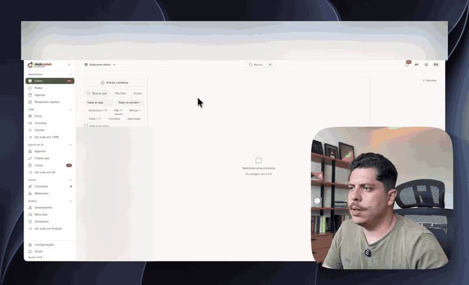

<div align="center">

🇧🇷 Português · [🇺🇸 English](README.en.md) · [🇪🇸 Español](README.es.md)

<picture>
  <source media="(prefers-color-scheme: dark)" srcset="docs/brand/deskcomm-logo-dark.svg">
  
</picture>

# 🛠️ DeskcommCRM — o Sistema Operacional de Vendas com IA, open source, pro WhatsApp

**Agentes de IA que atendem, qualificam e vendem no WhatsApp — dentro de um CRM open source rodando no seu servidor.**
**Sem mensalidade, sem feature travada, seus dados com você. A alternativa aberta a Kommo, Octadesk e Intercom.**

[](https://nextjs.org)
[](https://www.typescriptlang.org)
[](https://supabase.com)
[](hostgator-setup-kit/)
[](https://github.com/melgarafael/DeskcommCRM/actions/workflows/ci.yml)
[](LICENSE)

[](https://github.com/sponsors/melgarafael)
<!-- ALL-CONTRIBUTORS-BADGE:START - Do not remove or modify this section -->
[](#contributors-)
<!-- ALL-CONTRIBUTORS-BADGE:END -->
[**⚡ Instalar**](#-instalar-na-sua-vps-o-caminho-principal) · [**📖 Curso visual**](https://deskcomm.com.br/curso) · [**🔄 Atualizar**](#-atualizar) · [**🧭 Visão**](VISION.md) · [**🏗️ Arquitetura**](ARCHITECTURE.md) · [**🤝 Contribuir**](CONTRIBUTING.md) · [**🗺️ Roadmap**](#%EF%B8%8F-roadmap)



</div>

---

> ### ☁️ Rode este CRM em produção com 1 comando
>
> O DeskcommCRM foi desenvolvido em **parceria com a HostGator**: o [`hostgator-setup-kit/`](hostgator-setup-kit/)
> instala o CRM completo (app + WhatsApp + banco) numa VPS com um único comando, e o
> [runbook de produção](docs/runbooks/waha-hostgator.md) já assume esse ambiente.
>
> **[👉 Assinar a VPS HostGator com desconto da parceria](https://www.hostgator.com.br/52708-141-3-52.html)** —
> datacenter em São Paulo, ideal pro WhatsApp rodando 24/7. *(link de parceiro — assinar por ele apoia o projeto e sai mais barato)*
>
> **Ainda não tem servidor?** Rode isto **no seu computador** (macOS, Linux ou WSL). Ele diz
> qual plano contratar — com os números do runbook, não um "depende" — e te devolve o
> comando certo pro seu caso:
>
> ```bash
> curl -fsSL https://raw.githubusercontent.com/melgarafael/DeskcommCRM/main/hostgator-setup-kit/comecar.sh | bash
> ```
>
> *(prefere ler antes de executar? clone o repo e rode `bash hostgator-setup-kit/comecar.sh` —
> ele não instala nada sem você confirmar.)*

---

## ⚡ Instalar na sua VPS (o caminho principal)

### 1. Entre na sua VPS

Abra o **Terminal** no seu computador (no Windows, o **PowerShell**; no Mac ou Linux, o
**Terminal**) e conecte com o IP e a porta que a hospedagem te mandou por e-mail:

```bash
ssh -p PORTA root@SEU_IP
```

Troque `PORTA` e `SEU_IP` pelos seus. Se a hospedagem não mencionou porta nenhuma, é a padrão
(22) e você pode omitir: `ssh root@SEU_IP`.

Ele pede a senha. **Ao digitar, não aparece nada na tela — nem asteriscos.** Isso não é
travamento: é o terminal escondendo a senha. Digite (ou cole) e dê Enter.

> Na primeira conexão ele pergunta `Are you sure you want to continue connecting?` — responda
> `yes`. É o servidor se apresentando pela primeira vez.

### 2. Rode o instalador

Já dentro da VPS:

```bash
git clone https://github.com/melgarafael/DeskcommCRM.git
cd DeskcommCRM
bash hostgator-setup-kit/install.sh
```

É isso. **Você não instala Node, nem pnpm, nem compila nada** — a imagem do app já vem pronta.
Se faltar Docker, o instalador pergunta e instala sozinho.

### O que você precisa ter em mãos

| Item | Onde conseguir |
|---|---|
| **VPS com Docker** | [HostGator](https://www.hostgator.com.br/52708-141-3-52.html) (parceria) — ou qualquer VPS com Docker. 4 GB de RAM recomendados |
| **Domínio** | Um registro **A** apontando pro IP da VPS (ex.: `crm.suaempresa.com.br`) |
| **Banco** | Conta grátis no [supabase.com](https://supabase.com) — 3 chaves + connection string do **Session pooler**. Se o projeto ficar fora do ar parado (`522` ou `PGRST002` por horas), o compute Nano do plano grátis pode não bastar: [veja o runbook](docs/runbooks/custo-e-cota-do-supabase.md#5-quando-o-compute-nano-do-plano-grátis-não-basta) |
| **IA** | Uma chave de **OpenRouter**, **Anthropic** ou **OpenAI** — o instalador pergunta qual você quer |
| **WhatsApp** | Seu número, conectado por QR code no onboarding (ou o canal oficial da Meta) |

O instalador também atende VPS ARM64/aarch64, como a Oracle Ampere A1, e escolhe a imagem
NOWEB oficial do WAHA compatível com essa arquitetura. Vale para os dois caminhos: com Supabase
externo e com o Supabase na mesma VPS (as imagens do Supabase self-hosted fixadas pelo kit também
são publicadas para `linux/arm64`). Nada é compilado na VPS.

> 💡 **O Supabase pode ser criado pelo próprio instalador.** Exporte um
> `SUPABASE_ACCESS_TOKEN` antes de rodar e ele cria o projeto, espera o banco ficar saudável,
> busca as 4 credenciais e descobre o host do pooler testando conexão real — sem copiar e colar.

### O que o instalador faz por você

Ele **pergunta só o que é seu** (domínio, chaves, senha do admin), **valida cada resposta antes
de seguir** — chave errada ele recusa na hora, não três passos depois — e cuida do resto:

1. Gera todos os segredos técnicos sozinho (você não inventa senha nenhuma).
2. Cria as extensões do Postgres e aplica o schema completo (`supabase/baseline.sql`).
3. Cria o primeiro admin com o e-mail e a senha que você escolheu.
4. Sobe a stack inteira com **HTTPS automático** e confere a saúde no fim.
5. Instala o **cron das automações** (sem ele, as regras QUANDO/SE/ENTÃO ficam paradas na fila)
   e o **agente de atualização**, que é o que faz o botão "Atualizar agora" existir na tela.

**Rodar de novo não quebra nada** — o `install.sh` é idempotente: não duplica cron, não recria
usuário, retoma de onde parou.

> **Modo não-interativo:** copie `.env.hostgator.example` para `.env`, preencha e rode
> `bash hostgator-setup-kit/install.sh --yes`.

### Outra hospedagem? (Hostinger, Coolify, Dokploy, CapRover…)

Funciona. Se a sua VPS já vem com um **proxy reverso próprio** ocupando as portas 80/443, o
instalador **detecta isso sozinho** e publica o CRM através dele, em vez de tentar subir um
Caddy que não caberia. Num caso específico — proxy em `--network host`, como faz a Hostinger —
ele **pergunta em vez de adivinhar**, porque publicar atrás do proxy errado instala "com
sucesso" um site mudo. Detalhes em [`hostgator-setup-kit/README.md`](hostgator-setup-kit/README.md#vps-que-já-vem-com-proxy-próprio-hostinger-coolify-dokploy).

### Primeiro acesso

Abra `https://<seu-domínio>` (o cadeado leva ~1 min pra aparecer), entre com o admin, e tenha o
**Google Authenticator** ou **Authy** à mão *se* você quiser ligar a verificação em duas etapas — ela é **opcional** e fica em Configurações › Segurança; o primeiro login **não** a exige. No onboarding,
escaneie o QR code com o WhatsApp do seu número.

> **Já instalou?** Continue no [**curso visual gratuito**](https://deskcomm.com.br/curso):
> telas reais e indicações de onde clicar para aprender a usar a Inbox, organizar o funil e
> configurar seus agentes de IA, no seu ritmo.

### 🤖 Prefere que uma IA instale pra você?

O repositório traz **guias do assistente** que carregam sozinhos no Claude Code, Codex, Cursor,
OpenCode ou Antigravity: instalar, montar um cliente por nicho, analisar métricas, afinar o prompt
do agente e contribuir. Para tê-los em **qualquer pasta** — inclusive antes de clonar, no seu
computador —, rode uma vez:

```bash
curl -fsSL https://raw.githubusercontent.com/melgarafael/DeskcommCRM/main/scripts/instalar-guias.sh | bash
```

Depois abra uma sessão nova do seu assistente e diga *"quero instalar o CRM na minha VPS"*: pedir o
assunto em português aciona o guia certo em qualquer um dos cinco. Para chamar um guia pelo nome,
cada um tem o seu jeito — `/deskcomm-instalar` no Claude Code, no Cursor e no Antigravity;
`$deskcomm-instalar` no Codex; no OpenCode, peça pelo nome, em linguagem natural.

Os guias **não** se atualizam sozinhos: rodar o mesmo comando de novo traz a versão nova. Para
desfazer:

```bash
curl -fsSL https://raw.githubusercontent.com/melgarafael/DeskcommCRM/main/scripts/instalar-guias.sh | bash -s -- --remover
```

Com o repositório já clonado, os guias vêm dentro dele (`.agents/skills/`) e nem isso é preciso. Se
você rodou o comando mesmo assim, saiba que no Claude Code o guia instalado vale mais que o do clone
— e fica na versão do dia em que rodou, até rodar de novo (ou desfazer).
Também funciona o jeito antigo: jogar só a pasta `hostgator-setup-kit/` no chat do **Claude Code**
dentro da VPS — ele lê o [`CLAUDE.md`](hostgator-setup-kit/CLAUDE.md) do kit e conduz tudo em português.

---

## 🔄 Atualizar

Saiu versão nova? Há dois caminhos, e o primeiro **não exige terminal**.

### Pela tela (recomendado)

Quando existe versão nova, o rodapé do menu lateral acende **"Nova versão"** — só pro dono do
servidor, porque avisar quem não pode atualizar é ruído. Clique e você cai em
**Configurações → Atualização**, que mostra o que muda, faz **backup do banco sozinha** e
acompanha cada fase (backup → código → banco → no ar) até terminar. Nada de SSH.

Se a versão nova subir quebrada, o agente **volta pra imagem anterior sozinho** e grava essa
volta no `.env` — sem isso, o próximo restart traria o app quebrado de novo, em silêncio.

> Por baixo: o app só registra o pedido; quem executa é o agente que o `install.sh` deixou na
> sua VPS, num cron que confere **a cada 5 minutos** — então a atualização começa em até 5
> minutos depois do clique. Se esse agente estiver fora do ar, a tela avisa
> **"Atualização automática indisponível"** e mostra o comando abaixo — ela não finge que deu certo.

### Pelo terminal

```bash
cd /caminho/do/DeskcommCRM
bash hostgator-setup-kit/update.sh
```

O comando faz, nesta ordem: (1) confere se há mesmo versão nova — se não houver, sai na hora;
(2) **faz backup do banco antes de tocar em qualquer coisa**; (3) baixa o código novo;
(4) atualiza o banco re-aplicando o `baseline.sql`, que é idempotente e **auto-curativo**
(conserta sozinho dados bagunçados por versões antigas); (5) puxa a imagem nova do app;
(6) confere a saúde no fim.

**O alvo é a última versão publicada** (`v1.2.3`), não o topo da `main` — atualizar leva sempre
a uma versão marcada e descrita no [`CHANGELOG.md`](CHANGELOG.md), nunca a um commit não testado.
Ele **recusa** voltar pra uma versão anterior à instalada (isso desligaria coisas que você já tem);
pra isso existe `--force`, de propósito.

**Coisas normais que você vai ver:** um monte de `already exists` / `multiple primary keys` na
parte do banco — **é esperado e inofensivo**, são coisas que já existiam. O script filtra esse
ruído e mostra `✓ banco atualizado`. Se o banco estiver ocupado com o CRM atendendo, ele aplica de
novo sozinho (até 3 passadas) e conta isso na tela — isso vale a partir da atualização seguinte à
que instalar esta correção. Se aparecer `⚠ Apareceram avisos no banco que NÃO são os esperados`, aí sim guarde a
mensagem: o **fim** da saída diz o que fazer em cada caso (repetir com `--force` quando foi o banco
ocupado, declarar `SUPABASE_DB_ADMIN_URL` quando foi permissão).

**Deu ruim?** Guarde a mensagem e peça ajuda. O `restore.sh` **não** volta o backup por cima do
banco em uso: ele só restaura num banco vazio (ver [`hostgator-setup-kit/README.md`](hostgator-setup-kit/README.md)).
**Quer só diagnosticar?** `bash hostgator-setup-kit/healthcheck.sh`. Ele sai **0 só** quando o app se
declara saudável (status geral `healthy`) — por isso serve de alarme para cron/monitor.

> ⚠️ **Numa instalação antiga que ainda não tem o agente da tela**, rode `update.sh` **duas
> vezes**: a primeira execução ainda é a do script velho (que baixa o novo); a segunda instala
> o agente e liga o botão.

Passo a passo em linguagem simples: [`docs/ATUALIZANDO.md`](docs/ATUALIZANDO.md).

### Outros comandos do kit

| Script | Função |
|---|---|
| `install.sh` | Instala tudo (idempotente — pode rodar de novo) |
| `update.sh` | Atualiza pra versão nova, com backup automático |
| `backup.sh` | Backup do banco + sessões de WhatsApp |
| `restore.sh` | Restaura um backup |
| `reset-password.sh` | Redefine a senha de um usuário |
| `reset-mfa.sh` | Remove o MFA de quem perdeu o celular |
| `healthcheck.sh` | Diagnóstico de todos os serviços — sai 1 quando o app não está saudável |

> **Backup importa:** o plano grátis do Supabase **não faz backup sozinho**. Vale agendar
> `backup.sh` no cron diariamente. O `update.sh` já roda um backup antes de cada atualização.

### 🧹 Desinstalar (tirar esta aplicação do Docker)

Para parar e apagar **somente os recursos Docker desta instalação**, na raiz do repositório:

```bash
bash desinstalar_docker.sh
```

Ele descobre o projeto pelo label que o Docker Compose grava e remove apenas os containers,
volumes e redes internas **deste** projeto. Outras aplicações do mesmo servidor, imagens,
cache de build, a rede externa do proxy reverso, o código, o `.env`, os backups e um Supabase
externo não são tocados.

O modo interativo mostra quantos recursos encontrou e exige a confirmação
`REMOVER-<nome-do-projeto>` antes de remover qualquer coisa. Para uma rotina de descarte de
ambiente, `bash desinstalar_docker.sh --force` pula a pergunta. Use `--project-name NOME`
só quando a instalação tiver um `COMPOSE_PROJECT_NAME` personalizado que não esteja mais no
`.env`.

> **Os volumes vão junto** — inclusive as sessões locais do WhatsApp. Rode `backup.sh` antes se
> precisar preservá-las.

---

## ✨ O que é

**Deskcomm** vem de **Desk** (mesa) + **comm** (comércio): **o comercial de mesa** — toda a operação de vendas do seu negócio numa mesa só, operada por pessoas e agentes de IA juntos.

O projeto nasceu como CRM de e-commerce e a comunidade o levou muito além: hoje roda em **clínicas, imobiliárias, infoprodutos, agências, lojas e prestadores de serviço** — qualquer negócio que vende pelo WhatsApp. O produto acompanhou essa virada e virou um **sistema operacional de vendas**: agentes de IA com RAG por tenant atendem, qualificam, movem leads no funil, disparam automações e sabem a hora de passar pra um humano — com o CRM inteiro exposto via **MCP** pros agentes operarem de verdade. A história completa está em [`VISION.md`](VISION.md).

### Diferenciais

- 🤖 **Agentes de IA que operam o CRM** — RAG por tenant, skills que o agente executa sozinho durante o atendimento, memória da operação, análise de sentimento, handoff IA→humano auditado, IA como assignee de primeira classe e teto de gasto por organização. Não é chatbot decorativo: o agente atende, qualifica e move o funil.
- 🔁 **Nada morre no silêncio** — follow-up que retoma a conversa esfriada (com tempo adaptativo e gatilhos por etapa do funil), radar do que está em risco de morrer sem resposta, e central de avisos pro que precisa de decisão humana.
- 🧠 **Agentes que se auto-aprimoram** — conversas resolvidas viram conhecimento novo; a tela de **Evolução da IA** mostra se o agente está melhorando, onde erra e o que falta ensinar; **Propostas** são melhorias que a IA sugere pra si mesma, aplicáveis como versão nova — sempre com gate humano.
- 🧩 **Multi-nicho por design** — vocabulário configurável por pipeline: lead vira *Cliente*, *Paciente* ou *Comprador*; won vira *Pago*, *Agendado* ou *Fechado*. O mesmo core serve e-commerce (nosso berço, com integração Nuvemshop), clínica, imobiliária ou infoproduto.
- 💬 **WhatsApp de duas formas** — por **QR code** (WAHA, multi-número, com anti-banimento: throttle + jitter + janela de horário) ou pelo **canal oficial da Meta** (Cloud API, com templates aprovados e sincronizados). Mídia via Storage, STOP detection.
- 🔀 **Escolha sua IA** — OpenRouter, Anthropic ou OpenAI, decidido na instalação e trocável depois pela tela, **por parte do sistema** (o que conversa não precisa ser o que indexa).
- 👥 **Governança de atendimento** — RBAC server-side de verdade, atribuição/transferência auditada, fila com rodízio, roteamento automático por intenção e escopo de visualização por papel.
- 🏢 **Multi-tenant + LGPD by-design** — RLS em toda tabela tenant-aware com teste de isolamento como gate de CI; anonimização preferida sobre delete; audit append-only com retenção 5 anos.
- 🖥️ **Self-hosted de verdade** — seus dados na sua VPS; instalação e atualização com 1 comando (ou 1 clique); sem versão paga, sem feature travada.

### 🔌 Webhooks & Automações

Todo tenant pode criar **fontes de captação**: um endereço público (`/api/v1/webhooks/in/<token>`) que recebe leads de landing pages, formulários próprios ou ferramentas como Zapier/n8n via POST (JSON ou `application/x-www-form-urlencoded`) e já entra direto no funil/estágio escolhido — sem código, sem integração customizada por tenant. Em cima dessas fontes (e dos outros eventos do CRM — lead mudou de etapa, ganhou tag, chegou mensagem no WhatsApp), o tenant monta **automações**: regras no formato QUANDO/SE/ENTÃO que disparam ações como adicionar tag, mover o lead no funil, atribuir a um atendente, mandar uma mensagem de WhatsApp ou avisar outro sistema via webhook de saída.

Na UI, tudo mora em **Webhooks** na sidebar (visível só pra quem tem papel `manager`/`admin`). A tela tem três abas: **Receber dados** (criar fonte, copiar o endereço/formulário pronto, disparar um lead de teste, ver os últimos recebimentos), **Automações** (montar a regra, que sempre nasce pausada até você revisar e ligar) e **Atividade** (timeline de cada execução, com o resultado de cada ação e reenvio manual quando uma chamada externa falha).

Por baixo, cada evento vira uma linha em `event_log` — nenhum trigger de banco faz chamada HTTP diretamente. Quem drena essa fila é a rota `/api/v1/cron/event-log-drain`, chamada a cada minuto. **O `install.sh`/`update.sh` já configuram esse cron sozinhos** — sem ele, as automações são criadas normalmente mas nunca rodam.

---

## 🖥️ O que você opera (as telas)

| Grupo | Telas |
|---|---|
| **Atendimento** | **Inbox** (conversas de WhatsApp, você e a IA lado a lado) · **Radar** (quem esfriou e ainda está aberto) · **Respostas rápidas** |
| **CRM** | **Kanban** (onde cada negócio está no funil) · **Contatos** · **Funis** (etapas, vocabulário do negócio e motivos de perda) |
| **Agente de IA** | **Agentes** · **Follow-ups** · **Roteadores** · **Provedores** e **Credenciais** · **Conhecimento** (RAG) · **Memória** · **Skills** · **Casos** · **Alertas** · **Propostas** · **Execuções** · **Uso e orçamento** |
| **Canais** | **Conexões** (QR ou canal oficial da Meta, com saúde, reconexão e templates) · **Nuvemshop** · **Webhooks** |
| **Análise** | **Desempenho** (funil e performance por atendente) · **Evolução da IA** · **Audit Log** |
| **Organização** | **Equipe** · **Distribuição de atendimento** · **Organização** · **LGPD** · **API Tokens** · **Segurança** (MFA, códigos de recuperação, sessões) · Perfil, Notificações, Billing |

Toda tela tem porta na navegação — o CI reprova tela que existe mas em que só se chega digitando a URL.

---

## 🧱 Stack

| Camada | Escolha | Por quê |
|---|---|---|
| **Frontend** | Next.js 16 App Router (Turbopack) + React 19 + TypeScript 6 estrito | Server Components + Route Handlers no mesmo repo |
| **Estilo** | Tailwind + shadcn/ui (`new-york`, neutral) | Customizável sem lock-in |
| **DB** | Supabase (Postgres + RLS + `vector`) | Multi-tenant nativo, embedding pra RAG |
| **Auth** | Supabase Auth via `@supabase/ssr` | Cookie SameSite=Strict, HttpOnly |
| **Realtime** | Supabase Realtime | postgres_changes + broadcast |
| **Storage** | Supabase Storage (URLs assinadas) | Bucket privado `whatsapp-media` |
| **WhatsApp** | WAHA Plus (engine NOWEB) + Meta Cloud API | QR pra começar rápido; canal oficial pra escala |
| **Filas** | `event_log` table + workers (cron) | Trigger de banco nunca faz HTTP |
| **Rate limit** | Upstash Redis (sliding window) | Serverless, free tier suficiente |
| **AI** | Vercel AI SDK v7 — OpenRouter, Requesty, Anthropic, OpenAI e Google | Instalador pergunta qual; troca depois pela tela |
| **Validação** | Zod | Input externo, env, payloads |
| **Observability** | Sentry (scrub em erro, transação, span e breadcrumb) | Telemetria opt-in no install |
| **Hospedagem** | VPS com Docker (HostGator/SP na parceria) | App + WhatsApp + workers na sua máquina |

Detalhes: [`ARCHITECTURE.md`](ARCHITECTURE.md).

---

## 🧑‍💻 Desenvolvimento (só pra contribuir com o código)

> ⚠️ **Se você quer USAR o CRM, não é aqui** — use o [instalador da VPS](#-instalar-na-sua-vps-o-caminho-principal).
> Esta seção é pra quem vai mexer no código.

```bash
git clone https://github.com/melgarafael/DeskcommCRM.git
cd DeskcommCRM

nvm use                     # Node 22
npm install -g pnpm && pnpm install

cp .env.example .env.local  # guia completo em docs/SETUP.md

docker compose up -d        # WAHA local (opcional em dev sem WhatsApp)

# Schema: aplique o baseline, NÃO as migrations.
# As migrations 0001-0009 e 0013 são stubs `SELECT 1;` — a cadeia não sobe do zero.
# O schema real vive no baseline.sql, o mesmo que o install.sh aplica na VPS.
# `supabase db push` "passa" e deixa o banco vazio.
supabase link --project-ref <seu-ref>

# Num projeto Supabase NOVO, habilite antes as extensões que o schema usa —
# sem elas o baseline para em `type public.vector does not exist`.
psql "$SUPABASE_DB_URL" -v ON_ERROR_STOP=1 -c \
  'create extension if not exists vector with schema public;
   create extension if not exists citext with schema public;
   create extension if not exists pg_trgm with schema public;'

psql "$SUPABASE_DB_URL" -v ON_ERROR_STOP=1 -f supabase/baseline.sql

pnpm dev
```

App: <http://localhost:3000> · Health check: <http://localhost:3000/api/v1/health>

[`docs/SETUP.md`](docs/SETUP.md) é o tutorial completo de **todas as integrações** (Supabase, WAHA, provedores de IA, Upstash, Sentry, Resend, Nuvemshop) — ~60–90 min do zero ao app rodando.

---

## 📁 Estrutura

```
DeskcommCRM/
├── app/                    # Next.js App Router
│   ├── (admin)/            # Rotas super-admin (impersonate, tenants)
│   ├── (public)/           # Login, recovery
│   ├── app/                # Rotas autenticadas: inbox, radar, kanban, contacts,
│   │                       #   connections, ai/*, integrations, metrics, lgpd,
│   │                       #   audit, team, settings
│   └── api/v1/             # API REST canônica
├── components/             # React (ui/, inbox/, kanban/, shell/, ...)
├── lib/                    # supabase/, waha/, channels/, ai/, agent-engine/,
│                           #   api/, routing/, navigation/, env.ts
├── workers/                # consumers de event_log (IA, RAG, LGPD, mídia, rotinas)
├── supabase/migrations/    # SQL versionado (+ baseline.sql pro self-host)
├── tests/{e2e,unit,invariants,shell}/
├── scripts/                # seeds, qa-waves, manutenção
├── docs/                   # PRDs, specs, runbooks, SETUP.md, ATUALIZANDO.md
└── hostgator-setup-kit/    # instalação e atualização self-host
```

---

## 🧪 Testes

```bash
pnpm typecheck     # tsc --noEmit -p tsconfig.typecheck.json (inclui tests/)
pnpm lint          # eslint next/core-web-vitals
pnpm test:unit     # Vitest (NÃO inclui tests/invariants/**)
pnpm test:db       # Postgres efêmero + baseline install/update + invariantes
pnpm test:e2e      # Playwright (requer dev server)
```

**Estes checks são obrigatórios** pra mergear na `main`. A lista abaixo já disse "quatro" e depois "cinco" — **meça, não confie nela**:

```bash
gh api repos/melgarafael/DeskcommCRM/branches/main/protection \
  --jq '.required_status_checks.contexts|join(", ")'
# em 2026-08-14: verify, build-and-size, invariants, e2e, imagens-ok
```


| Check | O que faz |
|---|---|
| `verify` | typecheck + lint + `lint:channels` + `test:unit` + `test:shell` |
| `invariants` | sobe um Postgres limpo, aplica o `baseline.sql` em modo **install** e depois em modo **update** — as duas passadas com `ON_ERROR_STOP=1`, que é o que torna a segunda uma prova de idempotência e não só um "terminou" —, e roda os invariantes de RBAC, atribuição, escopo, roteamento, follow-up, webhooks e automações |
| `build-and-size` | `pnpm build` em Node 22 |
| `e2e` | sobe Supabase local, aplica o `baseline.sql` e roda pelo frontend todas as specs Playwright menos as que `FORA_DO_CI` declara |
| `imagens-ok` | reprova quando qualquer uma das três imagens Docker (`app`, `worker`, `scheduler`) não constrói — é o artefato que o self-hoster instala |

Quais specs ficam de fora é pergunta de comando, não de leitura — esta linha já afirmou que a única era `vps-fresh-onboarding`, e desde o PR #983 ela roda no CI:

```bash
git show origin/main:.github/workflows/e2e.yml | python3 -c "import sys,re; y=sys.stdin.read(); print(sorted({s for _,c in re.findall(r'(FORA_DO_CI):\s*>-\n((?:[ ]{8,}.*\n)+)',y) for s in re.findall(r'[a-z0-9-]+\.spec\.ts',c)}))"
```

`vps-fresh-onboarding` segue sendo a **P0** da nossa doutrina de QA visual, porque a instalação fresca é o produto que se vende. Ter gate não dispensa a prova pela tela: gate prova que não regrediu, não que a experiência ficou boa.

Entre os invariantes está o **teste de isolamento RLS**: cria 2 organizações, simula os claims JWT pelo mesmo caminho `auth.uid()` / `fn_user_org_ids()` que as policies de produção usam, e prova que um usuário da org A enxerga **zero linhas** da org B em `conversations`, `messages`, `contacts` e `crm_leads`. Antes disso, um caso de controle prova que as linhas da org B realmente existem — sem ele, o teste passaria com a tabela vazia.

---

## 📚 Documentação

| Doc | O que tem |
|---|---|
| [`hostgator-setup-kit/README.md`](hostgator-setup-kit/README.md) | **Instalação self-host** — o kit, os scripts, as hospedagens com proxy próprio |
| [`docs/ATUALIZANDO.md`](docs/ATUALIZANDO.md) | **Como atualizar** sua instalação, em linguagem simples |
| [`VISION.md`](VISION.md) | **Visão e posicionamento** — o que o projeto é, no que acredita e pra onde vai |
| [`CHANGELOG.md`](CHANGELOG.md) | O que mudou em cada versão — **leia a seção da versão antes de atualizar** |
| [`docs/SETUP.md`](docs/SETUP.md) | Setup de desenvolvimento, passo a passo de todas as integrações |
| [`docs/white-label.md`](docs/white-label.md) | **Instalar para clientes** — trocar a marca, uma instalação por cliente vs compartilhada, revenda |
| [`docs/runbooks/waha-hostgator.md`](docs/runbooks/waha-hostgator.md) | Runbook de WAHA em produção (dimensionamento, recuperação) |
| [`docs/runbooks/deploy.md`](docs/runbooks/deploy.md) | Deploy em produção |
| [`CLAUDE.md`](CLAUDE.md) | Convenções não-negociáveis (leitura obrigatória pra contribuir) |
| [`ARCHITECTURE.md`](ARCHITECTURE.md) | Visão de 1 página da arquitetura |
| [`docs/index.md`](docs/index.md) | Índice geral da documentação, com a regra de precedência |
| [`docs/handoffs/`](docs/handoffs/) | Diário dos épicos (`HANDOFF*.md`), com o índice em [`docs/handoffs/README.md`](docs/handoffs/README.md) |
| [`docs/prd/`](docs/prd/) · [`docs/specs/`](docs/specs/) | PRDs e specs técnicas (schema SQL, payloads, MCP, governança) |

---

## 🤝 Contribuindo

Esse projeto é open source pra comunidade. Toda contribuição é bem-vinda — desde fix de typo em doc até feature nova.

**Antes de abrir PR:**

1. Leia [`CLAUDE.md`](CLAUDE.md) (~5 min) — convenções não-negociáveis (multi-tenancy, RLS, audit, LGPD).
2. Leia [`CONTRIBUTING.md`](CONTRIBUTING.md) — fluxo de branches, commits, epic-executor.
3. Siga o [Código de Conduta](CODE_OF_CONDUCT.md).

**Fluxo curto:**

```bash
git checkout -b feat/short-slug
# implementa + testes
pnpm typecheck && pnpm lint && pnpm lint:channels && pnpm test:unit && pnpm test:shell && pnpm build
pnpm test:db   # precisa de Docker — é o job `invariants`, obrigatório no merge
git commit -m "feat(escopo): descrição"
# abre PR — o template já traz o checklist de Definition of Done
```

Essas duas linhas são **tudo o que dá para rodar na sua máquina**, de propósito: rodar só metade e
descobrir o resto como surpresa vermelha depois de horas de espera é a pior primeira experiência
que este repositório sabe entregar.

Dois gates obrigatórios **não** cabem aí e só rodam no CI: o `e2e` (precisa de Supabase local) e
o `imagens-ok` (constrói as três imagens Docker). Verde na sua máquina não é verde no merge.

**Definition of Done:** typecheck zero, lint zero, testes relevantes verdes, RLS testada se toca tabela tenant-aware, audit log emitido em mutações, migration versionada **+ apêndice no `baseline.sql`** se muda schema (senão a mudança não chega em quem se auto-hospeda). Detalhes em [`CLAUDE.md`](CLAUDE.md#definition-of-done).

---

<a id="contributors-"></a>

## 🙌 Quem constrói o DeskcommCRM

Obrigado a cada pessoa que já contribuiu, com código, bug bem relatado, ideia, documentação ou tradução. Para entrar nesta lista, veja [como contribuir](CONTRIBUTING.md) ([legenda dos ícones](https://allcontributors.org/docs/en/emoji-key)).

Quer apoiar o projeto de outro jeito? [Patrocine no GitHub Sponsors](https://github.com/sponsors/melgarafael).

<!-- ALL-CONTRIBUTORS-LIST:START - Do not remove or modify this section -->
<!-- prettier-ignore-start -->
<!-- markdownlint-disable -->
<table>
  <tbody>
    <tr>
      <td align="center" valign="top" width="12.5%"><a href="https://github.com/melgarafael"><br /><sub><b>Rafael Melgaço</b></sub></a><br /><a href="https://github.com/melgarafael/DeskcommCRM/commits?author=melgarafael" title="Code">💻</a> <a href="#maintenance-melgarafael" title="Maintenance">🚧</a> <a href="#ideas-melgarafael" title="Ideas, Planning, & Feedback">🤔</a></td>
      <td align="center" valign="top" width="12.5%"><a href="https://github.com/webtecnica"><br /><sub><b>webtecnica</b></sub></a><br /><a href="https://github.com/melgarafael/DeskcommCRM/commits?author=webtecnica" title="Code">💻</a> <a href="https://github.com/melgarafael/DeskcommCRM/commits?author=webtecnica" title="Documentation">📖</a></td>
      <td align="center" valign="top" width="12.5%"><a href="https://github.com/paulolimajr77"><br /><sub><b>Paulo Lima Jr</b></sub></a><br /><a href="https://github.com/melgarafael/DeskcommCRM/commits?author=paulolimajr77" title="Code">💻</a></td>
      <td align="center" valign="top" width="12.5%"><a href="https://github.com/jmpo"><br /><sub><b>Marcelo Pompa</b></sub></a><br /><a href="https://github.com/melgarafael/DeskcommCRM/commits?author=jmpo" title="Code">💻</a></td>
      <td align="center" valign="top" width="12.5%"><a href="https://github.com/Tong-bit-art"><br /><sub><b>ordinary being</b></sub></a><br /><a href="https://github.com/melgarafael/DeskcommCRM/commits?author=Tong-bit-art" title="Code">💻</a></td>
      <td align="center" valign="top" width="12.5%"><a href="https://github.com/JowaniOrantes"><br /><sub><b>Jowani Orantes</b></sub></a><br /><a href="https://github.com/melgarafael/DeskcommCRM/commits?author=JowaniOrantes" title="Code">💻</a></td>
      <td align="center" valign="top" width="12.5%"><a href="https://github.com/joaopaulomirandamatias"><br /><sub><b>João Paulo</b></sub></a><br /><a href="https://github.com/melgarafael/DeskcommCRM/commits?author=joaopaulomirandamatias" title="Code">💻</a></td>
      <td align="center" valign="top" width="12.5%"><a href="https://github.com/IanCouto"><br /><sub><b>Ian Couto</b></sub></a><br /><a href="https://github.com/melgarafael/DeskcommCRM/commits?author=IanCouto" title="Code">💻</a></td>
    </tr>
    <tr>
      <td align="center" valign="top" width="12.5%"><a href="https://github.com/rafaelbatistazz"><br /><sub><b>rafaelbatistazz</b></sub></a><br /><a href="https://github.com/melgarafael/DeskcommCRM/commits?author=rafaelbatistazz" title="Code">💻</a></td>
      <td align="center" valign="top" width="12.5%"><a href="https://github.com/423313"><br /><sub><b>423313</b></sub></a><br /><a href="https://github.com/melgarafael/DeskcommCRM/commits?author=423313" title="Code">💻</a></td>
      <td align="center" valign="top" width="12.5%"><a href="https://github.com/vitorlacerdadigital"><br /><sub><b>vitorlacerdadigital</b></sub></a><br /><a href="https://github.com/melgarafael/DeskcommCRM/commits?author=vitorlacerdadigital" title="Code">💻</a></td>
      <td align="center" valign="top" width="12.5%"><a href="https://github.com/maugarciasa"><br /><sub><b>maugarciasa</b></sub></a><br /><a href="https://github.com/melgarafael/DeskcommCRM/commits?author=maugarciasa" title="Code">💻</a></td>
      <td align="center" valign="top" width="12.5%"><a href="https://github.com/ozzure"><br /><sub><b>ozzure</b></sub></a><br /><a href="https://github.com/melgarafael/DeskcommCRM/commits?author=ozzure" title="Code">💻</a></td>
      <td align="center" valign="top" width="12.5%"><a href="https://github.com/hiro-nikaitou"><br /><sub><b>hiro-nikaitou</b></sub></a><br /><a href="https://github.com/melgarafael/DeskcommCRM/commits?author=hiro-nikaitou" title="Code">💻</a></td>
      <td align="center" valign="top" width="12.5%"><a href="https://github.com/maclevison"><br /><sub><b>Mac Silva</b></sub></a><br /><a href="https://github.com/melgarafael/DeskcommCRM/commits?author=maclevison" title="Code">💻</a></td>
      <td align="center" valign="top" width="12.5%"><a href="https://github.com/bossprt"><br /><sub><b>bossprt</b></sub></a><br /><a href="https://github.com/melgarafael/DeskcommCRM/commits?author=bossprt" title="Code">💻</a></td>
    </tr>
    <tr>
      <td align="center" valign="top" width="12.5%"><a href="https://github.com/gustavorodcruz96"><br /><sub><b>Gustavo Rodrigues</b></sub></a><br /><a href="https://github.com/melgarafael/DeskcommCRM/commits?author=gustavorodcruz96" title="Code">💻</a></td>
      <td align="center" valign="top" width="12.5%"><a href="https://github.com/LuckasBrito-Dev"><br /><sub><b>Lucas Brito</b></sub></a><br /><a href="https://github.com/melgarafael/DeskcommCRM/commits?author=LuckasBrito-Dev" title="Code">💻</a></td>
      <td align="center" valign="top" width="12.5%"><a href="https://github.com/FabioMundoDigital"><br /><sub><b>Fabio Kortex</b></sub></a><br /><a href="https://github.com/melgarafael/DeskcommCRM/commits?author=FabioMundoDigital" title="Code">💻</a></td>
      <td align="center" valign="top" width="12.5%"><a href="https://github.com/automatikpg-ux"><br /><sub><b>automatikpg-ux</b></sub></a><br /><a href="https://github.com/melgarafael/DeskcommCRM/commits?author=automatikpg-ux" title="Code">💻</a></td>
      <td align="center" valign="top" width="12.5%"><a href="https://github.com/nsbastosconsultoria"><br /><sub><b>Leandro Nogueira de Souza Bastos</b></sub></a><br /><a href="https://github.com/melgarafael/DeskcommCRM/commits?author=nsbastosconsultoria" title="Code">💻</a></td>
      <td align="center" valign="top" width="12.5%"><a href="https://github.com/vgamkt"><br /><sub><b>VANDER GUSTAVO ALVES</b></sub></a><br /><a href="https://github.com/melgarafael/DeskcommCRM/commits?author=vgamkt" title="Code">💻</a></td>
      <td align="center" valign="top" width="12.5%"><a href="https://github.com/rafaelcesardev"><br /><sub><b>Rafael César</b></sub></a><br /><a href="https://github.com/melgarafael/DeskcommCRM/commits?author=rafaelcesardev" title="Code">💻</a></td>
      <td align="center" valign="top" width="12.5%"><a href="https://github.com/SnoopyHuman"><br /><sub><b>SnoopyHuman</b></sub></a><br /><a href="https://github.com/melgarafael/DeskcommCRM/commits?author=SnoopyHuman" title="Code">💻</a></td>
    </tr>
    <tr>
      <td align="center" valign="top" width="12.5%"><a href="https://github.com/saraivabr"><br /><sub><b>Saraiva</b></sub></a><br /><a href="https://github.com/melgarafael/DeskcommCRM/commits?author=saraivabr" title="Code">💻</a></td>
      <td align="center" valign="top" width="12.5%"><a href="https://github.com/valterhjr"><br /><sub><b>Valter</b></sub></a><br /><a href="https://github.com/melgarafael/DeskcommCRM/commits?author=valterhjr" title="Code">💻</a></td>
      <td align="center" valign="top" width="12.5%"><a href="https://github.com/omayklourenco"><br /><sub><b>Mayk Lourenço</b></sub></a><br /><a href="https://github.com/melgarafael/DeskcommCRM/commits?author=omayklourenco" title="Code">💻</a></td>
      <td align="center" valign="top" width="12.5%"><a href="https://github.com/Draven9"><br /><sub><b>Eric Azevedo</b></sub></a><br /><a href="https://github.com/melgarafael/DeskcommCRM/commits?author=Draven9" title="Code">💻</a></td>
      <td align="center" valign="top" width="12.5%"><a href="https://github.com/Gervanno"><br /><sub><b>Gervànno</b></sub></a><br /><a href="https://github.com/melgarafael/DeskcommCRM/commits?author=Gervanno" title="Code">💻</a></td>
      <td align="center" valign="top" width="12.5%"><a href="https://github.com/felipebnt"><br /><sub><b>Felipe Oliveira</b></sub></a><br /><a href="https://github.com/melgarafael/DeskcommCRM/commits?author=felipebnt" title="Code">💻</a></td>
      <td align="center" valign="top" width="12.5%"><a href="https://github.com/flaviosiq"><br /><sub><b>flaviosiq</b></sub></a><br /><a href="https://github.com/melgarafael/DeskcommCRM/commits?author=flaviosiq" title="Code">💻</a></td>
      <td align="center" valign="top" width="12.5%"><a href="https://github.com/brunowatz"><br /><sub><b>Bruno Jakowatz </b></sub></a><br /><a href="https://github.com/melgarafael/DeskcommCRM/commits?author=brunowatz" title="Code">💻</a></td>
    </tr>
    <tr>
      <td align="center" valign="top" width="12.5%"><a href="https://github.com/fillipe-felix"><br /><sub><b>fillipe-felix</b></sub></a><br /><a href="https://github.com/melgarafael/DeskcommCRM/commits?author=fillipe-felix" title="Code">💻</a></td>
      <td align="center" valign="top" width="12.5%"><a href="https://github.com/claude"><br /><sub><b>Claude</b></sub></a><br /><a href="https://github.com/melgarafael/DeskcommCRM/commits?author=claude" title="Code">💻</a></td>
      <td align="center" valign="top" width="12.5%"><a href="https://github.com/sprakashsurya-debug"><br /><sub><b>sprakashsurya-debug</b></sub></a><br /><a href="https://github.com/melgarafael/DeskcommCRM/commits?author=sprakashsurya-debug" title="Code">💻</a></td>
      <td align="center" valign="top" width="12.5%"><a href="https://github.com/luka1601"><br /><sub><b>luka1601</b></sub></a><br /><a href="https://github.com/melgarafael/DeskcommCRM/commits?author=luka1601" title="Code">💻</a></td>
      <td align="center" valign="top" width="12.5%"><a href="https://github.com/samirhvbr"><br /><sub><b>Samir Hanna Verza</b></sub></a><br /><a href="https://github.com/melgarafael/DeskcommCRM/commits?author=samirhvbr" title="Code">💻</a></td>
      <td align="center" valign="top" width="12.5%"><a href="https://github.com/advglauberpires"><br /><sub><b>advglauberpires</b></sub></a><br /><a href="https://github.com/melgarafael/DeskcommCRM/commits?author=advglauberpires" title="Code">💻</a></td>
      <td align="center" valign="top" width="12.5%"><a href="https://github.com/Tanderakkkj"><br /><sub><b>Tanderakkkj</b></sub></a><br /><a href="https://github.com/melgarafael/DeskcommCRM/commits?author=Tanderakkkj" title="Code">💻</a></td>
      <td align="center" valign="top" width="12.5%"><a href="https://github.com/vagnerrm122"><br /><sub><b>vagnerrm122</b></sub></a><br /><a href="https://github.com/melgarafael/DeskcommCRM/commits?author=vagnerrm122" title="Code">💻</a></td>
    </tr>
    <tr>
      <td align="center" valign="top" width="12.5%"><a href="https://github.com/betoarts"><br /><sub><b>Humberto Moura Neto DEV</b></sub></a><br /><a href="https://github.com/melgarafael/DeskcommCRM/commits?author=betoarts" title="Code">💻</a></td>
      <td align="center" valign="top" width="12.5%"><a href="https://github.com/italopabloferreria"><br /><sub><b>Ítalo Pablo Ferreira</b></sub></a><br /><a href="https://github.com/melgarafael/DeskcommCRM/commits?author=italopabloferreria" title="Code">💻</a></td>
      <td align="center" valign="top" width="12.5%"><a href="https://github.com/Wyllams"><br /><sub><b>Wyllams Bione</b></sub></a><br /><a href="https://github.com/melgarafael/DeskcommCRM/commits?author=Wyllams" title="Code">💻</a></td>
      <td align="center" valign="top" width="12.5%"><a href="https://github.com/opp4s"><br /><sub><b>opp4s</b></sub></a><br /><a href="https://github.com/melgarafael/DeskcommCRM/commits?author=opp4s" title="Code">💻</a></td>
      <td align="center" valign="top" width="12.5%"><a href="https://github.com/nusretbayindir-stack"><br /><sub><b>nusretbayindir-stack</b></sub></a><br /><a href="https://github.com/melgarafael/DeskcommCRM/commits?author=nusretbayindir-stack" title="Code">💻</a></td>
      <td align="center" valign="top" width="12.5%"><a href="https://github.com/thiagobaltuilhe"><br /><sub><b>thiagobaltuilhe</b></sub></a><br /><a href="https://github.com/melgarafael/DeskcommCRM/commits?author=thiagobaltuilhe" title="Code">💻</a></td>
      <td align="center" valign="top" width="12.5%"><a href="https://github.com/fabianmartinelli-fm"><br /><sub><b>Fabian Martinelli</b></sub></a><br /><a href="https://github.com/melgarafael/DeskcommCRM/commits?author=fabianmartinelli-fm" title="Code">💻</a></td>
      <td align="center" valign="top" width="12.5%"><a href="https://github.com/Elevstudio-Dev"><br /><sub><b>Elevstudio-Dev</b></sub></a><br /><a href="https://github.com/melgarafael/DeskcommCRM/commits?author=Elevstudio-Dev" title="Code">💻</a></td>
    </tr>
    <tr>
      <td align="center" valign="top" width="12.5%"><a href="https://github.com/felipedelvan"><br /><sub><b>felipedelvan</b></sub></a><br /><a href="https://github.com/melgarafael/DeskcommCRM/commits?author=felipedelvan" title="Code">💻</a></td>
      <td align="center" valign="top" width="12.5%"><a href="https://github.com/in100tiva"><br /><sub><b>Luan Oliveira Dos Santos</b></sub></a><br /><a href="https://github.com/melgarafael/DeskcommCRM/commits?author=in100tiva" title="Code">💻</a></td>
      <td align="center" valign="top" width="12.5%"><a href="https://github.com/mauriciobera1990-droid"><br /><sub><b>mauriciobera1990-droid</b></sub></a><br /><a href="https://github.com/melgarafael/DeskcommCRM/commits?author=mauriciobera1990-droid" title="Code">💻</a></td>
      <td align="center" valign="top" width="12.5%"><a href="https://github.com/SerusoNakamoto"><br /><sub><b>SerusoNakamoto</b></sub></a><br /><a href="https://github.com/melgarafael/DeskcommCRM/commits?author=SerusoNakamoto" title="Code">💻</a></td>
      <td align="center" valign="top" width="12.5%"><a href="https://github.com/jostoz"><br /><sub><b>josuetoz</b></sub></a><br /><a href="https://github.com/melgarafael/DeskcommCRM/commits?author=jostoz" title="Code">💻</a></td>
      <td align="center" valign="top" width="12.5%"><a href="https://github.com/Drmachado0"><br /><sub><b>Drmachado0</b></sub></a><br /><a href="https://github.com/melgarafael/DeskcommCRM/commits?author=Drmachado0" title="Code">💻</a></td>
      <td align="center" valign="top" width="12.5%"><a href="https://github.com/rogercampel"><br /><sub><b>Roger Campel</b></sub></a><br /><a href="https://github.com/melgarafael/DeskcommCRM/commits?author=rogercampel" title="Code">💻</a></td>
      <td align="center" valign="top" width="12.5%"><a href="https://github.com/raphaelmartins"><br /><sub><b>Raphael Martins</b></sub></a><br /><a href="https://github.com/melgarafael/DeskcommCRM/commits?author=raphaelmartins" title="Code">💻</a></td>
    </tr>
    <tr>
      <td align="center" valign="top" width="12.5%"><a href="https://github.com/matheuspedro360"><br /><sub><b>matheuspedro360</b></sub></a><br /><a href="https://github.com/melgarafael/DeskcommCRM/commits?author=matheuspedro360" title="Code">💻</a></td>
      <td align="center" valign="top" width="12.5%"><a href="https://github.com/lzandonadi"><br /><sub><b>Lucas Falqueto Zandonadi</b></sub></a><br /><a href="https://github.com/melgarafael/DeskcommCRM/commits?author=lzandonadi" title="Code">💻</a></td>
      <td align="center" valign="top" width="12.5%"><a href="https://github.com/LeonardoMarcelo"><br /><sub><b>leonardo marcelo santana da paz</b></sub></a><br /><a href="https://github.com/melgarafael/DeskcommCRM/commits?author=LeonardoMarcelo" title="Code">💻</a></td>
      <td align="center" valign="top" width="12.5%"><a href="https://github.com/cabindaferreira"><br /><sub><b>João Ferreira</b></sub></a><br /><a href="https://github.com/melgarafael/DeskcommCRM/commits?author=cabindaferreira" title="Code">💻</a></td>
      <td align="center" valign="top" width="12.5%"><a href="https://github.com/claudioghirellifh"><br /><sub><b>Claudio Ghirelli Filho</b></sub></a><br /><a href="https://github.com/melgarafael/DeskcommCRM/commits?author=claudioghirellifh" title="Code">💻</a></td>
      <td align="center" valign="top" width="12.5%"><a href="https://github.com/xxfabioxx12"><br /><sub><b>xxfabioxx12</b></sub></a><br /><a href="https://github.com/melgarafael/DeskcommCRM/commits?author=xxfabioxx12" title="Code">💻</a></td>
      <td align="center" valign="top" width="12.5%"><a href="https://github.com/rafaeskytrabalho"><br /><sub><b>Renan Rafaesky</b></sub></a><br /><a href="https://github.com/melgarafael/DeskcommCRM/commits?author=rafaeskytrabalho" title="Code">💻</a></td>
      <td align="center" valign="top" width="12.5%"><a href="https://github.com/andersontomazi-ctrl"><br /><sub><b>andersontomazi-ctrl</b></sub></a><br /><a href="https://github.com/melgarafael/DeskcommCRM/commits?author=andersontomazi-ctrl" title="Code">💻</a></td>
    </tr>
    <tr>
      <td align="center" valign="top" width="12.5%"><a href="https://github.com/agencyspeedagend-del"><br /><sub><b>agencyspeedagend-del</b></sub></a><br /><a href="https://github.com/melgarafael/DeskcommCRM/commits?author=agencyspeedagend-del" title="Code">💻</a></td>
      <td align="center" valign="top" width="12.5%"><a href="https://github.com/vanksestevao"><br /><sub><b>vanksestevao</b></sub></a><br /><a href="https://github.com/melgarafael/DeskcommCRM/commits?author=vanksestevao" title="Code">💻</a></td>
      <td align="center" valign="top" width="12.5%"><a href="https://github.com/xxjjjj"><br /><sub><b>URNOTKRYSTALXU</b></sub></a><br /><a href="https://github.com/melgarafael/DeskcommCRM/commits?author=xxjjjj" title="Code">💻</a></td>
      <td align="center" valign="top" width="12.5%"><a href="https://github.com/kocaemre"><br /><sub><b>Emre K.</b></sub></a><br /><a href="https://github.com/melgarafael/DeskcommCRM/commits?author=kocaemre" title="Code">💻</a></td>
      <td align="center" valign="top" width="12.5%"><a href="https://github.com/arthurbarreto07"><br /><sub><b>arthurbarreto07</b></sub></a><br /><a href="https://github.com/melgarafael/DeskcommCRM/commits?author=arthurbarreto07" title="Code">💻</a></td>
      <td align="center" valign="top" width="12.5%"><a href="https://github.com/dilneiss"><br /><sub><b>Dilnei</b></sub></a><br /><a href="https://github.com/melgarafael/DeskcommCRM/commits?author=dilneiss" title="Code">💻</a></td>
      <td align="center" valign="top" width="12.5%"><a href="https://github.com/resdasilva"><br /><sub><b>resdasilva</b></sub></a><br /><a href="https://github.com/melgarafael/DeskcommCRM/commits?author=resdasilva" title="Code">💻</a></td>
      <td align="center" valign="top" width="12.5%"><a href="https://github.com/hampikamayuq"><br /><sub><b>Diego Galvez</b></sub></a><br /><a href="https://github.com/melgarafael/DeskcommCRM/commits?author=hampikamayuq" title="Code">💻</a></td>
    </tr>
    <tr>
      <td align="center" valign="top" width="12.5%"><a href="https://github.com/andradevander"><br /><sub><b>Vanderson Andrade</b></sub></a><br /><a href="https://github.com/melgarafael/DeskcommCRM/commits?author=andradevander" title="Code">💻</a></td>
      <td align="center" valign="top" width="12.5%"><a href="https://github.com/Thibaultjaigu"><br /><sub><b>Thibault Jaigu</b></sub></a><br /><a href="https://github.com/melgarafael/DeskcommCRM/commits?author=Thibaultjaigu" title="Code">💻</a></td>
      <td align="center" valign="top" width="12.5%"><a href="https://github.com/rodrigotxt"><br /><sub><b>Rodrigo Martins</b></sub></a><br /><a href="https://github.com/melgarafael/DeskcommCRM/commits?author=rodrigotxt" title="Code">💻</a></td>
      <td align="center" valign="top" width="12.5%"><a href="https://github.com/GGBueno"><br /><sub><b>Giovane Bueno</b></sub></a><br /><a href="https://github.com/melgarafael/DeskcommCRM/commits?author=GGBueno" title="Code">💻</a></td>
      <td align="center" valign="top" width="12.5%"><a href="https://github.com/erikyudi"><br /><sub><b>erikyudi</b></sub></a><br /><a href="https://github.com/melgarafael/DeskcommCRM/commits?author=erikyudi" title="Code">💻</a></td>
      <td align="center" valign="top" width="12.5%"><a href="https://github.com/eudanielhenrique"><br /><sub><b>Daniel Henrique</b></sub></a><br /><a href="https://github.com/melgarafael/DeskcommCRM/commits?author=eudanielhenrique" title="Code">💻</a></td>
      <td align="center" valign="top" width="12.5%"><a href="https://github.com/Clalber"><br /><sub><b>Clalber Pereira</b></sub></a><br /><a href="https://github.com/melgarafael/DeskcommCRM/commits?author=Clalber" title="Code">💻</a></td>
      <td align="center" valign="top" width="12.5%"><a href="https://github.com/AllisonFABRASoftware"><br /><sub><b>Allison FABRA Software</b></sub></a><br /><a href="https://github.com/melgarafael/DeskcommCRM/commits?author=AllisonFABRASoftware" title="Code">💻</a></td>
    </tr>
    <tr>
      <td align="center" valign="top" width="12.5%"><a href="https://github.com/allisonwilliancandido"><br /><sub><b>Allison Willian</b></sub></a><br /><a href="https://github.com/melgarafael/DeskcommCRM/commits?author=allisonwilliancandido" title="Code">💻</a></td>
      <td align="center" valign="top" width="12.5%"><a href="https://github.com/Alencaf"><br /><sub><b>Alencaf</b></sub></a><br /><a href="https://github.com/melgarafael/DeskcommCRM/commits?author=Alencaf" title="Code">💻</a></td>
      <td align="center" valign="top" width="12.5%"><a href="https://github.com/Sandersono"><br /><sub><b>Sanderson Palmeira de Oliveira</b></sub></a><br /><a href="https://github.com/melgarafael/DeskcommCRM/commits?author=Sandersono" title="Code">💻</a></td>
      <td align="center" valign="top" width="12.5%"><a href="https://github.com/victor-will"><br /><sub><b>victor-will</b></sub></a><br /><a href="https://github.com/melgarafael/DeskcommCRM/commits?author=victor-will" title="Code">💻</a></td>
      <td align="center" valign="top" width="12.5%"><a href="https://github.com/salomaobatistamkt"><br /><sub><b>salomaobatistamkt</b></sub></a><br /><a href="https://github.com/melgarafael/DeskcommCRM/commits?author=salomaobatistamkt" title="Code">💻</a></td>
      <td align="center" valign="top" width="12.5%"><a href="https://github.com/gaberaldo-svg"><br /><sub><b>gaberaldo-svg</b></sub></a><br /><a href="https://github.com/melgarafael/DeskcommCRM/commits?author=gaberaldo-svg" title="Code">💻</a></td>
      <td align="center" valign="top" width="12.5%"><a href="https://github.com/vinicoretecnologia-svg"><br /><sub><b>vinicoretecnologia-svg</b></sub></a><br /><a href="https://github.com/melgarafael/DeskcommCRM/commits?author=vinicoretecnologia-svg" title="Code">💻</a></td>
      <td align="center" valign="top" width="12.5%"><a href="https://github.com/RafaelBarbosaBR"><br /><sub><b>RafaelBarbosaBR</b></sub></a><br /><a href="https://github.com/melgarafael/DeskcommCRM/commits?author=RafaelBarbosaBR" title="Code">💻</a></td>
    </tr>
    <tr>
      <td align="center" valign="top" width="12.5%"><a href="https://github.com/pedroscharrff"><br /><sub><b>pedroscharrff</b></sub></a><br /><a href="https://github.com/melgarafael/DeskcommCRM/commits?author=pedroscharrff" title="Code">💻</a></td>
      <td align="center" valign="top" width="12.5%"><a href="https://github.com/LuigiMDev"><br /><sub><b>Luigi Matheus</b></sub></a><br /><a href="https://github.com/melgarafael/DeskcommCRM/commits?author=LuigiMDev" title="Code">💻</a></td>
      <td align="center" valign="top" width="12.5%"><a href="https://github.com/tatarevick"><br /><sub><b>tatarevick</b></sub></a><br /><a href="https://github.com/melgarafael/DeskcommCRM/commits?author=tatarevick" title="Code">💻</a></td>
      <td align="center" valign="top" width="12.5%"><a href="https://github.com/anarkaike"><br /><sub><b>Junio de Almeida Vitorino</b></sub></a><br /><a href="https://github.com/melgarafael/DeskcommCRM/commits?author=anarkaike" title="Code">💻</a></td>
      <td align="center" valign="top" width="12.5%"><a href="https://github.com/JonathasmpDEV"><br /><sub><b>Jonathas Micael de Paulo</b></sub></a><br /><a href="https://github.com/melgarafael/DeskcommCRM/commits?author=JonathasmpDEV" title="Code">💻</a></td>
      <td align="center" valign="top" width="12.5%"><a href="https://github.com/Frank-zhu2000"><br /><sub><b>jack</b></sub></a><br /><a href="https://github.com/melgarafael/DeskcommCRM/commits?author=Frank-zhu2000" title="Code">💻</a></td>
      <td align="center" valign="top" width="12.5%"><a href="https://github.com/CristianoFF43"><br /><sub><b>CristianoFF43</b></sub></a><br /><a href="https://github.com/melgarafael/DeskcommCRM/commits?author=CristianoFF43" title="Code">💻</a></td>
      <td align="center" valign="top" width="12.5%"><a href="https://github.com/obrunogonzaga"><br /><sub><b>Bruno Gonzaga Santos</b></sub></a><br /><a href="https://github.com/melgarafael/DeskcommCRM/commits?author=obrunogonzaga" title="Code">💻</a></td>
    </tr>
    <tr>
      <td align="center" valign="top" width="12.5%"><a href="https://github.com/brastramidia"><br /><sub><b>José Oliveira</b></sub></a><br /><a href="https://github.com/melgarafael/DeskcommCRM/commits?author=brastramidia" title="Code">💻</a></td>
      <td align="center" valign="top" width="12.5%"><a href="https://github.com/AlecsanderAbreu"><br /><sub><b>Alecsander Abreu</b></sub></a><br /><a href="https://github.com/melgarafael/DeskcommCRM/commits?author=AlecsanderAbreu" title="Code">💻</a></td>
      <td align="center" valign="top" width="12.5%"><a href="https://github.com/careis-junior"><br /><sub><b>careis-junior</b></sub></a><br /><a href="https://github.com/melgarafael/DeskcommCRM/commits?author=careis-junior" title="Code">💻</a></td>
      <td align="center" valign="top" width="12.5%"><a href="https://github.com/dajiaohuang"><br /><sub><b>Wu Shuwen</b></sub></a><br /><a href="https://github.com/melgarafael/DeskcommCRM/commits?author=dajiaohuang" title="Code">💻</a></td>
      <td align="center" valign="top" width="12.5%"><a href="https://github.com/lauropilatti-c01"><br /><sub><b>lauropilatti-c01</b></sub></a><br /><a href="https://github.com/melgarafael/DeskcommCRM/commits?author=lauropilatti-c01" title="Code">💻</a></td>
      <td align="center" valign="top" width="12.5%"><a href="https://github.com/AngelaHelloKittyBaby"><br /><sub><b>AngelaHelloKittyBaby</b></sub></a><br /><a href="https://github.com/melgarafael/DeskcommCRM/commits?author=AngelaHelloKittyBaby" title="Code">💻</a></td>
      <td align="center" valign="top" width="12.5%"><a href="https://github.com/mbiero"><br /><sub><b>mbiero</b></sub></a><br /><a href="https://github.com/melgarafael/DeskcommCRM/commits?author=mbiero" title="Code">💻</a></td>
      <td align="center" valign="top" width="12.5%"><a href="https://github.com/peterkeussen"><br /><sub><b>Peter Keussen de Souza</b></sub></a><br /><a href="https://github.com/melgarafael/DeskcommCRM/commits?author=peterkeussen" title="Code">💻</a></td>
    </tr>
    <tr>
      <td align="center" valign="top" width="12.5%"><a href="https://github.com/profpeque"><br /><sub><b>profpeque</b></sub></a><br /><a href="https://github.com/melgarafael/DeskcommCRM/commits?author=profpeque" title="Code">💻</a></td>
      <td align="center" valign="top" width="12.5%"><a href="https://github.com/scavio-ai"><br /><sub><b>Scavio AI</b></sub></a><br /><a href="https://github.com/melgarafael/DeskcommCRM/commits?author=scavio-ai" title="Code">💻</a></td>
      <td align="center" valign="top" width="12.5%"><a href="https://github.com/wellpelomundo"><br /><sub><b>Wellington Ribeiro</b></sub></a><br /><a href="https://github.com/melgarafael/DeskcommCRM/commits?author=wellpelomundo" title="Code">💻</a></td>
      <td align="center" valign="top" width="12.5%"><a href="https://github.com/ygorebos"><br /><sub><b>Ygor E O Silva</b></sub></a><br /><a href="https://github.com/melgarafael/DeskcommCRM/commits?author=ygorebos" title="Code">💻</a></td>
      <td align="center" valign="top" width="12.5%"><a href="https://github.com/DissonADSon"><br /><sub><b>Anderson Simão</b></sub></a><br /><a href="https://github.com/melgarafael/DeskcommCRM/commits?author=DissonADSon" title="Code">💻</a></td>
      <td align="center" valign="top" width="12.5%"><a href="https://github.com/carloshmlima"><br /><sub><b>Carlos Lima</b></sub></a><br /><a href="https://github.com/melgarafael/DeskcommCRM/commits?author=carloshmlima" title="Code">💻</a></td>
      <td align="center" valign="top" width="12.5%"><a href="https://github.com/lucasa15"><br /><sub><b>lucasa15</b></sub></a><br /><a href="https://github.com/melgarafael/DeskcommCRM/commits?author=lucasa15" title="Code">💻</a></td>
      <td align="center" valign="top" width="12.5%"><a href="https://github.com/ajsaranetaeu"><br /><sub><b>ajsaranetaeu</b></sub></a><br /><a href="https://github.com/melgarafael/DeskcommCRM/commits?author=ajsaranetaeu" title="Code">💻</a></td>
    </tr>
    <tr>
      <td align="center" valign="top" width="12.5%"><a href="https://github.com/SrPascoa"><br /><sub><b>Fábio Páscoa</b></sub></a><br /><a href="https://github.com/melgarafael/DeskcommCRM/commits?author=SrPascoa" title="Code">💻</a></td>
      <td align="center" valign="top" width="12.5%"><a href="https://github.com/felpzGondim"><br /><sub><b>felpzGondim</b></sub></a><br /><a href="https://github.com/melgarafael/DeskcommCRM/commits?author=felpzGondim" title="Code">💻</a></td>
      <td align="center" valign="top" width="12.5%"><a href="https://github.com/HigorLira"><br /><sub><b>HigorLira</b></sub></a><br /><a href="https://github.com/melgarafael/DeskcommCRM/commits?author=HigorLira" title="Code">💻</a></td>
      <td align="center" valign="top" width="12.5%"><a href="https://github.com/joaoalexsandroed"><br /><sub><b>joaoalexsandroed</b></sub></a><br /><a href="https://github.com/melgarafael/DeskcommCRM/commits?author=joaoalexsandroed" title="Code">💻</a></td>
      <td align="center" valign="top" width="12.5%"><a href="https://github.com/lucasprestes1"><br /><sub><b>lucasprestes1</b></sub></a><br /><a href="https://github.com/melgarafael/DeskcommCRM/commits?author=lucasprestes1" title="Code">💻</a></td>
      <td align="center" valign="top" width="12.5%"><a href="https://github.com/matheussouzasantos"><br /><sub><b>Matheus Santos</b></sub></a><br /><a href="https://github.com/melgarafael/DeskcommCRM/commits?author=matheussouzasantos" title="Code">💻</a></td>
      <td align="center" valign="top" width="12.5%"><a href="https://github.com/RenanzitoIA"><br /><sub><b>Renan Alves</b></sub></a><br /><a href="https://github.com/melgarafael/DeskcommCRM/commits?author=RenanzitoIA" title="Code">💻</a></td>
      <td align="center" valign="top" width="12.5%"><a href="https://github.com/rominparekh"><br /><sub><b>Romin Parekh</b></sub></a><br /><a href="https://github.com/melgarafael/DeskcommCRM/commits?author=rominparekh" title="Code">💻</a></td>
    </tr>
    <tr>
      <td align="center" valign="top" width="12.5%"><a href="https://github.com/xxgamesxx14"><br /><sub><b>xxgamesxx14</b></sub></a><br /><a href="https://github.com/melgarafael/DeskcommCRM/commits?author=xxgamesxx14" title="Code">💻</a></td>
      <td align="center" valign="top" width="12.5%"><a href="https://github.com/chiliec"><br /><sub><b>Vladimir Babin</b></sub></a><br /><a href="https://github.com/melgarafael/DeskcommCRM/commits?author=chiliec" title="Code">💻</a></td>
      <td align="center" valign="top" width="12.5%"><a href="https://github.com/Aleshan-dev"><br /><sub><b>Aleshan-dev</b></sub></a><br /><a href="https://github.com/melgarafael/DeskcommCRM/commits?author=Aleshan-dev" title="Code">💻</a></td>
      <td align="center" valign="top" width="12.5%"><a href="https://github.com/faxamkt"><br /><sub><b>faxa marketing</b></sub></a><br /><a href="https://github.com/melgarafael/DeskcommCRM/commits?author=faxamkt" title="Code">💻</a></td>
      <td align="center" valign="top" width="12.5%"><a href="https://github.com/mentitaa"><br /><sub><b>Mentita</b></sub></a><br /><a href="https://github.com/melgarafael/DeskcommCRM/commits?author=mentitaa" title="Code">💻</a></td>
      <td align="center" valign="top" width="12.5%"><a href="https://github.com/luiscgc91"><br /><sub><b>luiscgc91</b></sub></a><br /><a href="https://github.com/melgarafael/DeskcommCRM/commits?author=luiscgc91" title="Code">💻</a></td>
      <td align="center" valign="top" width="12.5%"><a href="https://github.com/lucivan212"><br /><sub><b>lucivan212</b></sub></a><br /><a href="https://github.com/melgarafael/DeskcommCRM/commits?author=lucivan212" title="Code">💻</a></td>
      <td align="center" valign="top" width="12.5%"><a href="https://github.com/leadframeassessoria-lab"><br /><sub><b>leadframeassessoria-lab</b></sub></a><br /><a href="https://github.com/melgarafael/DeskcommCRM/commits?author=leadframeassessoria-lab" title="Code">💻</a></td>
    </tr>
    <tr>
      <td align="center" valign="top" width="12.5%"><a href="https://github.com/gabigurgeldev"><br /><sub><b>GABRIEL MORAIS GURGEL</b></sub></a><br /><a href="https://github.com/melgarafael/DeskcommCRM/commits?author=gabigurgeldev" title="Code">💻</a></td>
      <td align="center" valign="top" width="12.5%"><a href="https://github.com/actions-user"><br /><sub><b>actions-user</b></sub></a><br /><a href="https://github.com/melgarafael/DeskcommCRM/commits?author=actions-user" title="Code">💻</a></td>
      <td align="center" valign="top" width="12.5%"><a href="https://github.com/fillipeagra-cyber"><br /><sub><b>fillipeagra-cyber</b></sub></a><br /><a href="https://github.com/melgarafael/DeskcommCRM/commits?author=fillipeagra-cyber" title="Code">💻</a></td>
      <td align="center" valign="top" width="12.5%"><a href="https://github.com/carlospaivabr"><br /><sub><b>Carlos Paiva</b></sub></a><br /><a href="https://github.com/melgarafael/DeskcommCRM/commits?author=carlospaivabr" title="Code">💻</a></td>
      <td align="center" valign="top" width="12.5%"><a href="https://github.com/caiofacchinato"><br /><sub><b>caiofacchinato</b></sub></a><br /><a href="https://github.com/melgarafael/DeskcommCRM/commits?author=caiofacchinato" title="Code">💻</a></td>
      <td align="center" valign="top" width="12.5%"><a href="https://github.com/alexneverland"><br /><sub><b>Lazaros Avramidis</b></sub></a><br /><a href="https://github.com/melgarafael/DeskcommCRM/commits?author=alexneverland" title="Code">💻</a></td>
      <td align="center" valign="top" width="12.5%"><a href="https://github.com/scademir"><br /><sub><b>Ademir Santos</b></sub></a><br /><a href="https://github.com/melgarafael/DeskcommCRM/commits?author=scademir" title="Code">💻</a></td>
      <td align="center" valign="top" width="12.5%"><a href="https://github.com/patronotech"><br /><sub><b>patronotech</b></sub></a><br /><a href="https://github.com/melgarafael/DeskcommCRM/commits?author=patronotech" title="Code">💻</a></td>
    </tr>
    <tr>
      <td align="center" valign="top" width="12.5%"><a href="https://github.com/rabbitkleber"><br /><sub><b>rabbitkleber</b></sub></a><br /><a href="https://github.com/melgarafael/DeskcommCRM/commits?author=rabbitkleber" title="Code">💻</a></td>
      <td align="center" valign="top" width="12.5%"><a href="https://github.com/rafaelbatistak"><br /><sub><b>rafaelbatistak</b></sub></a><br /><a href="https://github.com/melgarafael/DeskcommCRM/commits?author=rafaelbatistak" title="Code">💻</a></td>
      <td align="center" valign="top" width="12.5%"><a href="https://github.com/ragaspaleilao"><br /><sub><b>ragaspaleilao</b></sub></a><br /><a href="https://github.com/melgarafael/DeskcommCRM/commits?author=ragaspaleilao" title="Code">💻</a></td>
      <td align="center" valign="top" width="12.5%"><a href="https://github.com/realLoganLuo"><br /><sub><b>Logan-Luo</b></sub></a><br /><a href="https://github.com/melgarafael/DeskcommCRM/commits?author=realLoganLuo" title="Code">💻</a></td>
      <td align="center" valign="top" width="12.5%"><a href="https://github.com/renatofortal"><br /><sub><b>renatofortal</b></sub></a><br /><a href="https://github.com/melgarafael/DeskcommCRM/commits?author=renatofortal" title="Code">💻</a></td>
      <td align="center" valign="top" width="12.5%"><a href="https://github.com/rgisjr"><br /><sub><b>rgisjr</b></sub></a><br /><a href="https://github.com/melgarafael/DeskcommCRM/commits?author=rgisjr" title="Code">💻</a></td>
      <td align="center" valign="top" width="12.5%"><a href="https://github.com/stivanellidrop-dotcom"><br /><sub><b>stivanellidrop-dotcom</b></sub></a><br /><a href="https://github.com/melgarafael/DeskcommCRM/commits?author=stivanellidrop-dotcom" title="Code">💻</a></td>
      <td align="center" valign="top" width="12.5%"><a href="https://github.com/tratham-oficial"><br /><sub><b>tratham-oficial</b></sub></a><br /><a href="https://github.com/melgarafael/DeskcommCRM/commits?author=tratham-oficial" title="Code">💻</a></td>
    </tr>
    <tr>
      <td align="center" valign="top" width="12.5%"><a href="https://github.com/vitor-licassali"><br /><sub><b>vitor-licassali</b></sub></a><br /><a href="https://github.com/melgarafael/DeskcommCRM/commits?author=vitor-licassali" title="Code">💻</a></td>
      <td align="center" valign="top" width="12.5%"><a href="https://github.com/w4rlockem"><br /><sub><b>w4rlockem</b></sub></a><br /><a href="https://github.com/melgarafael/DeskcommCRM/commits?author=w4rlockem" title="Code">💻</a></td>
      <td align="center" valign="top" width="12.5%"><a href="https://github.com/xofrd"><br /><sub><b>William</b></sub></a><br /><a href="https://github.com/melgarafael/DeskcommCRM/commits?author=xofrd" title="Code">💻</a></td>
      <td align="center" valign="top" width="12.5%"><a href="https://github.com/Agenciatektus"><br /><sub><b>Agência Tektus</b></sub></a><br /><a href="https://github.com/melgarafael/DeskcommCRM/commits?author=Agenciatektus" title="Code">💻</a></td>
      <td align="center" valign="top" width="12.5%"><a href="https://github.com/codex"><br /><sub><b>Codex</b></sub></a><br /><a href="https://github.com/melgarafael/DeskcommCRM/commits?author=codex" title="Code">💻</a></td>
      <td align="center" valign="top" width="12.5%"><a href="https://github.com/EduFkn"><br /><sub><b>Eduardo Almeida</b></sub></a><br /><a href="https://github.com/melgarafael/DeskcommCRM/commits?author=EduFkn" title="Code">💻</a></td>
      <td align="center" valign="top" width="12.5%"><a href="https://github.com/edaben"><br /><sub><b>edaben</b></sub></a><br /><a href="https://github.com/melgarafael/DeskcommCRM/commits?author=edaben" title="Code">💻</a></td>
      <td align="center" valign="top" width="12.5%"><a href="https://github.com/thinhnx128"><br /><sub><b>Gau·Beo</b></sub></a><br /><a href="https://github.com/melgarafael/DeskcommCRM/commits?author=thinhnx128" title="Code">💻</a></td>
    </tr>
    <tr>
      <td align="center" valign="top" width="12.5%"><a href="https://github.com/gyanu2507"><br /><sub><b>Gyanu Mayank</b></sub></a><br /><a href="https://github.com/melgarafael/DeskcommCRM/commits?author=gyanu2507" title="Code">💻</a></td>
      <td align="center" valign="top" width="12.5%"><a href="https://github.com/hamiltonviana"><br /><sub><b>hamiltonviana</b></sub></a><br /><a href="https://github.com/melgarafael/DeskcommCRM/commits?author=hamiltonviana" title="Code">💻</a></td>
      <td align="center" valign="top" width="12.5%"><a href="https://github.com/Hefesto25"><br /><sub><b>Hefesto25</b></sub></a><br /><a href="https://github.com/melgarafael/DeskcommCRM/commits?author=Hefesto25" title="Code">💻</a></td>
      <td align="center" valign="top" width="12.5%"><a href="https://github.com/holive"><br /><sub><b>holive</b></sub></a><br /><a href="https://github.com/melgarafael/DeskcommCRM/commits?author=holive" title="Code">💻</a></td>
      <td align="center" valign="top" width="12.5%"><a href="https://github.com/oianmaxdev"><br /><sub><b>oianmaxdev</b></sub></a><br /><a href="https://github.com/melgarafael/DeskcommCRM/commits?author=oianmaxdev" title="Code">💻</a></td>
      <td align="center" valign="top" width="12.5%"><a href="https://github.com/KauaAmaral"><br /><sub><b>Kauã Amaral</b></sub></a><br /><a href="https://github.com/melgarafael/DeskcommCRM/commits?author=KauaAmaral" title="Code">💻</a></td>
      <td align="center" valign="top" width="12.5%"><a href="https://github.com/kristhianlumai-lgtm"><br /><sub><b>kristhianlumai-lgtm</b></sub></a><br /><a href="https://github.com/melgarafael/DeskcommCRM/commits?author=kristhianlumai-lgtm" title="Code">💻</a></td>
      <td align="center" valign="top" width="12.5%"><a href="https://github.com/devmonisat"><br /><sub><b>Monisat</b></sub></a><br /><a href="https://github.com/melgarafael/DeskcommCRM/commits?author=devmonisat" title="Code">💻</a></td>
    </tr>
    <tr>
      <td align="center" valign="top" width="12.5%"><a href="https://github.com/lcsilvestrini"><br /><sub><b>Luiz Carlos Silvestrini</b></sub></a><br /><a href="https://github.com/melgarafael/DeskcommCRM/commits?author=lcsilvestrini" title="Code">💻</a></td>
      <td align="center" valign="top" width="12.5%"><a href="https://github.com/lmarceloc"><br /><sub><b>Marcelo</b></sub></a><br /><a href="https://github.com/melgarafael/DeskcommCRM/commits?author=lmarceloc" title="Code">💻</a></td>
      <td align="center" valign="top" width="12.5%"><a href="https://github.com/marcelovolei15"><br /><sub><b>marcelovolei15</b></sub></a><br /><a href="https://github.com/melgarafael/DeskcommCRM/commits?author=marcelovolei15" title="Code">💻</a></td>
      <td align="center" valign="top" width="12.5%"><a href="https://github.com/murilloimparavel"><br /><sub><b>Murillo Alves</b></sub></a><br /><a href="https://github.com/melgarafael/DeskcommCRM/commits?author=murilloimparavel" title="Code">💻</a></td>
      <td align="center" valign="top" width="12.5%"><a href="https://github.com/pljrcombr"><br /><sub><b>pljrcombr</b></sub></a><br /><a href="https://github.com/melgarafael/DeskcommCRM/commits?author=pljrcombr" title="Code">💻</a></td>
      <td align="center" valign="top" width="12.5%"><a href="https://github.com/Teowfb"><br /><sub><b>Teowfb</b></sub></a><br /><a href="https://github.com/melgarafael/DeskcommCRM/commits?author=Teowfb" title="Code">💻</a></td>
      <td align="center" valign="top" width="12.5%"><a href="https://github.com/terceiroregiss"><br /><sub><b>Terceiro Régis</b></sub></a><br /><a href="https://github.com/melgarafael/DeskcommCRM/commits?author=terceiroregiss" title="Code">💻</a></td>
      <td align="center" valign="top" width="12.5%"><a href="https://github.com/PiahDoNeumann"><br /><sub><b>Valdecir Neumann</b></sub></a><br /><a href="https://github.com/melgarafael/DeskcommCRM/commits?author=PiahDoNeumann" title="Code">💻</a></td>
    </tr>
    <tr>
      <td align="center" valign="top" width="12.5%"><a href="https://github.com/ViktorHugodev"><br /><sub><b>Victor H Correa</b></sub></a><br /><a href="https://github.com/melgarafael/DeskcommCRM/commits?author=ViktorHugodev" title="Code">💻</a></td>
      <td align="center" valign="top" width="12.5%"><a href="https://github.com/ygorl"><br /><sub><b>ygorl</b></sub></a><br /><a href="https://github.com/melgarafael/DeskcommCRM/commits?author=ygorl" title="Code">💻</a></td>
      <td align="center" valign="top" width="12.5%"><a href="https://github.com/bfs2021"><br /><sub><b>zgy</b></sub></a><br /><a href="https://github.com/melgarafael/DeskcommCRM/commits?author=bfs2021" title="Code">💻</a></td>
      <td align="center" valign="top" width="12.5%"><a href="https://github.com/ricagui"><br /><sub><b>Ricardo Mendes</b></sub></a><br /><a href="https://github.com/melgarafael/DeskcommCRM/commits?author=ricagui" title="Code">💻</a></td>
      <td align="center" valign="top" width="12.5%"><a href="https://github.com/ZvisionAutomations"><br /><sub><b>ZvisionAutomations</b></sub></a><br /><a href="https://github.com/melgarafael/DeskcommCRM/commits?author=ZvisionAutomations" title="Code">💻</a></td>
      <td align="center" valign="top" width="12.5%"><a href="https://github.com/jhometal"><br /><sub><b>jhometal</b></sub></a><br /><a href="https://github.com/melgarafael/DeskcommCRM/issues?q=author%3Ajhometal" title="Bug reports">🐛</a> <a href="#ideas-jhometal" title="Ideas, Planning, & Feedback">🤔</a></td>
      <td align="center" valign="top" width="12.5%"><a href="https://github.com/juniorpagedown"><br /><sub><b>juniorpagedown</b></sub></a><br /><a href="https://github.com/melgarafael/DeskcommCRM/issues?q=author%3Ajuniorpagedown" title="Bug reports">🐛</a></td>
      <td align="center" valign="top" width="12.5%"><a href="https://github.com/nemyasalmeida"><br /><sub><b>nemyasalmeida</b></sub></a><br /><a href="https://github.com/melgarafael/DeskcommCRM/issues?q=author%3Anemyasalmeida" title="Bug reports">🐛</a></td>
    </tr>
    <tr>
      <td align="center" valign="top" width="12.5%"><a href="https://github.com/hudson-souza-mkt"><br /><sub><b>hudson-souza-mkt</b></sub></a><br /><a href="https://github.com/melgarafael/DeskcommCRM/commits?author=hudson-souza-mkt" title="Code">💻</a> <a href="https://github.com/melgarafael/DeskcommCRM/issues?q=author%3Ahudson-souza-mkt" title="Bug reports">🐛</a></td>
      <td align="center" valign="top" width="12.5%"><a href="https://github.com/NeroSued"><br /><sub><b>Nero Sued</b></sub></a><br /><a href="#ideas-NeroSued" title="Ideas, Planning, & Feedback">🤔</a></td>
      <td align="center" valign="top" width="12.5%"><a href="https://github.com/aerosuiteapp"><br /><sub><b>Danilo Costa</b></sub></a><br /><a href="#ideas-aerosuiteapp" title="Ideas, Planning, & Feedback">🤔</a> <a href="https://github.com/melgarafael/DeskcommCRM/issues?q=author%3Aaerosuiteapp" title="Bug reports">🐛</a></td>
      <td align="center" valign="top" width="12.5%"><a href="https://github.com/frankjohann"><br /><sub><b>Frank Johann</b></sub></a><br /><a href="#ideas-frankjohann" title="Ideas, Planning, & Feedback">🤔</a></td>
      <td align="center" valign="top" width="12.5%"><a href="https://github.com/tec7alex"><br /><sub><b>tec7alex</b></sub></a><br /><a href="#ideas-tec7alex" title="Ideas, Planning, & Feedback">🤔</a></td>
      <td align="center" valign="top" width="12.5%"><a href="https://github.com/shu-chen-dot-ca"><br /><sub><b>Shu Chen</b></sub></a><br /><a href="https://github.com/melgarafael/DeskcommCRM/commits?author=shu-chen-dot-ca" title="Code">💻</a></td>
      <td align="center" valign="top" width="12.5%"><a href="https://github.com/renatomprado"><br /><sub><b>Renato Prado</b></sub></a><br /><a href="https://github.com/melgarafael/DeskcommCRM/commits?author=renatomprado" title="Code">💻</a></td>
      <td align="center" valign="top" width="12.5%"><a href="https://github.com/Villa-Nova-Cont"><br /><sub><b>Villa-Nova-Cont</b></sub></a><br /><a href="https://github.com/melgarafael/DeskcommCRM/commits?author=Villa-Nova-Cont" title="Code">💻</a></td>
    </tr>
    <tr>
      <td align="center" valign="top" width="12.5%"><a href="https://seax.com.br/"><br /><sub><b>Seax</b></sub></a><br /><a href="https://github.com/melgarafael/DeskcommCRM/commits?author=seax-trophy" title="Code">💻</a></td>
      <td align="center" valign="top" width="12.5%"><a href="https://github.com/routeti"><br /><sub><b>routeti</b></sub></a><br /><a href="https://github.com/melgarafael/DeskcommCRM/commits?author=routeti" title="Code">💻</a></td>
      <td align="center" valign="top" width="12.5%"><a href="https://codenome.com/"><br /><sub><b>Ricardo Souza</b></sub></a><br /><a href="https://github.com/melgarafael/DeskcommCRM/commits?author=Riicksouzaa" title="Code">💻</a> <a href="https://github.com/melgarafael/DeskcommCRM/issues?q=author%3ARiicksouzaa" title="Bug reports">🐛</a></td>
      <td align="center" valign="top" width="12.5%"><a href="https://github.com/rglucchini-ai"><br /><sub><b>rglucchini-ai</b></sub></a><br /><a href="https://github.com/melgarafael/DeskcommCRM/commits?author=rglucchini-ai" title="Code">💻</a> <a href="#ideas-rglucchini-ai" title="Ideas, Planning, & Feedback">🤔</a></td>
      <td align="center" valign="top" width="12.5%"><a href="https://asishkumar.com/"><br /><sub><b>Asish Kumar</b></sub></a><br /><a href="https://github.com/melgarafael/DeskcommCRM/commits?author=officialasishkumar" title="Code">💻</a></td>
      <td align="center" valign="top" width="12.5%"><a href="https://github.com/mindflowai1"><br /><sub><b>mindflowai1</b></sub></a><br /><a href="https://github.com/melgarafael/DeskcommCRM/commits?author=mindflowai1" title="Code">💻</a> <a href="https://github.com/melgarafael/DeskcommCRM/issues?q=author%3Amindflowai1" title="Bug reports">🐛</a></td>
      <td align="center" valign="top" width="12.5%"><a href="https://github.com/jay23606"><br /><sub><b>Jay</b></sub></a><br /><a href="https://github.com/melgarafael/DeskcommCRM/commits?author=jay23606" title="Code">💻</a></td>
      <td align="center" valign="top" width="12.5%"><a href="https://hanbintan.com/"><br /><sub><b>Hanbin Tan</b></sub></a><br /><a href="https://github.com/melgarafael/DeskcommCRM/commits?author=hskl18" title="Code">💻</a></td>
    </tr>
    <tr>
      <td align="center" valign="top" width="12.5%"><a href="https://github.com/felipehenriquess"><br /><sub><b>Felipe Henrique</b></sub></a><br /><a href="https://github.com/melgarafael/DeskcommCRM/commits?author=felipehenriquess" title="Code">💻</a></td>
      <td align="center" valign="top" width="12.5%"><a href="https://github.com/betoloko1970"><br /><sub><b>betoloko1970</b></sub></a><br /><a href="https://github.com/melgarafael/DeskcommCRM/commits?author=betoloko1970" title="Code">💻</a></td>
      <td align="center" valign="top" width="12.5%"><a href="https://github.com/berrub00"><br /><sub><b>berrub00</b></sub></a><br /><a href="https://github.com/melgarafael/DeskcommCRM/commits?author=berrub00" title="Code">💻</a></td>
      <td align="center" valign="top" width="12.5%"><a href="https://github.com/zeroaiproject"><br /><sub><b>Zero AI</b></sub></a><br /><a href="https://github.com/melgarafael/DeskcommCRM/commits?author=zeroaiproject" title="Code">💻</a></td>
      <td align="center" valign="top" width="12.5%"><a href="https://github.com/World2576"><br /><sub><b>World2576</b></sub></a><br /><a href="https://github.com/melgarafael/DeskcommCRM/commits?author=World2576" title="Code">💻</a></td>
      <td align="center" valign="top" width="12.5%"><a href="https://github.com/wanjinhao1"><br /><sub><b>Kratos</b></sub></a><br /><a href="https://github.com/melgarafael/DeskcommCRM/commits?author=wanjinhao1" title="Code">💻</a></td>
      <td align="center" valign="top" width="12.5%"><a href="https://github.com/Denispds"><br /><sub><b>Denis pereira dos santos Araújo</b></sub></a><br /><a href="https://github.com/melgarafael/DeskcommCRM/commits?author=Denispds" title="Code">💻</a></td>
      <td align="center" valign="top" width="12.5%"><a href="https://github.com/gabriel-lima-git-hub"><br /><sub><b>gabriel-lima-git-hub</b></sub></a><br /><a href="https://github.com/melgarafael/DeskcommCRM/commits?author=gabriel-lima-git-hub" title="Code">💻</a></td>
    </tr>
    <tr>
      <td align="center" valign="top" width="12.5%"><a href="https://github.com/lucas-nobrega"><br /><sub><b>Lucas</b></sub></a><br /><a href="https://github.com/melgarafael/DeskcommCRM/issues?q=author%3Alucas-nobrega" title="Bug reports">🐛</a></td>
      <td align="center" valign="top" width="12.5%"><a href="https://github.com/WaldineyGodoy"><br /><sub><b>WaldineyGodoy</b></sub></a><br /><a href="#ideas-WaldineyGodoy" title="Ideas, Planning, & Feedback">🤔</a></td>
      <td align="center" valign="top" width="12.5%"><a href="https://github.com/brunno-soaress"><br /><sub><b>brunno-soaress</b></sub></a><br /><a href="https://github.com/melgarafael/DeskcommCRM/issues?q=author%3Abrunno-soaress" title="Bug reports">🐛</a></td>
      <td align="center" valign="top" width="12.5%"><a href="https://github.com/gleisaum"><br /><sub><b>Gleison Neves</b></sub></a><br /><a href="https://github.com/melgarafael/DeskcommCRM/issues?q=author%3Agleisaum" title="Bug reports">🐛</a></td>
      <td align="center" valign="top" width="12.5%"><a href="https://github.com/amexgestao"><br /><sub><b>amexgestao</b></sub></a><br /><a href="#ideas-amexgestao" title="Ideas, Planning, & Feedback">🤔</a></td>
      <td align="center" valign="top" width="12.5%"><a href="https://github.com/InvestidorDiversificado"><br /><sub><b>InvestidorDiversificado</b></sub></a><br /><a href="https://github.com/melgarafael/DeskcommCRM/issues?q=author%3AInvestidorDiversificado" title="Bug reports">🐛</a></td>
    </tr>
  </tbody>
</table>

<!-- markdownlint-restore -->
<!-- prettier-ignore-end -->

<!-- ALL-CONTRIBUTORS-LIST:END -->

---

## 🐛 Reportando bugs

Abra uma [issue](https://github.com/melgarafael/DeskcommCRM/issues/new/choose) — o template pede o que precisamos (ambiente, `/api/v1/health`, steps). Rodar `bash hostgator-setup-kit/healthcheck.sh` e colar a saída ajuda muito.

Pra **vulnerabilidades de segurança**, **NÃO abra issue pública** — use o [relato privado de vulnerabilidades](https://github.com/melgarafael/DeskcommCRM/security/advisories/new). Detalhes em [`SECURITY.md`](SECURITY.md).

---

## 🗺️ Roadmap

### ✅ Entregue

- **Fundação & plataforma** — auth (MFA pra admin), multi-tenancy com RLS + teste de isolamento, RBAC 4 papéis, audit log append-only, onboarding de tenant.
- **Atendimento WhatsApp** — inbox 3 painéis em tempo real, conexões multi-número por **QR (WAHA)** ou **canal oficial da Meta** (templates aprovados e sincronizados), mídia via Storage, anti-banimento (throttle + jitter + janela de horário), STOP detection.
- **CRM & pedidos** — kanban com vocabulário configurável por nicho (fractional indexing), gestão de funis pela tela, customer 360, contatos, tags, integração Nuvemshop.
- **IA nativa** — agentes com RAG por tenant (pgvector), **skills** que o agente executa sozinho, **memória da organização**, roteador de intenção por número, análise de sentimento, handoff IA→humano, teto de gasto por org, MCP server interno.
- **Escolha de provedor de IA** — OpenRouter, Anthropic ou OpenAI, decidido na instalação e trocável por parte do sistema pela tela.
- **Follow-up vivo** — retomada de conversa esfriada com tempo adaptativo, gatilhos por etapa do funil e por caso, fila com rodízio, e o Radar do que corre risco de morrer sem resposta.
- **LGPD** — export e redact via workers, anonimização em cascata, consentimento auditado.
- **Self-host** — `hostgator-setup-kit` (app + WhatsApp + banco com 1 comando), `baseline.sql` auto-curativo, **atualização pela tela** com backup automático, runbook de produção.
- **Webhooks & automação** — fontes de captação + regras QUANDO/SE/ENTÃO + gatilhos pra sistemas externos.
- **Governança de atendimento** — RBAC server-side em toda a API, atribuição e transferência auditadas (IA como assignee de 1ª classe), visualização por papel (RLS) + métricas por atendente, roteamento automático com fila e painel de gestão, e contrato de governança pra agentes de IA externos ([`docs/specs/14`](docs/specs/14-contrato-governanca-agentes-externos.md)).
- **Operação visível** — motivo da retenção anti-ban traduzido na conversa, central de avisos com severidade, aviso de mensagem presa, controle de proteção de envio (janela/ritmo/teto), capacidades declaradas do agente e propostas do flywheel aplicáveis como versão nova (com gate humano).

### 🔮 Próximo

- **MCP público** — capabilities do CRM expostas pro ecossistema de agentes: plugue o agente que quiser e ele opera o Deskcomm.
- **Templates por nicho** — pipelines e vocabulários prontos pra clínica, imobiliária, infoproduto e serviços (e-commerce já entregue).
- **Integrações** — VTEX e Shopify via adapter pattern (Nuvemshop já entregue).
- **Identity probabilística** — unificação de contatos entre canais.

---

## 💬 Comunidade

- **Discussões:** [GitHub Discussions](https://github.com/melgarafael/DeskcommCRM/discussions) — pra perguntas, ideias, showcase.
- **Issues:** [GitHub Issues](https://github.com/melgarafael/DeskcommCRM/issues) — bugs e tasks.
- **Instagram:** [@melgarafael](https://www.instagram.com/melgarafael)
- **YouTube:** [youtube.com/@melgarafael](https://www.youtube.com/@melgarafael)

---

## 📜 Licença

Distribuído sob a licença **MIT** — veja [`LICENSE`](LICENSE). Você pode usar, modificar
e distribuir livremente, inclusive comercialmente. O software é fornecido **"como está",
sem garantias** (ver cláusula de isenção no `LICENSE`).

---

## 🛟 Suporte & responsabilidades (self-host)

Este é um projeto **self-host**: cada pessoa roda o CRM na **própria infraestrutura**
(VPS, banco Supabase e chave de IA próprios). Isso implica:

- **Suporte é comunitário e "as-is".** Dúvidas e bugs entram como
  [Issues](https://github.com/melgarafael/DeskcommCRM/issues) ou
  [Discussions](https://github.com/melgarafael/DeskcommCRM/discussions). Não há SLA nem
  suporte garantido — é open source mantido por boa vontade.
- **Você é responsável pela sua instalação.** Atualizações não são automáticas (você clica
  ou roda `update.sh` quando quiser), e manter/backup do seu servidor é com você.
- **LGPD — atenção:** quem **hospeda** a instância é o **controlador** dos dados pessoais
  ali tratados (clientes, conversas, pedidos), com as obrigações legais decorrentes. Os
  mantenedores do projeto **não são** controladores nem operadores da sua instância, e não
  têm acesso ao seu banco, ao seu WhatsApp nem ao seu storage. A única coisa que pode sair
  da sua máquina para nós é o relatório de erro descrito abaixo — e só se você deixar.
- **Telemetria (Sentry):** o `install.sh` **pergunta** durante a instalação e respeita a
  sua resposta; em modo não-interativo, sem `SENTRY_DSN` definido, a telemetria fica
  **desligada**. Se você aceitar o Sentry da comunidade, o que é enviado são **relatórios
  de erro** (stack trace) com CPF, telefone e e-mail substituídos, cabeçalhos sensíveis
  removidos, e token de webhook/convite redigido da URL — **sem** rastreamento de
  performance e **sem** replay de sessão contínuo, que ficam em 0 nesse caminho. Vai
  junto do erro a gravação dos instantes que o antecederam, com texto e mídia mascarados,
  as mesmas URLs redigidas e nenhuma gravação nas páginas com credencial na URL
  ([`lib/sentry/replay.ts`](lib/sentry/replay.ts)). Para desligar a
  qualquer momento: `SENTRY_DSN=off` no `.env`. Para mandar ao **seu** Sentry (aí sim com
  performance e replay): `SENTRY_DSN=<seu-dsn>`. O que é redigido, e por quê, está em
  [`lib/sentry/scrub.ts`](lib/sentry/scrub.ts); a resolução do DSN em
  [`lib/sentry/dsn.ts`](lib/sentry/dsn.ts).

---

## 🙏 Agradecimentos

- **WAHA** ([devlikeapro](https://waha.devlikeapro.com/)) — engine WhatsApp.
- **Supabase** — Postgres + Auth + Storage + Realtime numa stack só.
- **HostGator** — parceria de infraestrutura que tornou o self-host de 1 comando possível.
- **Anthropic**, **OpenAI** e **OpenRouter** — os provedores de IA que o CRM sabe usar.
- **shadcn/ui** — base de componentes.
- A comunidade que nos levou do e-commerce pra clínicas, imobiliárias, infoprodutos e além — vocês definiram o que este projeto é.

---

<div align="center">

**Built with ☕ in Brasil** · **Made for the community**

Siga o desenvolvimento: [Instagram](https://www.instagram.com/melgarafael) · [YouTube](https://www.youtube.com/@melgarafael)

</div>
