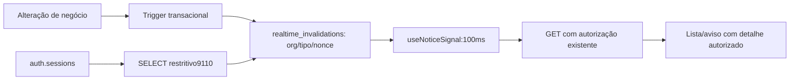

# Candidato local A: avisos autorizados

Sem detalhes de alerta/transferência no transporte. Fonte anterior, cache e sessão não podem servir de aprovação de autorização. Código preparado/testado offline; WS exclusivo e integração real ainda pendentes.
