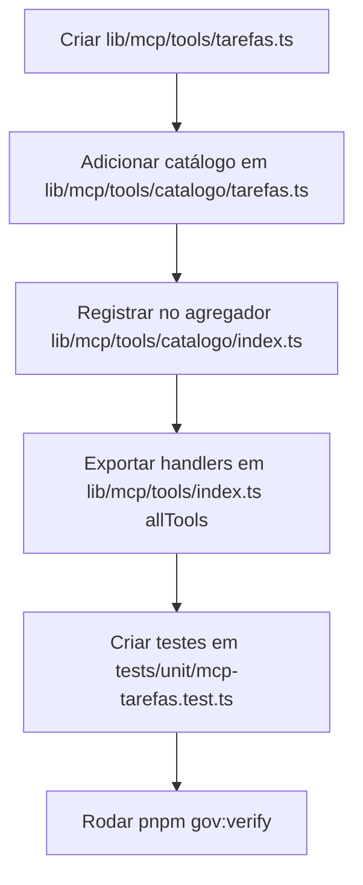

# Plano de Implantação: Suporte a Tarefas (`crm_tasks`) no MCP do DeskcommCRM

> **Documento de Especificação Técnica para o Agente Desenvolvedor do DeskcommCRM**  
> **Objetivo:** Expor as operações de tarefas (`crm_tasks`) nativamente no servidor MCP (`/api/mcp`), permitindo que agentes de IA e clientes externos (Antigravity, Cursor, Claude Code) criem e listem tarefas sem depender de SQL direto.

---

## 1. Contexto e Motivação
Atualmente, o DeskcommCRM já possui as rotas REST completas para tarefas em `app/api/v1/tasks/route.ts` e `app/api/v1/tasks/[id]/route.ts`, suportando:
- Vínculo a `contact_id`, `lead_id` e `demanda_id` (assunto do atendimento).
- Atribuição a membros da equipe (`assigned_to`).
- Disparo de evento na timeline do negócio (`crm_lead_activities`).
- Registro no log de auditoria (`api_audit_log`).

Porém, o catálogo MCP em `lib/mcp/tools/` ainda **não possui** ferramentas para tarefas. Isso força clientes externos a recorrerem a scripts diretos no banco de dados.

---

## 2. Ferramentas a Implementar no MCP

### Tool 1: `crm_create_task`
Cria uma nova tarefa na organização autenticada.

- **Nome no MCP:** `crm_create_task`
- **Role mínima:** `agent`
- **Escopo:** `tasks:write` ou `crm:write`
- **Parâmetros (`inputSchema` em Zod):**
  - `title`: `z.string().trim().min(1).max(255)` (Obrigatório) — Título da tarefa.
  - `description`: `z.string().max(5000).optional()` — Detalhamento da tarefa.
  - `due_date`: `z.string().datetime({ offset: true }).optional()` — Data e hora de vencimento ISO-8601 (com fuso horário).
  - `priority`: `z.enum(["low", "medium", "high", "urgent"]).default("medium")`.
  - `contact_id`: `z.string().uuid().optional()` — ID do contato relacionado.
  - `lead_id`: `z.string().uuid().optional()` — ID do negócio no funil (se houver).
  - `demanda_id`: `z.string().uuid().optional()` — ID da demanda/atendimento ativo.
  - `assigned_to`: `z.string().uuid().optional()` — ID do usuário (`auth.users`) responsável pela execução.

- **Comportamento do Handler (`lib/mcp/tools/tarefas.ts`):**
  1. Validar que `organization_id` vem estritamente de `ctx.organizationId` (nunca do payload).
  2. Se `assigned_to` for informado, validar se o usuário pertence à organização via helper `conferirResponsavel()`.
  3. Se `demanda_id` for informado, validar integridade via `conferirDemanda()`.
  4. Inserir em `public.crm_tasks`.
  5. Auditar via `auditMcpToolCall` / `api_audit_log` (`action: 'crm_task.created'`).
  6. Disparar `registraAtividadeDaTarefa` para persistir em `crm_lead_activities` se `lead_id` estiver presente (respeitando o invariante de fechamento de laço do Sistema Vivo).
  7. Retornar JSON estruturado da tarefa criada.

---

### Tool 2: `crm_list_tasks`
Lista tarefas pendentes ou filtradas da organização.

- **Nome no MCP:** `crm_list_tasks`
- **Role mínima:** `viewer`
- **Escopo:** `tasks:read` ou `crm:read`
- **Parâmetros (`inputSchema` em Zod):**
  - `status`: `z.enum(["pending", "in_progress", "completed", "cancelled"]).optional()`.
  - `assigned_to`: `z.union([z.literal("me"), z.literal("ninguem"), z.string().uuid()]).optional()`.
  - `contact_id`: `z.string().uuid().optional()`.
  - `lead_id`: `z.string().uuid().optional()`.
  - `demanda_id`: `z.string().uuid().optional()`.
  - `due_from`: `z.string().datetime().optional()`.
  - `due_to`: `z.string().datetime().optional()`.
  - `limite`: `z.number().int().min(1).max(100).default(50)`.

- **Comportamento do Handler:**
  1. Consultar `public.crm_tasks` filtrando por `organization_id = ctx.organizationId`.
  2. Aplicar ordenação padrão: `due_date ASC NULLS LAST, created_at DESC`.
  3. Fazer join leve com `contacts(name)` e `profiles(full_name)` para retornar nomes legíveis ao modelo.

---

## 3. Roteiro Passo a Passo de Arquivos a Modificar / Criar



### Arquivo 1: `lib/mcp/tools/tarefas.ts` (Novo)
Implementar os handlers executáveis `crmCreateTaskHandler` e `crmListTasksHandler`, reutilizando as regras já existentes em `lib/tarefas/`.

### Arquivo 2: `lib/mcp/tools/catalogo/tarefas.ts` (Novo)
Declarar as entradas amigáveis com rótulos para humanos usando `declararTools`:
```typescript
import { declararTools } from "./tipos";

export const TOOLS_TAREFAS = declararTools([
  {
    name: "crm_create_task",
    rotulo: "Criar tarefa da equipe",
    explicacao: "Agenda uma tarefa ou retorno vinculado a um cliente ou atendimento com prazo e responsável.",
    risco: "inofensivo",
    papelMinimo: "agent",
    apenasHumano: false,
    oQueToca: ["crm_tasks", "crm_lead_activities"],
  },
  {
    name: "crm_list_tasks",
    rotulo: "Listar tarefas da equipe",
    explicacao: "Consulta a lista de tarefas pendentes e agendamentos internos.",
    risco: "leitura",
    papelMinimo: "viewer",
    apenasHumano: false,
    oQueToca: ["crm_tasks"],
  },
]);
```

### Arquivo 3: `lib/mcp/tools/catalogo/index.ts`
Importar e adicionar `...TOOLS_TAREFAS` ao array `TOOL_CATALOG`.

### Arquivo 4: `lib/mcp/tools/index.ts`
Adicionar as definições de `crm_create_task` e `crm_list_tasks` no array `allTools`.

### Arquivo 5: Testes Automatizados
Criar `tests/unit/mcp-tarefas.test.ts` cobrindo:
1. Criação com sucesso passando `assigned_to` e `due_date`.
2. Rejeição de `assigned_to` com usuário fora da organização.
3. Listagem filtrada por organização garantindo isolamento multi-tenant (RLS).

---

## 4. Definition of Done (DoD)
- [ ] `pnpm typecheck` passa sem erros.
- [ ] `pnpm lint` passa sem erros.
- [ ] `tests/unit/catalogo-tools-leigo-friendly.test.ts` valida as novas ferramentas.
- [ ] Ao enviar uma requisição JSON-RPC `tools/list` para `/api/mcp`, `crm_create_task` e `crm_list_tasks` aparecem no schema.
- [ ] Nenhuma quebra de isolamento multi-tenant (`organization_id` validado pelo token).
