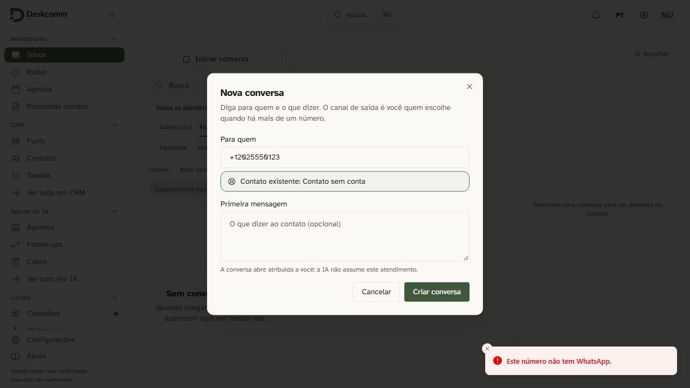
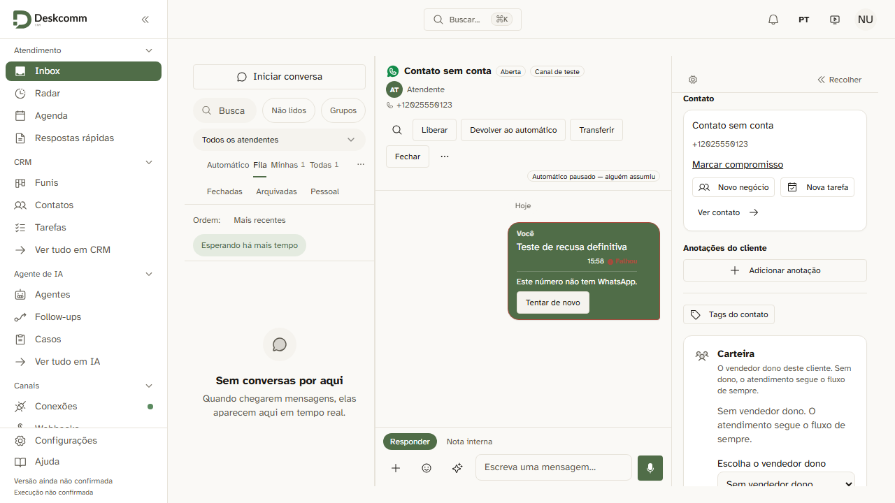

# Número sem conta: prova em tela da Issue #5293

Esta prova foi refeita em 26/11/2026 em clone independente obtido diretamente de `https://github.com/melgarafael/DeskcommCRM.git`, base `b2b5d4c0d`. Antes de aplicar a correção, a árvore tinha diff vazio contra a main oficial.

A spec `tests/e2e/numero-sem-whatsapp.spec.ts` passou com Chromium e build de produção, usando um Supabase novo criado do baseline oficial. Antes das fixtures, o banco tinha zero organizações. O transporte HTTP foi simulado em `127.0.0.1:3999`; nenhuma conta ou mensagem real foi usada.

- Iniciar conversa: a resposta negativa mostra o aviso e não cria conversa. Zero chamadas de envio.
- Conversa legada: o envio grava `failed`, `numero_sem_whatsapp` e natureza permanente; o motivo aparece na bolha. Zero chamadas de envio.
- Uma resposta 503 não prova ausência de conta: abertura e envio continuam. Uma resposta positiva permite abrir.

Para repetir, siga `.agents/skills/deskcomm-contribuir/references/receita-e2e-local.md`, gere o ambiente local de testes, execute `pnpm e2e:build` e `pnpm exec playwright test tests/e2e/numero-sem-whatsapp.spec.ts --workers=1`. A porta 3999 deve estar livre para o mock. A spec recusa banco remoto e transporte fora do endereço local previsto.

Limites: a prova não usou WhatsApp nem agente de IA/LLM reais. Os estados de ausência de conta, sucesso e indisponibilidade são respostas HTTP controladas; o handler de envio compartilhado pelo worker também tem regressão direta.
## Ajustes da revisão do PR #5298

Foram repetidas as specs `agenda-google-meet`, `autonomia-assistida` e `numero-sem-whatsapp`: 5 casos aprovados em build de produção e banco local novo do baseline. Os servidores de teste das duas primeiras specs respondem à consulta de existência antes de interpretar o corpo dos envios como JSON. O agente usa o modo interno de simulação; não há chamada a um LLM real.

A spec de número sem conta agora cobre também `POST /api/v1/messages` com `phone_number`: resposta 422, código `numero_sem_whatsapp`, motivo legível e zero chamadas de envio. A regressão unitária mantém o resolvedor de abertura real e simula apenas a capacidade de consultar conta do adapter. Retirar a tradução da recusa após o commit produziu exatamente 1 falha prevista (500 no lugar de 422); restaurar o código aprovou os 11 testes da rota. A regressão ampliada aprovou 108 testes em 10 arquivos.

O risco de falso negativo de uma sessão real pareada continua não medido. A decisão de recusar a abertura e a linha de registro da spec no workflow continuam sujeitas à revisão do mantenedor.

## Justificativa dos ajustes nos invariantes (#5298)

No CI de `1ecad8ad4`, `invariants-majors (17)` encontrou cinco falhas em três arquivos. O check `invariants` apenas propagou essa reprovação. A reprodução local no PostgreSQL 17 confirmou os mesmos cinco casos: os receptores HTTP registravam o novo `GET /api/contacts/check-exists`, sem corpo, como uma mensagem extra, além do único POST de envio.

A alteração em `tests/invariants/agenda-meet.test.ts`, `entrega-sem-meet-sai-sem-link.test.ts` e `remarcacao-chega-dizendo-que-mudou.test.ts` se limita aos receptores desses cenários. Eles agora respondem positivamente à consulta de conta, separada da captura dos envios. As asserções de uma única mensagem, replay, conteúdo, link, remarcação e isolamento permanecem intactas; nenhum caso é removido ou pulado, e não há mudança de schema ou regra de produto. Esta é a justificativa escrita para tocar os arquivos congelados, conforme `CONTRIBUTING.md`.

Reprodução antes do ajuste: 3 arquivos, 5 casos reprovados e 32 aprovados. Depois do ajuste, os mesmos três arquivos passaram integralmente: 37/37 testes no PostgreSQL 17, via `TEST_DB_IMAGE=pgvector/pgvector:pg17 pnpm test:db tests/invariants/remarcacao-chega-dizendo-que-mudou.test.ts tests/invariants/entrega-sem-meet-sai-sem-link.test.ts tests/invariants/agenda-meet.test.ts`. O harness instalou e reaplicou o baseline sem erro e removeu seu banco descartável ao terminar. `pnpm typecheck` e ESLint dos três arquivos também passaram.

Contraprova após o commit `85eeb967d`: retirar somente a resposta à consulta de conta de `remarcacao-chega-dizendo-que-mudou` e executar seu caso `CONTROLE` produziu exatamente a falha prevista: 1 caso reprovado, com a contagem de mensagens 2 em vez de 1. O outro caso ficou fora dessa execução pelo filtro de nome; não foi adicionado nenhum skip ao teste.

Restaurado o ajuste, a execução final dos três arquivos voltou a passar: 37/37 casos, sem casos pulados, no PostgreSQL 17. A suíte completa da matriz permanece para o CI; esta rodada local cobre integralmente os três arquivos que haviam reprovado.
