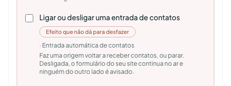
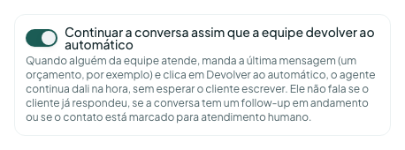
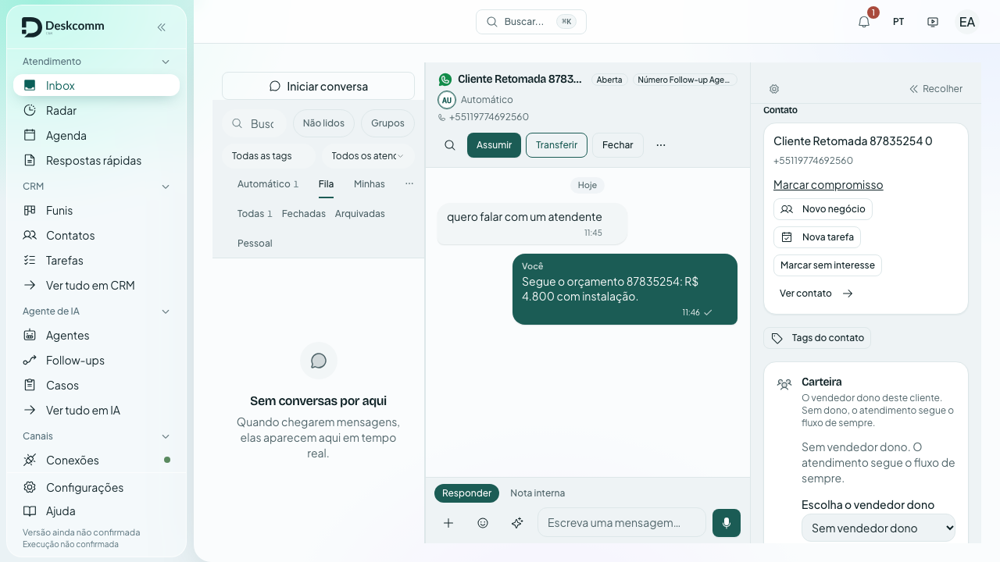
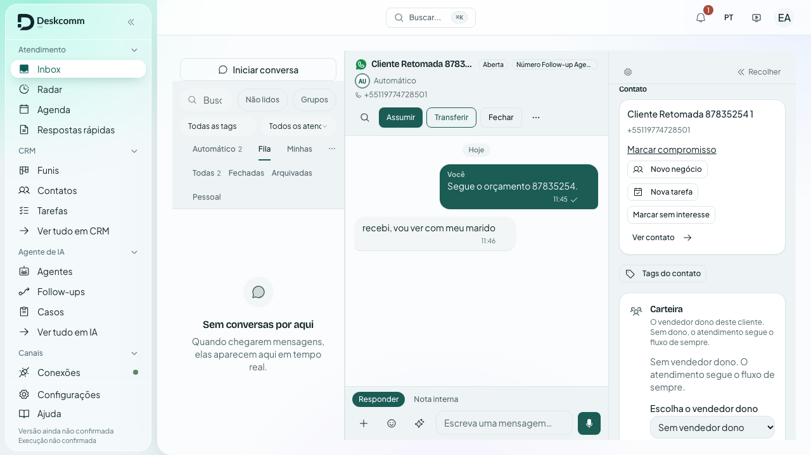

# Retomar ao devolver: evidência da prova pela tela

Gerada por `tests/e2e/retomar-ao-devolver.spec.ts`, num Supabase local com o `baseline.sql` aplicado e o app compilado com `pnpm e2e:build`, na mesma receita do CI. Cada captura prova uma afirmação.

## 1. A opção nasce desligada

O editor do agente, em **Quando ele entra em ação**, mostra a opção **Continuar a conversa assim que a equipe devolver ao automático** com o texto que explica quando o agente não fala. Ela vem desligada, então quem não mexer não vê mudança. A spec cobra isso com `not.toBeChecked()`.

## 2. Ligada, a opção sobrevive a salvar e recarregar

A spec liga a opção, salva o rascunho, **recarrega** a página e fotografa. O schema da versão é `.strict()`: sem a chave na validação, ela seria descartada e a caixa voltaria desligada, mesmo com o salvar dando certo. A spec também confere no banco que `trigger_config.resume_on_handback` ficou `true` no rascunho.

## 3. Com a equipe por último, a devolução põe um turno de retomada na fila

A conversa tem o pedido do cliente ("quero falar com um atendente") e, por último, o orçamento enviado pela equipe. Depois do clique em **Devolver ao automático**, o cabeçalho mostra "Automático".

A spec então drena o `event_log` pela rota de produção e cobra que haja **um** `followup_turn` com `mode='retomada'`, `source_event_id` igual ao `ai.handoff_resolved` desta devolução e a fronteira da conversa. Também cobra que drenar de novo não cria um segundo turno.

## 4. Controle: com o cliente por último, nada vai para a fila

Mesma devolução, mas a última mensagem é do cliente. O consumidor lê o evento e **não** põe turno de retomada, porque o turno de resposta normal cuida disso. O motivo fica gravado no próprio evento: `retomada-ao-devolver.v1: pulado:ultima_fala_nao_e_da_equipe`.
